<p align="center"></p>

# Chickens of Yolk Street

An egg farm game in one shared live market, where players and AI agents with their own NEAR wallets trade the same eggs.

**Play:** https://yolkstreet.25th.dev (NEAR testnet, season `s1`) · **Demo post:** https://x.com/25THPRMR/status/2121560697037271481 · **License:** [MIT](LICENSE)

## The problem

Farm games fake their economies: prices follow a curve someone wrote and the rivals are scripts, so nothing a player does moves the market. On-chain games often go the other way and put wallets and tokens in front of the game. Here every egg any farm sells, player or AI, is supply in one market, so prices, gluts and bankruptcies come only from what everyone trades. The chain keeps a checkable record of that market, and the player starts with one click as a guest, signing in with only an email to keep the farm or mint.

## Try it in 3 minutes

1. **Press PLAY (no sign-in needed).** Open https://yolkstreet.25th.dev and press **PLAY**: a guest farm with ten hens and a generated name opens at once, in the same live market as everyone (it wears a small **GUEST** tag on the board). The tour starts; **SKIP** ends it.
2. **Collect and sell.** Click an egg a hen laid: it pops into the crate, **COLLECT** in the top bar drops by one and **SELL** rises. Click the crate: a **SOLD** stamp slams and the coins arc to your counter.
3. **Read the AI traders.** Press **MARKET** in the top bar. The **PRICES** tab shows today's price, yesterday's sales against what the street needs, and **WHAT THE AI TRADERS SAY**: each agent's own line on what it just did.
4. **Answer an agent.** When a card slides in (the Bakery's contract, the Wholesaler's bulk order, the Squeezer's feed deal), press **ACCEPT**, or set **YOUR PRICE** with **-** and **+** and press **COUNTER**: the agent takes it, counters, or walks away.
5. **Hatch a hen.** Open the shop (top bar) and buy a hen: an egg drops at the coop door, wobbles, cracks and hatches her.
6. **Follow a receipt.** Open the ledger (top bar). A settled day shows **DAYS a-b**, the range its batch settled: press it to open the `settle_day` transaction on the testnet explorer. A day still waiting says **IN A BATCH** (ranges settle every 10 in-game days, 30 real minutes).
7. **See the Feather odds.** Open https://yolkstreet.25th.dev/mint (no sign-in needed): the Feathers left of 777, each grade's odds of a hen at the reveal, the recent mints and all 777 numbers.
8. **Sign in to mint a Feather.** A guest's Feather tickets are saved on the farm; minting one needs a wallet. Press **SAVE THIS FARM** (Settings, or your profile) and sign in with your email: the whole farm (coins, hens, machines, land, badges, tickets, records) moves into your account and a NEAR testnet wallet is made for you silently (no extension, no seed phrase). Rename the farm if you like (**KEEP** keeps the name), then **MINT** in the top bar mints a held ticket at once. Returning players use **SIGN IN** on the title.

## How NEAR fits, per track

One contract, **`play.coys-game.testnet`** (version 6, Rust `near-sdk` 5.30.1, wasm built in CI, sha256 `d6c85dd9...`). Every check below is a free view call on it.

**Games With Real Economies.** Eggs are NEP-245 tokens (`egg-white`, `egg-cream`, `egg-brown`, `egg-golden`) held by player and agent wallets. An in-game day is 3 real minutes; every 10 closed days settle in one owner-only `settle_day` call that mints, moves and burns the eggs and carries the SHA-256 of those days' full records (supply, price multiplier, every farm's net). The contract keeps only a fixed-size head per season. Check: `season_head({"season": "s1"})`, `mt_batch_supply`, `late_days({"season": "s1"})`. Receipt: [`5Js9kNyp...`](https://testnet.nearblocks.io/txns/5Js9kNyp7T18UMtp9jm5Ke3rDChWXccKqvgeFBYTZrvY), `s1` days 1033 to 1042 in one call.

**Agent Economy.** Seven AI agents (two rival farms, two feed suppliers, three egg buyers) run businesses with their own cash, memory and a sub-account wallet of the game account; the eggs they buy settle to their wallets, and a Bakery contract delivery moves egg tokens from the player's wallet to the Bakery's. Agent decisions run on a provider chain: NEAR AI Cloud is the primary model, SERV Reasoning is the fallback, and rule-based strategies are the last resort, all under a hard daily spend cap. Check: `mt_batch_balance_of({"account_id": "oldmoney1.play.coys-game.testnet", "token_ids": ["egg-white", "egg-cream", "egg-brown", "egg-golden"]})` shows the eggs a wallet held at the last settled range (any of `bakery1`, `loyalist1`, `oldmoney1`, `squeezer1`, `trader1`, `upstart1`, `wholesaler1`; the Bakery's empties when it bakes). Wallet: [`bakery1.play.coys-game.testnet`](https://testnet.nearblocks.io/address/bakery1.play.coys-game.testnet).

**NFTs That Do Something.** Hens are never minted. Feathers are NEP-171 tokens, 777 at most, enforced on chain: each is a claim ticket for one of the 777 Founding Hens planned for the mainnet launch. Farm milestones win tickets; minting one costs 25 in-game coins, draws a random free number from a seed anyone can replay, and the game pays the gas: the owner-only `mint_feather` mints it at once to the player's wallet with its card image and hash in the token. Its grade (Fluff, Plume, Quill or Golden Quill) comes from the farm's record and sets its odds at the reveal, whose provenance was fixed in advance with `commit_provenance`. Check: `feather_supply()`, `nft_token({"token_id": "001"})`. Receipt: [`3nL5mUUQ...`](https://testnet.nearblocks.io/txns/3nL5mUUQkbVPuCtLVbUabD8sFD5GFNg62BASB3wzLzoD) mints Feather #001 of 777, a Quill, to a player's wallet (in the `s1` settlement of day 577, before version 6 moved mints to `mint_feather`).

## Architecture

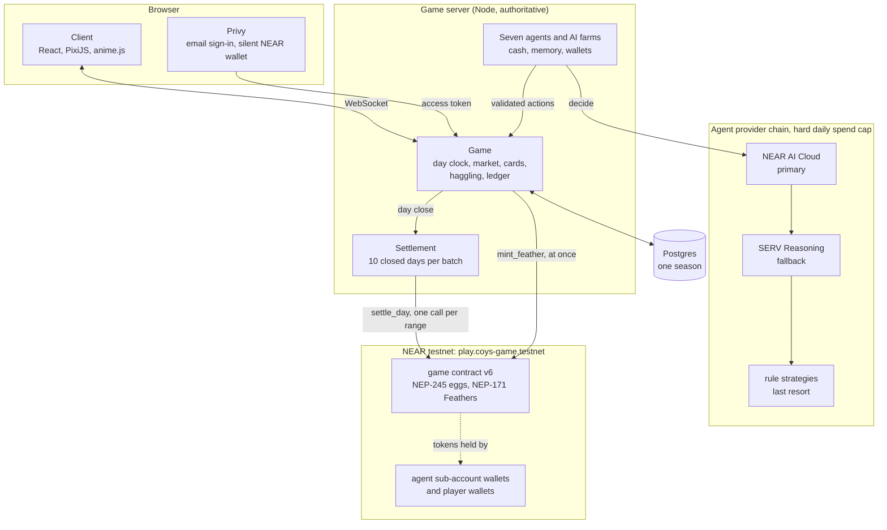

## The price rule

One multiplier sets every grade's price for the next day, from everything sold that day:

$$
\text{price multiplier} = \mathrm{clamp}\left(\left(\frac{\text{demand}}{\text{supply}}\right)^{0.8},\ 0.4,\ 2.5\right),
\qquad
\text{demand} = 15 \cdot \max(1, F)
$$

Supply is every egg sold that day by players and agents (street sales, order fills, card deals, contract deliveries, the Wholesaler's resales); $F$ is the open agents plus the player farms not bust, so demand grows with the street. No supply gives 2.5. An egg sells at its grade's base price times the multiplier.

<p align="center"></p>

<p align="center"><sub>A bought hen hatching at the coop: <code>docs/readme/hatch.svg</code>, made by <code>scripts/derive-art/readme-hatch.ts</code> from the game's hatch sprite sheet.</sub></p>

## Run it locally

Node 22.22.2 or newer (CI uses 24.22.3). From a clean clone:

```sh
git clone https://github.com/iam25th1/chickens-of-yolk-street.git && cd chickens-of-yolk-street
npm ci --ignore-scripts
npm run dev        # server on port 8787, client on http://localhost:5173
```

Every variable is optional for local play (`.env.example` names them all). Without `PRIVY_APP_ID` a labelled local dev login asks for a name; without `NEAR_TESTNET_ACCOUNT_ID` and `NEAR_TESTNET_PRIVATE_KEY` each settlement is a recorded no-op; without `NEARAI_API_KEY` and `SERV_API_KEY` the agents run on their rule strategies. Production also needs `NODE_ENV=production`, `GAME_SEASON`, `SESSION_SECRET` and a Postgres `DATABASE_URL`; then `npm run build` and `npm start`.

```sh
npm run typecheck && npm run lint && npm test   # 485 tests; the Postgres ones need TEST_DATABASE_URL
npm run build && npm run test:e2e               # headless browser checks; CHROME_PATH points at a Chromium
cd contracts/coys-game && cargo test            # contract unit tests
```

## Hackathon disclosure

Built in the NEAR HACKATHON window, 1 to 14 November 2026 (first commit 11 November). Libraries: React 19, PixiJS 8, anime.js 4, Privy, near-api-js 7, zod 4, ws, pg, PGlite, `near-sdk`, `near-contract-standards` and `near-sdk-contract-tools`, with Vite, Vitest and Playwright (exact versions pinned in the lockfiles). AI tooling: the code and docs were written with Claude Code at 25TH's direction (most commits carry its co-author line); the art and sounds were made in Spawn and are kept byte for byte in `iam25th1/coys-assets`, and newer art is derived from them by code (`scripts/derive-art/`); in play, the agents call NEAR AI Cloud and SERV Reasoning; the demo video's voice is kokoro-onnx. The dated build history is in [docs/build-log.md](docs/build-log.md).

## License

[MIT](LICENSE), copyright 2026 25TH (iam25th1).

## More detail

Everything below opens on a click; none of it is needed to try the game.

<details>
<summary><b>At a glance</b>: the play loop, the market, the agents, the chain, the feel</summary>

## At a glance

| | |
|---|---|
| **Play loop** | Hens lay on a schedule; you collect, sell, buy hens, feed, coops and machines. One in-game day is 3 real minutes, and each day brings 2 to 4 decision cards from the agents. Everything on the farm is clickable; a first-run tour walks the loop by doing it, then a chain of goals pays coins for learning the rest. Every farm keeps a **profile** (eight tabs, a public version) and earns **76 cosmetic badges**; a bought hen hatches from an egg at the coop door, and a farm can buy more land. |
| **Market** | One price multiplier for everyone, set by the whole market's daily supply against demand that grows with the number of farms. Instant street sales, a real order book with limit orders, and player-to-player trades, all on one **Market** page with seven tabs. |
| **Agents** | Seven: two rival farms, two feed suppliers, three egg buyers. Each has its own wallet, memory and personality, decides once a day, pays a fee for each decision, remembers every deal, haggles in character, borrows, and can go bust. Agent decisions run on a provider chain: NEAR AI Cloud is the primary model, SERV Reasoning is the fallback, and rule-based strategies are the last resort, all under a hard daily spend cap. |
| **Chain** | Hens are never minted. The beta mints **Feathers** (NEP-171 on NEAR testnet, **777 ever**, capped on chain): claim tickets for the 777 Founding Hens, planned to be revealed at the mainnet launch. Milestones win tickets; a player mints one into a Feather at once for 25 coins, and the game pays the testnet gas. Eggs are NEP-245 tokens, and every ten in-game days settle in one call that stores nothing new: a SHA-256 of those days' full records, kept in the game's database. Agents hold sub-account wallets. Players start at once as guests and sign in with email to keep the farm or mint; the wallet is made silently at sign-in. |
| **Feel** | Squash and stretch, hitstop, screen shake, particles and layered sound on every action, portraits that talk with voice babble, and a reduce-motion switch. |

</details>

<details>
<summary><b>The economy</b>: base prices, the multiplier, hen payback, feed prices</summary>

## The economy

Every number lives in one object, `ECONOMY` in [`packages/shared/src/economy.ts`](packages/shared/src/economy.ts), including every agent's costs, markups, penalties and thresholds.

**Market price.** One multiplier for every grade's base price (white 1.00, cream 1.20, brown 1.50, golden 6.00), set by the total eggs sold that day by all players and agents (street sales, order fills, card deals, contract deliveries and the wholesaler's resales) against demand $D_d$, which grows with the number of active farms $F_d$ (player farms plus open agents):

$$
m_{d+1} = \mathrm{clamp}\left(\left(\frac{D_d}{S_d}\right)^{0.8},\ 0.40,\ 2.50\right)
\qquad
D_d = 15 \cdot F_d
$$

With two players and the seven agents, $D = 135$: a typical day sits near $1.00$ whether Yolk Street has two farms or twenty. The economy sheet keeps the fixed reference $D = 600$ (at $S = 1300$, $m = 0.54$). The market has crashed when $m \le 0.80$.

**Hen payback.** With base laying $0.80$, feed laying multiplier $f$, breakage $b$, the tier's expected egg price $\bar p$ at multiplier $m$, and feed at $0.12$ kg a day from a 25 kg bag of price $P$:

$$
\text{margin} = 0.80\, f\,(1-b)\,\bar p\, m - \frac{P}{25}\cdot 0.12
\qquad
\text{payback} = \frac{8}{\text{margin}}
$$

On standard feed at $m = 1$: margin $= 0.4624$, payback $= 17.3$ days.

**Feed from the Squeezer.** Its bag price rises with how desperate a farm looks, $\delta \in [0, 1]$ (feed days left weigh most, low cash adds): $P_{sq} = P \cdot (1.05 + 0.5\,\delta)$. The Loyalist takes 2% off per past deal, up to 15%, and offers credit due in 5 days at 8%.

</details>

<details>
<summary><b>The agent cast</b>: seven agents and the AI farms that enter</summary>

## The agent cast

| Agent | Role | Character (rule policy and haggling) |
|---|---|---|
| **Upstart Eggs** | rival farm | Lives on the Loyalist's feed credit. On a good week (recent closes averaging 1.08x or more) it borrows, puts every coin into hens and packs its coops past capacity; in a glut it dumps its fresh eggs below the Wholesaler's bid. Agents repay credit in full even into the red, so a boom that turns into a glut busts it. Undercuts players to the trader. Haggles loosely. |
| **Old Money Farms** | rival farm | Never panics: below 0.90x it holds half its crate back and sells the lot once the price recovers (a glut of its own), keeps cash, premium feed, buys bust farms' hens at auction. Makes buyout offers to struggling players. Proud: walks away from insulting asks. |
| **The Squeezer** | feed supplier | Reads desperation (low feed, low cash) and prices it in. Barely bends in a haggle. |
| **The Loyalist** | feed supplier | Rewards repeat buyers with discounts and offers credit terms; never extends credit after a default. Bends the most. |
| **Yolk Street Bakery** | egg buyer | Wants steady volume: offers standing contracts and posts daily buy orders. A missed delivery costs a penalty; two cancel the contract and start a sulk. |
| **The Market Trader** | egg buyer | Pays a premium for brown and golden, up to what it resells for in town; walks away from farms whose quality slips; warns of gluts. |
| **The Wholesaler** | egg buyer | Buys anything in bulk at a low price (bulk-order cards sized from a farm's daily lay, standing bids under the market, deeper in a glut), resells it into the street the next day: the same eggs count as supply twice, which drags a glut out. |

Each agent has its own cash, stock and **memory of every farm** (deals, value, refusals, haggles won and lost, missed deliveries, sulks) in Postgres, a persona, its last few **public reasons** (one line each, on the market board) and a **weekly reflection** it reads back. It decides once per in-game day and pays 0.50 coins per decision from its own cash. Below 40 coins it sits out every other day to save the fee, so a struggling business visibly gets worse. Below zero it closes: its orders and contracts end, a rival's hens go to auction at half price, and a new agent of the same role opens three days later under a fresh name.

**New AI farms** enter too: Early Bird Eggs, the Cluck Collective, Gilded Roost Estates and Pennywise Poultry (from a registry; they look like the Upstart or Old Money, start smaller and have their own personas). At each day close one may enter (a 25% chance) after three days of supply under demand or a rival's bust, always when fewer than two AI farms are open, never past `max(4, 1.5 x player farms)`. Every AI farm and agent wears an **AI** tag on the Market page and the ticker. Details, the 30-day model-against-rules comparison and the costs: [docs/agents.md](docs/agents.md).

</details>

<details>
<summary><b>Systems</b>: agent decisions, cards, the order book, the chain, the server, the client, the simulation, assets, security</summary>

## Systems

<details>
<summary><b>Agent decisions</b>: one shape for rules and the model, always validated</summary>

- Each agent sees a context: its cash and stock, its last reflection and reasons, the live market and recent history, the last three days' supply against demand, recent busts, how many AI and player farms are open, auction hens, its own farm (rivals), and a brief of every farm with its memory of it (`apps/server/src/agents/decision.ts`).
- On the days that matter, a model gets a persona prompt and must answer with the decision JSON schema (`response_format: json_schema, strict`), which includes a public `reason` under 80 characters; routine days run on the rule strategy. Every decision, model or rules, goes through `validateDecision`: text cleaned and cut safely, then the schema, then only the agent's own role's parts, offers only to player farms it sees, fills only to orders it sees. Anything unusable falls back to the rule policy and the fallback is logged and counted.
- The provider chain is NEAR AI Cloud, then SERV Reasoning, then the rules, each provider behind a breaker. Decisions go to the provider's cheap model (NEAR AI's main one on hard days); weekly reflections to its main one.
- The game bounds every number: prices are shares of the live price within bands, quantities are capped by stock and cash, offers only reach real player farms, and every farm action goes through the same validated actions players use.
- Spend caps: `LLM_DAILY_CAP_USD` (1.50) per UTC day for every provider and agent together, and per agent `LLM_AGENT_DAILY_CAP_USD` (a quarter of it) and `LLM_AGENT_DAILY_CALLS` (240, failed calls counted), tracked from token usage and each model's per-token price (`*_MAIN_PRICE`, `*_CHEAP_PRICE`, else the provider's own list, else the assumed prices). Each call reserves its prompt with a margin and a full reply first, so a cap is never crossed; past it, the agent uses rules until the next day. The old `NEARAI_` cap names are still read.
- Decisions apply in two phases: farm actions and restock before the market closes (their sales count today), then orders, fills and offers once tomorrow's price is set.

</details>

<details>
<summary><b>Cards and haggling</b>: 2 to 4 a day, never scripted</summary>

- Agents' offers become cards (bulk order, premium order, standing contract, feed deal, credit terms, undercut, buyout offer, glut warning), plus player trade cards from other players' sell orders. At most one per agent and four per player per day, arriving at 12%, 30%, 48% and 64% of the day.
- Choices: accept, decline, counter, and the card's own options (switch supplier, match price, sell now or hold, sell hens).
- A counter is a proposal. The agent accepts any ask inside its hidden walk-away price; otherwise it concedes part of the gap (its personality's concession), and walks away after three rounds, or at once from an insulting ask if it is proud. The walk-away price comes from personality and memory: regulars get more room, farms that won haggles get less, missed deliveries cost room.
- The sales clerk auto-accepts bulk and premium orders at or above the player's floor; the delivery cart delivers standing contracts at dusk.

</details>

<details>
<summary><b>Order book</b></summary>

- Buyer agents post buy orders each day; farms post limit sells (the eggs leave the crate into the order and come back if it expires after 3 days). Orders cross at the resting price, best price first.
- Players sell into buy orders, buy each other's eggs (also offered as player trade cards), and cancel their own orders. Every fill is a trade on the market board and counts as supply.

</details>

<details>
<summary><b>Chain</b>: one contract, one call per ten days</summary>

- `contracts/coys-game` (Rust, `near-sdk` 5.30.1): NEP-171 Feathers from `near-contract-standards`, NEP-245 eggs from `near-sdk-contract-tools` (`Nep245` derive without per-account storage fees, so holders need no deposit; the contract pays storage), `Owner` access control, and `settle_day`.
- `settle_day(batch)`: owner only; within a season, days strictly in order and each once. One call settles a range of closed days (`first_day` to `day`, ten by default: `SETTLE_EVERY_DAYS`): it mints, transfers and burns egg tokens, updates the season's fixed-size head (last day, the SHA-256 of the range's full settlement, a running hash chain), and emits a `day_settled` event. A settled range stores nothing new (version 4); version 2's per-day records are released with `prune_days` into an archive hash. Since version 6 it carries no Feathers: `mint_feather` mints each one at once.
- **Seasons**: a season is one game world from day 1, and one database holds one season (`GAME_SEASON`). A new season starts again at day 1 on the same contract while repeats within a season are refused; a server pointed at another season's database refuses to start. Version 1 settled days without seasons; `migrate` upgrades it in place and files those days under `legacy` (done on `coys-game.testnet`).
- The batch (`apps/server/src/chain/batch.ts`): the trades of the range's days between holders become egg transfers; then every account is reconciled to what it really holds (crate plus open sell orders, or a buyer's stock) with mints and burns, starting from the balances last confirmed on chain. A failed call is caught up by the next, and no burn exceeds a balance. Each day's full settlement (every farm's net and the egg moves) is kept as exact text in `market_days.settlement_json`; the digest on chain is the SHA-256 over the range's day records, and the call carries only the moving farms' nets.
- **Feathers only** (version 4): hens are never minted; `settle_day` refuses them. Feathers are capped at 777 on chain and numbered, with the founders provenance committed once ([docs/founding-hens.md](docs/founding-hens.md)); since version 6 `mint_feather` mints each one at once with the number the server drew.
- **Feather images**: the grade's Spawn card frame and feather, with the number, are composed once at mint into a 96x136 PNG and stored in the token metadata with its `media_hash`. Why: it is the simplest correct storage. The token is self-contained and verifiable from the chain alone, with no image host, pinning service or URL to keep alive. A Feather costs 1,913 to 2,075 bytes of state, measured on the live contract (0.019 to 0.021 NEAR), plus 0.0004 to 0.0005 NEAR of gas. Mints go out only while the game account's free balance stays above its margin (`CHAIN_MINT_NEAR`, default 0.027 each; `CHAIN_MIN_BALANCE_NEAR`, default 0.1); the rest wait, and go out once it does.
- **Agent wallets**: sub-accounts of the game account, funded from it (`AGENT_ACCOUNT_FUNDING_NEAR`, default 0.01), with keys derived from the game key by HMAC so no extra secret is stored. They are a pool: a wallet whose agents are all bust (any kind) is free, and a new agent takes a free one before a new one is created and funded; every wallet and its funding is recorded (`agent_wallets`), and each creation logs the pool's size and the NEAR spent.
- **Players**: the Privy wallet holds their Feathers and eggs. Egg mints and transfers happen only in the range batch, never per click; a Feather mints when its owner mints it.
- Testnet only, enforced in code before any key is used: accounts must be `.testnet` (or implicit), RPC hosts must be testnet, and the RPC's `chain_id` must say `testnet` before anything is signed. Without credentials, every day's batch is built the same way and logged as a NO-OP.
- **Deliveries on chain**: a contract delivery is a trade from the player's wallet to the Bakery's sub-account, so the day's batch moves the eggs as NEP-245 tokens between them (then burns them when the Bakery bakes). Proven on testnet (receipt above), in a dedicated test, and in every seed of the simulation.
- Tests: 33 contract unit tests, 10 for the planned reveal (`contracts/founding-hens`), and 10 **sandbox tests** (`contracts/sandbox-tests`, near-workspaces 0.24): a full day settlement, a settled day storing nothing, holder transfers, only the game can settle or mint, a new season settling day 1 after an old season ended at day 3, 777 Feathers minted then the 778th refused, the provenance committed once, the version 2 wasm that ran on `play.coys-game.testnet` (kept in `contracts/sandbox-tests/res`) upgrading in place with its records released into the archive hash, and the reveal giving exactly 7/70/200/500 and the same hens from the same seed. They run in CI (Linux); the wasm CI builds is what gets deployed (`npm run deploy-contract` checks its sha256, testnet only, see [deploy/testnet.md](deploy/testnet.md)).

</details>

<details>
<summary><b>Server</b>: authoritative, transactional, reconnect safe</summary>

- `apps/server`: Node, `ws`, `pg` and PGlite behind one `Db` interface. `DATABASE_URL=postgres://...` uses Postgres; `pglite://<dir>` (default `.data/coys`) or `memory://` uses embedded PGlite for local play and tests. Production (`NODE_ENV=production`) refuses PGlite and requires `GAME_SEASON` and `SESSION_SECRET`.
- Migrations run on every boot and are safe to repeat; on Postgres they run in one transaction under an advisory lock, so two instances booting together cannot race (tested on real Postgres in CI). v1 (clock, market days, players, farms, coops, hens, unlocks, lay events, orders, ledger), v2 (agents, memory, cards, contracts, debts, order book fields, trades, inference usage, confirmed chain balances), v3 (each day's demand), v4 (seasons on the clock, market days and every ledger row; market days keyed by season and day), and v5 to v17 one change each, up to v15 (provider usage), v16 (farm land) and v17 (settlement ranges); all are in `apps/server/src/db/migrations.ts`.
- `/healthz` (and `/api/health`) reports the version and commit baked in at build time, the season, the day and a timed database round trip; it answers 503 when the database does not.
- `DEMO_DAY_SECONDS` (20 to 3600) shortens the in-game day for recording; production ignores it unless `DEMO_MODE=1`. The client takes the day length from the server clock.
- Backups: `scripts/db-backup.ts` (pg_dump to `backups/coys-<UTC time>.dump`) and `scripts/db-restore.ts` (pg_restore in one transaction, stops at the first error); the password reaches the tools as an environment variable, never on a command line. CI round-trips a backup between two Postgres databases.
- Every farm cash change writes the balance and a ledger row in the same transaction; tests check the ledger total equals cash, for players and rival farms, across a 30-day simulation.
- Mutations run one at a time; messages go out only after commit. Strict zod schemas reject any extra field. Per-player rate limits, reconnect-safe request ids.

</details>

<details>
<summary><b>Client</b>: screens, juice and sound</summary>

- Whole device pixels everywhere: the UI is laid out in UI pixels drawn at $p$ device pixels each (CSS zoom), the world at $k$ device pixels per world pixel, painted art from the atlas cut for that density (see [Visual quality](#visual-quality-and-the-tour-12-november-2026)). PixiJS draws the farm and the town square; anime.js drives every UI motion, in whole-pixel steps, never rotating text.
- **Card overlay**: one composed modal (portrait and line, the card art upright beside them, answers in one row); the card slides in with an overshoot and a paper swoosh; the portrait talks with its voice babble while the line types out; outcomes play the agent's expression and slam a stamp; a haggle win flips the card to gold with a hitstop, shake, confetti and the win chime; a fail sends the agent walking with the fail sound.
- **Market page**: seven tabs (prices, sell, buy orders, your orders, trade, the hen auction, farms) over the town square plate with animated bunting and a milling crowd (market murmur loop), the split-flap ticker by grade, the farms ranked with their signs, what the AI traders say, big trades and the order book.
- **Ledger**: day-by-day profit, contracts, debts, and each settled day's on-chain receipt (the range call that settled it).
- **Shop**: listed hens drawn from their trait layers with laying trait and price (auction hens marked), feed with supplier switching, coops, machines.
- **Rival bust**: the sign tips over, a price wave crosses the ticker, medium shake, falling feathers, the collapse crash and the bust sting. **Glut**: the ticker drops red and the market tension music plays until prices recover.
- **Tour**: thirteen spotlight steps covering the whole game, each moving on only when the player does it; Back, Skip, progress dots, replayable from Settings. Waiting cards queue in the side panel with a count; an unanswered card closes with its day.
- **Page**: descriptive title and meta description, a favicon and a 1200x630 share image cut from the sprites by `scripts/make-share-images.ts`.
- Everything from brief 1 stays: lays, hand collect, big haul, deal stamp, coop builds, unlocks, crash, new day.

</details>

<details>
<summary><b>Simulation</b>: 30 in-game days, five seeds, seven agents and two headless players</summary>

`apps/server/test/sim.test.ts` runs the whole market for 30 days on five fixed seeds, with AI farms entering by the entry rule (it also checks their count stays within its bounds every day). The stub model answers each agent's own in-character decision as JSON on most calls and garbage on every fourth, under a 0.25 USD cap; both headless players have wallets, and every day settles through a recording chain writer that builds the real batch. The test checks, per seed: the median day's multiplier is between 0.80 and 1.30, at least one day falls to 0.80 or below, contract eggs move on chain to the Bakery's wallet, the spend cap holds, and ledgers equal cash; and a rival busts naturally in at least three of the five seeds.

| Seed | Median day | Lowest day | Days at 0.80x or below | Rival bust | Contracts (signed, delivered, missed) | Bakery contract eggs moved on chain | Wholesaler resold | Model calls, fallbacks, spend (cap 0.25 USD) |
|---|---|---|---|---|---|---|---|---|
| 1 | 1.10x | 0.67x | 11 | Upstart Eggs, day 25 | 8, 50, 8 | 103 | 168 | 66, 154, 0.2424 USD |
| 2 | 1.08x | 0.66x | 10 | Upstart Eggs, day 15 | 9, 36, 13 | 78 | 231 | 64, 157, 0.2416 USD |
| 3 | 1.07x | 0.65x | 10 | Upstart Eggs, day 17 | 8, 37, 9 | 89 | 205 | 65, 156, 0.2420 USD |
| 4 | 1.10x | 0.66x | 11 | Upstart Eggs, day 15 | 9, 35, 13 | 94 | 239 | 64, 157, 0.2416 USD |
| 5 | 1.16x | 0.64x | 10 | Upstart Eggs, day 15 | 8, 39, 9 | 101 | 189 | 63, 158, 0.2412 USD |

Demand is 135 a day (two players and seven agents) and drops to 120 while a bust rival's successor is waiting to open. Seed 1, day by day (supply of demand, then the multiplier it set): days 6 to 18 swing between about 220 and 90 eggs as Old Money holds half its crate below 0.90x and releases it on the recovery, so the price alternates between roughly 1.3x and 0.7x; the Upstart's cash runs 12, 80, 104, 36, 121 and it busts on day 25 when its feed credit falls due in a glut. The only 2.50x day is day 2, after a first day with no sales. Hen and order ids are random, so the exact numbers move a little between runs; the acceptance holds on every run.

The companion test forces a glut on Upstart Eggs (no cash, empty trough, crashed market): it goes bust on day 2, its hens go to auction, and Hatch and Dash opens as the new rival on day 5.

</details>

<details>
<summary><b>Asset pipeline</b>: verified, byte for byte</summary>

- `npm run pack-assets` checks every manifest file of `iam25th1/coys-assets` against its SHA-256 and packs 86 sprite sheets (PixiJS JSON with rows, per-frame durations and anchors) and 59 sounds (124 MP3 takes, 12 gapless loop OGGs). PNG, MP3 and OGG files are copied byte for byte.
- Hen trait layers match `01-hen-anims` frame for frame; brown and black bodies are palette swaps in code. The server composes each Feather's card image at mint (`apps/server/src/chain/feather-image.ts`).

</details>

<details>
<summary><b>Security</b></summary>

- No secrets in the repo or the client bundle: `.env` is ignored; `.env.example` names and describes every variable with no values; the client reads only the public Privy app id from `/api/config`; the built bundle is grepped for key-like strings.
- The model key, the testnet key and agent keys live only on the server. Testnet only, enforced in code.
- Every dependency pinned exactly; installed with `npm ci --ignore-scripts` locally and in CI; Rust crates pinned with `Cargo.lock` and built `--locked`; cargo-near checksum-verified in CI.

</details>

</details>

<details>
<summary><b>Where it runs</b>: Pier on a Mac, Render as the fallback, what the server trusts</summary>

## Where it runs, and what the server trusts

**Where it runs.** One Node process per season serves the built client, the API and the WebSocket on one port; Pier runs it on a Mac behind a Cloudflare tunnel, and Render is the fallback with a restore path between them ([deploy/pier](deploy/pier/README.md), [deploy/render](deploy/render/README.md)).

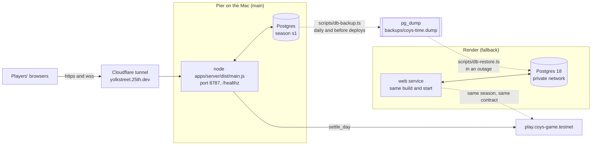

The client never sends a balance or an outcome. It asks for actions; the only prices it sends are proposals (a haggle ask, a limit order) that the server bounds and that an agent or counterparty must accept. The server applies every action in a database transaction and answers with state and events that drive the juice.

</details>

<details>
<summary><b>NEAR pieces and testnet receipts</b>: every component, and every transaction since 11 November</summary>

## How NEAR fits in

NEAR tools used: **Privy social login** (email, with a silent NEAR wallet), **NEAR AI Cloud** (the primary model for agent decisions, with SERV Reasoning as the fallback), **NEP-171** Feathers, **NEP-245** egg tokens, **sub-account agent wallets**, and **compact batched testnet settlement** (one call per ten in-game days, no storage per day).

| NEAR piece | What it does here | Status in this build |
|---|---|---|
| **Game contract on testnet** (`near-sdk` 5.30.1) | One contract on the game account: the Feathers (NEP-171, `near-contract-standards` 5.30.1, 777 ever, capped on chain), egg tokens (NEP-245, `near-sdk-contract-tools` 4.0.0 from the near org), `settle_day`, owner only, once per range of closed days of a season (ten by default), storing only a fixed-size head per season, and `mint_feather`, owner only, which mints one Feather at once. | **Live**, version 6, on `play.coys-game.testnet` (upgraded in place on 12 November 2026 to version 4, tx [`9jsFd4EA...`](https://testnet.nearblocks.io/txns/9jsFd4EAZc3nkE4v11x4poVTMhLyYzPpuZKrsCud9J4s), to version 5, tx [`4h7ZEQkP...`](https://testnet.nearblocks.io/txns/4h7ZEQkPG66zVmNrNvLr8W3b9dyBYmQoFibEBFCWuN92), and on 13 November to version 6, tx [`8aADyAiD...`](https://testnet.nearblocks.io/txns/8aADyAiDPopPb67ZnY9WATvLM6jz7XjyWAgocF9o174r); wasm built in CI with `cargo near`, sha256 `d6c85dd9...`), live season `s1`, with the founders provenance committed ([`JBoKNVa6...`](https://testnet.nearblocks.io/txns/JBoKNVa6Pi5jAb2BA4chAh8K43GGpWgw8AtHJy26b5AB)). The demo account `coys-game.testnet` stays on version 2 ([deploy/testnet.md](deploy/testnet.md)). |
| **Agent wallets** (near-api-js 7.5.3) | Each agent gets a testnet sub-account of the game account (`bakery1.play.coys-game.testnet` and so on, on the live game), funded from it; its eggs settle to it. A contract delivery moves egg tokens from the player's wallet to the Bakery's. | **Live**: seven wallets, and a delivery proven on chain (below). |
| **Privy social login** (docs.near.org social login) | Email sign-in; a NEAR testnet wallet is created silently with Privy's extended-chains API; the server verifies the ES256 access token with `jose`. That wallet holds the player's Feathers and eggs. | Wired. Needs `PRIVY_APP_ID` and the live domain in Privy's allowed domains. |
| **NEAR AI Cloud** (OpenAI-compatible) | First in the agents' provider chain: decisions on the days that matter, as structured JSON output (`json_schema`, strict) checked against a zod schema, and a weekly reflection; anything unusable falls back to rules and is logged. One shared daily spend cap, and caps per agent. | Integrated as the primary model; SERV Reasoning is the fallback and the rule strategies the last resort. Needs `NEARAI_API_KEY` and account credits; `z-ai/glm-5.3-flash` for decisions, `Qwen/Qwen3.6-35B-A3B-FP8` for weekly reflections and hard days. Costs: [docs/agents.md](docs/agents.md). |

**Testnet receipts.** Every link opens the transaction on the testnet explorer.

| When | What | Transaction |
|---|---|---|
| 11 Nov | Game contract deployed and initialised on `coys-game.testnet` (version 1) | [Bzhs5zTq...](https://testnet.nearblocks.io/txns/Bzhs5zTqUJFNE83HzjZsCUonxhwkcHTXuV868nbMdGoc) |
| 11 Nov | Seven agent wallets created: `bakery1`, `loyalist1`, `oldmoney1`, `squeezer1`, `trader1`, `upstart1`, `wholesaler1` (each `.coys-game.testnet`) | on the first day close |
| 11 Nov | Day 1 settled: 94 egg tokens and 12 hen NFTs minted | [tW6D6wqy...](https://testnet.nearblocks.io/txns/tW6D6wqyd97366MCi59in83ge8N8RfRZwtKHuxEDrLm) |
| 11 Nov | Day 2 settled: 54 eggs minted, 4 burned (a street sale), 12 more hens | [2b2wWs9X...](https://testnet.nearblocks.io/txns/2b2wWs9XSU8MDcPmpUeyujtbmUXPRZfsbfduF17TS8MS) |
| 11 Nov | Day 3 settled: 26 eggs minted, 16 burned, 12 more hens | [42awyreg...](https://testnet.nearblocks.io/txns/42awyregh4i6BgKDQTXBmjqZa4MBfrPKSJTrfYHRQvTC) |
| 11 Nov | Contract upgraded in place to seasons; `migrate` files days 1 to 3 under the season `legacy`, keeping all 36 hens and every egg balance | [HXYRgKDn...](https://testnet.nearblocks.io/txns/HXYRgKDnKS7TveYSwDHQp31nsNtzx2jnw64F2hUA39Cf) |
| 11 Nov | Season `delivery-proof` day 1: a fresh season starts at day 1 on the same contract | [FwR1skf3...](https://testnet.nearblocks.io/txns/FwR1skf3G1weRLRypZLhyb7CbBcKzVKuoKQ3n6FQoFJQ) |
| 11 Nov | Season `delivery-proof` day 2: the player delivers 3 eggs on a Bakery standing contract; two NEP-245 `mt_transfer` events move 1 white and 2 cream from the player's wallet `f9ad7ca1...` to `bakery1.coys-game.testnet`, which then bakes them (burned) | [2Erp19yX...](https://testnet.nearblocks.io/txns/2Erp19yXaNGekgt6a8EgK2q66gSnDRpAAmQmb3cH2ifF) |
| 11 Nov | Season `tour5-20261111`: the headless tour behind the screenshots, one settlement per 30-second day for 12 days (the ledger links in the ledger screenshot are these) | day 1 [8WeCaoGp...](https://testnet.nearblocks.io/txns/8WeCaoGpJJ72nHqpVcnunnrN8FAEgzJWvAm44VbfT1ER), day 12 [2jebGi4R...](https://testnet.nearblocks.io/txns/2jebGi4RLcinhyvL6WC7pizakx5WAmpvepMqGYJEdNk6) |

Check it yourself with view calls on `coys-game.testnet`: `day_record({"season": "delivery-proof", "day": 2})` (shows `egg_transfers: 2`), `last_settled_day({"season": "legacy"})` (3), `nft_total_supply()` (this demo account stays on version 2, so its early test hens still count there); the `mt_transfer` events are in the day 2 transaction's receipts. In these runs every agent used its rule policy and each fallback was logged: the path the tests also cover.

**Live deploy.** https://yolkstreet.25th.dev runs season `s1` on Pier, settling to its own production contract
account `play.coys-game.testnet` ([deploy/pier](deploy/pier/README.md), [deploy/testnet.md](deploy/testnet.md)).
Checked on 11 November 2026 at about 20:06 UTC (a snapshot of that day; `/healthz` now answers the current commit and day):

```json
{"ok":true,"version":"0.1.0","commit":"a2d54b574f2f","season":"s1","day":2,"db":{"kind":"postgres","ok":true,"ms":0},"settlement":"near-testnet","uptimeS":108}
```

| When | What | Transaction |
|---|---|---|
| 11 Nov | `play.coys-game.testnet` created by `coys-game.testnet` with the same public key, funded with 5.33 NEAR | [9bejUg6V...](https://testnet.nearblocks.io/txns/9bejUg6VLDakSHe7MZj6ecQatNrSv9ifS5rBajpztiKY) |
| 11 Nov | Game contract (wasm sha256 `fc7645dc...`) deployed and initialised on it, owner `play.coys-game.testnet` | [5ZdpvZgA...](https://testnet.nearblocks.io/txns/5ZdpvZgA4U4idi6DorRN8AfH5kMcHk2CzyGnwp9gy2Gd) |
| 11 Nov | Agent wallet `upstart1.play.coys-game.testnet`, 0.05 NEAR | [DBsnzZUE...](https://testnet.nearblocks.io/txns/DBsnzZUETH8aLTt5Sk7aFY42bcMZ6UCNGaZMqi2q8BqW) |
| 11 Nov | Agent wallet `oldmoney1.play.coys-game.testnet`, 0.05 NEAR | [6zrX27tX...](https://testnet.nearblocks.io/txns/6zrX27tXnVYGCNnribskBo9EJGWDeQXBMSsNsCuXgbVs) |
| 11 Nov | Agent wallet `squeezer1.play.coys-game.testnet`, 0.05 NEAR | [2pCBa4nx...](https://testnet.nearblocks.io/txns/2pCBa4nxkasgRLiZnT66gcRXLL3FZuuh6KRjzKTtiBUt) |
| 11 Nov | Agent wallet `loyalist1.play.coys-game.testnet`, 0.05 NEAR | [J5XmcTQb...](https://testnet.nearblocks.io/txns/J5XmcTQb5TbGhr6kjzBgq7N9QbSEVDcKuMbepxrvkrJB) |
| 11 Nov | Agent wallet `bakery1.play.coys-game.testnet`, 0.05 NEAR | [6XoSGUAn...](https://testnet.nearblocks.io/txns/6XoSGUAnp98xLnTB7vg1LyS6vmS5bk99h274iTg4Jf4A) |
| 11 Nov | Agent wallet `trader1.play.coys-game.testnet`, 0.05 NEAR | [FfCVpyMj...](https://testnet.nearblocks.io/txns/FfCVpyMjNcZScYkGu75JYy6oVBSn3LWVtSWqxTgaaM4a) |
| 11 Nov | Agent wallet `wholesaler1.play.coys-game.testnet`, 0.05 NEAR | [4xqGJnhA...](https://testnet.nearblocks.io/txns/4xqGJnhAcTpRHM2wEZU2H9PZLvKd5k2LDcnzGMpt3jRf) |
| 11 Nov | Season `s1` day 1 settled on the production contract (`last_settled_day({"season": "s1"})` was 1 then; it now follows the latest settled range) | [Fz56pALi...](https://testnet.nearblocks.io/txns/Fz56pALiRXbLvt9ZK6R6ZwRg1uhzdeJ2XRyxcipHdaS6) |

Also checked live: the title page, `/build/index-BL-i4f2Y.js` and `/assets/sprites/12-crate.png` answer 200, a
WebSocket on `wss://yolkstreet.25th.dev/ws` upgrades (101) and answers a ping, and `/api/market` serves the market
state. On 12 November contract version 4 replaced the per-day record with a fixed-size head, so `s1`'s settlements stopped
growing the account's storage (they had cost about 1.06 NEAR a real day; now about 0.19 NEAR of gas), and version 2's
day records can be released back to the account ([The Feathers beta](#the-feathers-beta-compact-settlement-and-the-layout-spec-12-november-2026)).
Since 13 November ten closed days settle in one call: about 0.002 NEAR of gas a call (0.0020 and 0.0023 measured on two
range calls on 14 November), about 0.1 NEAR a real day.

</details>

<details>
<summary><b>Environment variables</b></summary>

## Environment variables

All optional for local play. Copy `.env.example` to `.env` at the repo root. Production needs `NODE_ENV=production`, `GAME_SEASON`, `SESSION_SECRET` and a Postgres `DATABASE_URL` ([deploy/pier](deploy/pier/README.md) lists every variable).

| Variable | Used by | Without it |
|---|---|---|
| `NODE_ENV` | server | local play rules (PGlite allowed, demo days allowed) |
| `PORT`, `DATABASE_URL`, `SESSION_SECRET` | server | 8787; PGlite at `.data/coys`; a random secret per boot |
| `HOST` | server | listens on every interface |
| `GAME_SEASON` | server | a fresh database makes its own `dev-...` season; an existing one keeps its own |
| `GUEST_FARMS_PER_IP_PER_DAY`, `GUEST_FARMS_PER_HOUR` | server | guest play: 3 new guest farms per address a day, 60 on the street an hour; 0 turns guest play off |
| `DEMO_DAY_SECONDS`, `DEMO_MODE` | server | 180-second days; `DEMO_MODE=1` lets a production server use demo days; outside production, with `HOST` on loopback, it also turns on the demo session (`/?demo=new`) that records the demo video |
| `ALLOW_PGLITE_IN_PRODUCTION` | server | production refuses PGlite (set only to check a build) |
| `ALLOW_DEV_LOGIN` | server | dev login only when Privy is not set up |
| `PRIVY_APP_ID`, `PRIVY_VERIFICATION_KEY` | server, client (via `/api/config`) | labelled local dev login |
| `NEAR_TESTNET_ACCOUNT_ID`, `NEAR_TESTNET_PRIVATE_KEY` | server, deploy script | daily settlement is a recorded NO-OP |
| `NEAR_TESTNET_RPC_URL`, `NEAR_GAME_CONTRACT_ID` | server | `https://test.rpc.fastnear.com`; the signing account |
| `SETTLE_EVERY_DAYS` | server | 10: days settle in ranges of ten, one call each (1 settles every day on its own) |
| `CHAIN_MINT_NEAR`, `CHAIN_MIN_BALANCE_NEAR`, `AGENT_ACCOUNT_FUNDING_NEAR` | server | 0.027 kept free per Feather mint (measured 0.0213, plus 25%); 0.1 margin, kept for settlement gas (about 50 ten-day range calls), under which mints and agent wallet links wait; 0.01 per new agent wallet |
| `NEARAI_API_KEY`, `NEARAI_BASE_URL`, `NEARAI_MODEL`, `NEARAI_CHEAP_MODEL` | server | NEAR AI Cloud left out of the provider chain |
| `NEARAI_MAIN_PRICE`, `NEARAI_CHEAP_PRICE` | server | `/v1/models`, else the assumed prices in `apps/server/src/agents/brain.ts` (USD per million tokens, "input,output") |
| `SERV_API_KEY`, `SERV_BASE_URL`, `SERV_MODEL`, `SERV_CHEAP_MODEL` | server | SERV Reasoning left out of the chain; `https://inference-api.openserv.ai/v1`, `gpt-5.4-mini` (reflections), `gpt-6-luna` (decisions) |
| `SERV_REASONING_EFFORT` | server | `none` (or `low`, `medium`, `high`) |
| `SERV_MAIN_PRICE`, `SERV_CHEAP_PRICE` | server | SERV's published prices in `apps/server/src/ai/serv.ts` (confirm them in the OpenServ console) |
| `LLM_DAILY_CAP_USD` (old name `NEARAI_DAILY_SPEND_CAP_USD`, still read) | server | 1.50, every provider together |
| `LLM_AGENT_DAILY_CAP_USD`, `LLM_AGENT_DAILY_CALLS` (old `NEARAI_AGENT_DAILY_` names still read) | server | a quarter of the shared cap; 240 calls, failed ones included |
| `LLM_PRICE_MOVE`, `LLM_DECISION_GAP_DAYS`, `LLM_CLOSE_BUDGET_SECONDS` | server | 0.15 (a 15% move asks a model); 3 in-game days between model decisions; 60 s of model calls per day close |
| `ASSETS_DIR` | `npm run pack-assets` | required to re-pack |

</details>

<details>
<summary><b>Commands</b></summary>

## Commands

| Command | Does |
|---|---|
| `npm ci --ignore-scripts` | install from the lockfile, no install scripts |
| `npm run dev` | server (port 8787) and client (Vite, port 5173) |
| `npm test` | Vitest: economy, agents, haggling, market, chain batch, simulation, WebSocket, packer, pixel passes, hen movement |
| `npm run test:e2e` | after a build: the naming screen and the tour at five sizes, and every screen, tab, page and tour step in a headless browser at 12 window sizes (`E2E_SIZES` keeps a few: CI runs 1280x720, 1920x1080 and 390x844); fails on anything that scrolls or is cut off (`SCREENSHOTS=1` saves them to `docs/screenshots`) |
| `npm run typecheck` / `npm run lint` | strict TypeScript; ESLint plus a check that no file holds an em dash |
| `npm run build` / `npm start` | bundle the server and client; serve both on one port |
| `npm run deploy-contract -- --wasm <file> --account <id.testnet> [--create] [--migrate]` | deploy a CI-built contract to a testnet account (sha256 checked, mainnet refused; see [deploy/testnet.md](deploy/testnet.md)) |
| `npm run settle-late-days -- --season <id> [--dry-run]` | record closed days whose settlement failed, late, by their digests (the server also does it at each day close) |
| `npx tsx scripts/db-backup.ts` / `scripts/db-restore.ts` | back up the Postgres database to `backups/`, or restore a dump into another (see [deploy/pier](deploy/pier/README.md)) |
| `npx tsx scripts/make-share-images.ts` | cut the favicon and the share image from the sprites |
| `cd contracts/coys-game && cargo test` | contract unit tests (CI also runs `cargo near build` and the sandbox tests) |

</details>

<details>
<summary><b>Repository layout</b></summary>

## Repository layout

```
apps/client          Vite + React shell + PixiJS world + anime.js motion + Web Audio
apps/server          game server: HTTP, WebSocket, game, agents, cards, market, chain, db
packages/shared      economy config and formulas, agent pricing, protocol, pixel passes
contracts/coys-game  the game contract (Rust); res/ holds the CI-built wasm and its sha256
contracts/sandbox-tests  near-workspaces sandbox tests for the contract (res/ holds the version 2, 4 and 5 wasm for the upgrade tests)
scripts              asset packer, dev runner, text check, testnet deploy, backups, share images, late days
e2e                  the browser check: no scrollbars, nothing cut off, at every window size
deploy               Pier and Render settings, testnet contract accounts and seasons
render.yaml          Render Blueprint (fallback host)
docs/screenshots     headless captures of this build
docs/submission      drafts: demo shot list, post drafts, form fields
docs/readme          the README's animated hatch (made by scripts/derive-art/readme-hatch.ts)
docs/build-log.md    the dated build history
```

</details>

<details>
<summary><b>What is stubbed, and why</b></summary>

## What is stubbed, and why

- **Contract builds run in CI**: the first development machine (Windows, with Application Control) blocked the unsigned build scripts cargo compiles, so the contract is built and sandbox-tested on Linux in CI, and the deployed wasm is the CI artifact (its sha256 is committed and checked by the deploy script).
- **Privy end to end** needs a real browser and inbox; the server and client sides are wired and tested headlessly up to the token check.
- **Model decisions** depend on a provider answering: agent decisions run on a provider chain: NEAR AI Cloud is the primary model, SERV Reasoning is the fallback, and rule-based strategies are the last resort, all under a hard daily spend cap. A model is held to the same rules a rule strategy follows.
- **Player credit default** is remembered and blocks further credit, but a player is never pushed below zero; agents always repay in full.
- **Feather mints go one at a time** through `mint_feather`, each RPC call paced and retried with backoff; a mint that cannot go out yet (no wallet linked, the game account under its margin) waits and goes again when the wallet is linked or at the next day close.
- **The live deploy** (Pier on the Mac, the tunnel, Render) is set up from [deploy/](deploy/); it is not run from this repository.

</details>

<details>
<summary><b>Verification</b>: CI, and what was checked live</summary>

## Verification

This README was checked on 14 November 2026: every transaction and account it links under
[How NEAR fits, per track](#how-near-fits-per-track) answered on testnet, and every view method it names there answered
on `play.coys-game.testnet` (read-only calls).

On a fresh clone: `npm ci --ignore-scripts`, then typecheck, lint, test and build all pass. CI is green: the TypeScript job on every push and pull request (with PostgreSQL 16: the Postgres tests, the production build booting against Postgres with `/healthz` checked, and a backup restored into a second database), the browser checks (`layout`: every browser check at 1280x720, 1920x1080 and 390x844; the full sweep at 12 window sizes runs locally before a merge) on pull requests that change more than docs, and the contracts workflow whenever `contracts/` changes (unit tests, `cargo near build`, sandbox tests). The economy sheet tests hit their values exactly; the five-seed simulation meets the economy acceptance; a malformed model answer falls back to rules; a new season settles day 1 after an old season ended at day 3; non-game accounts cannot mint or settle; two real WebSocket clients see the same prices and each other's trades; no secrets in the repo or bundle; no file has an em dash.

The live Pier deploy and its tunnel were checked end to end on 11 November 2026 (receipts under [How NEAR fits in](#how-near-fits-in)).

Brief 8 was checked on 12 November 2026: the hen size and movement tests (41 window sizes and a resize sequence), the
belt test (no egg colour on any frame), the browser check at 11 window sizes with every screen, tab, page and tour step
open (nothing scrolls, nothing is cut off), the contract's unit and sandbox tests (version 4 upgraded to 5 with the test
Feathers burnt and two missed days recorded), and on `play.coys-game.testnet` the upgrade, the burn (0 minted, 777
remaining) and days 509 and 510 recorded late, with no unsettled closed day left in `s1` (under
[Scaling, no scrollbars, a clean conveyor and the 777 restored](#scaling-no-scrollbars-a-clean-conveyor-and-the-777-restored-12-november-2026)).

Brief 7 was checked live on 12 November 2026 on `4471029`: the version 4 upgrade and the release of version 2's records on
`play.coys-game.testnet`, three Feathers minted in a test season, the mint page and the board, and the farm and its layout
overlay at five sizes with no overlap (under [the Feathers beta](#the-feathers-beta-compact-settlement-and-the-layout-spec-12-november-2026)).
The contracts job builds both contracts; the sandbox mints 777 Feathers and refuses the 778th, settles 30 days with no new
storage, upgrades version 2 and releases its records, and reveals exactly 7/70/200/500.

Brief 6 was checked live on 12 November 2026 on `c48d2f2`: the farm at four sizes with no overlap, the first-run tour for brand-new players at three sizes, a 30-second capture of the belt and the coop doors, and live milestone rolls (under [Founding Hens](#founding-hens-machines-at-work-sound-and-a-guide-12-november-2026)). The contracts job builds the version 3 wasm and the sandbox mints 777 Founding Hens and refuses the 778th.

The visual-quality pass was checked live on 12 November 2026: cold load at five sizes, the whole tour completed by an automated browser at five sizes, the no-overlap check with every modal and tour step open, and device-pixel crops (numbers under [Visual quality](#visual-quality-and-the-tour-12-november-2026)).

The playability rescue was checked live on 12 November 2026: cold load, the four window sizes, every world object's card, an egg collected, and a 20-second flicker capture (numbers under [Playability rescue](#playability-rescue-12-november-2026)).

**Not verifiable headlessly:** whether it now looks and feels good to a person, a Render deploy, Privy login on the live domain, the quality of real model decisions, how haggling and cards feel, whether portraits and voices read right, and how the market evolves over weeks of real play.

</details>

<details>
<summary><b>A longer walkthrough on a local copy</b>: sixteen steps, from install to a production build</summary>

## A longer walkthrough on a local copy

Node 22.22.2 or newer (CI and the deploy docs use 24.22.3). Each step says what to do and what you should see. Commands are the same in PowerShell and a POSIX shell unless shown otherwise.

1. **Install.** Run `npm ci --ignore-scripts`. You see the lockfile install with no package install scripts (`.npmrc` also sets `ignore-scripts=true`).
2. **Test.** Run `npm test`. You see **485 tests: 483 pass and 2 skip**: the 2 Postgres tests need `TEST_DATABASE_URL` (CI sets it); on a fresh clone without a coys-assets checkout beside the repo, the asset re-pack check skips too (482 and 3). After `npm run build`, `npm run test:e2e` opens every screen in a headless browser at 12 window sizes and checks that nothing scrolls or is cut off (it needs a Chromium: `CHROME_PATH` points at one). Among them: the economy sheet (margin **0.46**, payback **17.3** days, multiplier **0.54** at 1300 supply against the fixed 600 reference, a 30-hen coop **full on day 16**), the five-seed 30-day market simulation, haggling, model fallbacks, seasons, the chain batch with a contract delivery moving tokens to the Bakery, `/healthz`, two real WebSocket clients in one market, and every frame of every derived animation (no blank frame, no neighbouring row, atlases up to date).
3. **Play.** Run `npm run dev` and open http://localhost:5173. You see an egg fill up over the loading plate, then the title: the logo stamps in and the price ticker scrolls.
4. **Play.** Press **PLAY**: a guest farm opens at once, with a generated name and no sign-in. You see your farm: 10 hens, a starter coop, **50.00** coins, **DAY001**. **SIGN IN** on the title is for returning players: with `PRIVY_APP_ID` set you sign in with email; without it a red **LOCAL DEV LOGIN** label asks for a name. A guest's **SAVE THIS FARM** (Settings, or the profile) signs in the same way and carries the farm into the account.
5. **Take the tour.** The first time you enter your farm the tour starts on its own: your hen walks you through the loop by doing it (collect an egg, sell, the market, feed, an offer, a hen, machines, rivals, the ledger). Each step ends when you do the thing; **SKIP** ends it, and it never comes back unless you press **REPLAY THE TOUR** in **SETTINGS**. After it, the goal in the corner shows what to aim for next, with a **CLAIM** button and coins when you reach it. The **?** in the top bar opens **HOW TO PLAY**, the guide to everything.
6. **Collect and sell.** Click an egg a hen just laid: you see it pop into the crate, **COLLECT** in the top bar drops by one and **SELL** rises by one. Click the crate (or press **SELL N EGGS** on the card): a **SOLD** stamp slams and coins arc to the counter. Click anything else on the farm (a hen, the trough, a coop, the farmhouse, the sign, a machine) to open its card.
7. **Meet the agents.** From day 2 cards slide in: a portrait talks in its own voice while its line types out (the Bakery offering a standing contract, the Wholesaler a bulk order, the Squeezer a feed deal). Press **ACCEPT**: you see the right stamp slam.
8. **Win a haggle.** On a buyer's card, press **-** a few times so **YOUR PRICE** sits just above the offer, then **COUNTER**. You see the card flip to gold with confetti and the win chime (inside the agent's walk-away price).
9. **Lose one.** On another card, press **+** many times and **COUNTER**. You see the agent counter, get cross, and after three rounds (or at once, if it is proud) walk off with the fail sound.
10. **Sell into a glut.** Speed days up: `DEMO_DAY_SECONDS=30` before `npm run dev` (PowerShell: `$env:DEMO_DAY_SECONDS = "30"; npm run dev`). Open the **Market** (top bar): its PRICES tab shows today's sales against what the street needs. When a day's supply runs well past demand (Old Money releasing its hoard, the Wholesaler reselling), you see the next multiplier fall, the ticker turn red at 0.80 or lower, the **GLUT WARNING** card in the tray, and the tension music take over.
11. **Watch a rival bust.** The Upstart borrows feed from the Loyalist to grow on good weeks. When a glut meets its debt, it goes below zero: you see its sign tip over, a price wave cross the ticker, feathers fall, and its hens appear in the shop as **AUCTION** hens at half price; a new rival opens three days later. At 30-second days this usually happens 8 to 14 minutes into a season.
12. **Deliver a contract.** Accept the Bakery's contract, then press **DELIVER** on the desk each day (or buy the delivery cart: it delivers at dusk). You see coins arrive; with testnet credentials the settlement batch moves those egg tokens to the Bakery's wallet. Miss one and you pay a penalty and the Bakery remembers.
13. **Read the ledger.** Open the **ledger** (top bar): you see the season and tabs: **DAYS** (income, costs and net a day, in pages that fit the window; a settled day links its receipt, **DAYS a-b**, the range of days one call settled, which opens the testnet explorer, and a day still waiting says **IN A BATCH**), **CONTRACTS**, **FEATHERS** and **MILESTONES**. Nothing in the game scrolls: longer lists have **PREV** and **NEXT**.
14. **Comfort.** **SETTINGS**: a volume and a mute for each of twelve sound groups (master, music, ambience, hens, eggs and money, cards and stamps, haggling, machines, market and rivals, agent voices, buttons, new day and stings), a reset button, and **REDUCE MOTION**, kept per browser. Each change applies at once and plays a sample. With reduce motion, stamps still slam and chime, but nothing shakes or freezes.
15. **Win a Feather.** Reach a milestone in good standing (fill your coops, sell 500 eggs, win 10 haggles...). At the day close you get one roll at 30%: a win is a **Feather Ticket**, a miss says so kindly and names the next milestone. Press **MINT** in the top bar: the Feather Mint (also at `/mint`) shows your tickets and the grade a mint would get now, the Feathers left of 777, each grade's odds, the recent mints, all 777 numbers (in pages that fit the window), and the provenance and contract. Press **MINT A FEATHER (25 COINS)**: the press stamps your Feather (Fluff, Plume, Quill or Golden Quill) with a random number of 777, minted at once to your wallet, with its receipt. Add `?debug=layout` to the address to see the farm's layout spec drawn over it.
16. **Production build.** `npm run build`, then start it as production would (PowerShell):
    `$env:NODE_ENV = "production"; $env:GAME_SEASON = "local"; $env:SESSION_SECRET = "a-long-random-string"; $env:DATABASE_URL = "postgres://..."; node apps/server/dist/main.js`.
    Open http://localhost:8787/healthz: you see `{"ok":true,"version":"0.1.0","commit":"...","season":"local",...,"db":{"kind":"postgres","ok":true,...}}`. Without a Postgres at hand, `ALLOW_PGLITE_IN_PRODUCTION=1` with `DATABASE_URL=memory://` checks the build on PGlite (never for players).

</details>

<details>
<summary><b>Screenshots and video</b></summary>

## Screenshots and video

The live site on 12 November 2026 after the visual-quality pass (season `s1`), from fresh headless browsers through the
tunnel (since then hens are no longer minted, so the hen certificate and the ledger's hen certificates shown here are gone,
and the market board became the Market page). The farm at every listed size, UI drawn at whole device pixels:

| 1280x720 | 1920x1080 |
|---|---|
|  |  |
| **2560x1440 at 2x (5120x2880 device pixels)** | **390x844 (phone)** |
|  |  |

The tour and the modals, at 1280x720. The market board shows the temporary check farms the verification used (removed afterwards):

| Tour step 1: collect | Tour step 4: gluts |
|---|---|
|  |  |
| **A card, composed** | **Market board** |
|  |  |
| **Shop** | **A hen's card** |
|  |  |
| **Feed** | **Ledger** |
|  |  |

<details>
<summary><b>The earlier build (11 November): title, tour, sale, haggles, glut, bust, ledger, market, shop</b></summary>

<br>

| Title | Sign in |
|---|---|
|  |  |
| **First-run tour** | **Farm** |
|  |  |
| **A sale** | **Haggle win** |
|  |  |
| **Haggle fail** | **Glut** |
|  |  |
| **Rival bust** | **Ledger with receipts** |
|  |  |
| **Market board** | **Shop** |
|  |  |

Screenshots come from a headless tour of the built game at 1280x720: the real server code in-process with 30-second demo days and live testnet settlement in the season `tour5-20261111`, and the built client in headless Edge, with 0 console errors or warnings. The sale, haggles, glut and receipts happened on their own. The bust was staged: a one-player tour had no natural bust by day 12, so the tour gave the Upstart a 64.80 Loyalist debt falling due that day, and the game's own rules did the rest (collected in full in a glut, below zero, bust). Natural busts are what the simulation shows.

</details>

**Video:** in the [demo post](https://x.com/25THPRMR/status/2121560697037271481); it is recorded from the game itself, as [docs/submission/demo-video.md](docs/submission/demo-video.md) explains.

**Live resize** (13 November 2026, the live farm in a fresh headless browser: wide 1600x760, narrow 900x760, tall
560x1000, wide again; ten hens, all inside the yard at every size, the same size at the same zoom):
[docs/screenshots/live-resize.mp4](docs/screenshots/live-resize.mp4), with the four stills
([wide](docs/screenshots/live-resize-1-wide-1600x760.png), [narrow](docs/screenshots/live-resize-2-narrow-900x760.png),
[tall](docs/screenshots/live-resize-3-tall-560x1000.png), [wide again](docs/screenshots/live-resize-4-wide-1600x760.png))
and the [belt](docs/screenshots/live-belt-clean.png), which carries only real eggs.

</details>

### Notes by date

What each stage of the build changed, newest first, as written at the time (later changes are noted where a
statement no longer holds).

<details>
<summary><b>Hatching, the Market page, profiles and badges (13 November 2026)</b></summary>

## Hatching, the Market page, profiles and badges (13 November 2026)

**Who runs the farms.** Some farms on Yolk Street are other players, some are AI (marked AI). The feed suppliers and
the egg buyers are AI, each with its own coins and memory. The title, How to Play, the tour, this README, the page
header and the submission notes all say so; nothing says every farm is AI any more.

**The stray egg.** A small egg bobbed below the crate. It was not a game egg: the crate sheet's `overflow` frame has a
pile of eggs that pokes up into the row above, so when the atlas cutter split the painted sheet into frames, no cell
held most of that pile, and the loose egg became the main body of a frame on its own. The cutter
([`scripts/lib/derive.ts`](scripts/lib/derive.ts)) now hands any loose piece of the crate sheet to the body directly
below it (`FALL_INTO_BODY_BELOW`), and a test checks that every crate frame sits on its feet with nothing loose.

**The shop.** A hen's button says what it does: `BUY 4`. An auction hen wears a small `AUCTION` tag, and the hens tab
explains it in one line: "Auction hens come from farms that went bust, sold cheap."

**New hens hatch.** A hen you buy (from the list, the auction or at random) no longer walks in from the gate. A big egg
drops into a free spot in the coop yard (never on an object, the path or another hen), lands with a squash, wobbles,
cracks and bursts; the hen pops out with a squash and stretch, a feather puff and shell bits, shakes herself off and
wanders. Several hatch a beat apart, spread across the yard, and three or more get the hen chorus. The sounds (egg crack,
pop or splat, cluck, chorus) follow the sound settings' categories; the shake and hitstop follow reduce motion. Her card
opens from her as soon as she has hatched. The egg is new Spawn art (below), 24 world pixels tall and 20 wide, room
for a crouched hen ([size table](apps/client/src/pixi/farm/spec.ts)).

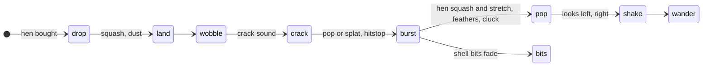

**The Market page.** The market was a board behind a small icon. It is now a page of its own: **MARKET** in the top bar,
or the farm's own sign. It fills the window under the top bar (your coins stay in sight), never scrolls, and each tab
opens with one plain line saying what it is for.

| Tab | What it holds |
|---|---|
| **Prices** | today's price per grade on split-flaps, today's sales against what the street needs with the glut line, a 10-day chart (price level or one grade, a normal-price line, each day marked glut or scarce), what each AI trader last said, and the big trades |
| **Sell** | sell one grade or the whole crate at today's price (machine bonuses included), or post a sell order at your own price |
| **Buy orders** | the AI buyers' orders, each filled with one tap from your crate |
| **Your orders** | your open orders (at most 10), each with CANCEL |
| **Trade** | other farms' offers to buy from (AI farms tagged AI), and your own offers as everyone sees them |
| **Hen auction** | hens from farms that went bust, sold cheap |
| **Farms** | the AI farms' signs, and every farm ranked with its best badges; tap one for its public profile |

The server now sends the last 10 closed days with the market state (`MarketState.chart`). The tour's market steps and
How to Play point at the page.

**Your profile.** The **PROFILE** button in the top bar, your farm's name in Settings, or your own farm in the Market's
ranking opens your farm's record in eight tabs, without scrolling:

| Tab | What it shows |
|---|---|
| **Overview** | farm sign and name, days on the street, good standing, coins, net worth and its parts, rank and the rank and net-worth charts, a row of your best badges, the street |
| **Eggs** | laid, collected, broken and sold, by grade, per day and for the season |
| **Money** | coins in and out by kind (feed, hens, coops, machines, repairs, fees), profit per day, the best and worst day |
| **Flock** | room in the coops, eggs a day, each hen's looks, laying rate and age, the looks seen |
| **Machines** | each machine's condition, effect and work, repairs paid, streaks, breakdowns, days since the last |
| **Market** | contracts kept and missed, deliveries in a row, haggles won and lost, orders filled, eggs sold, market share, rivals outlasted |
| **Mint** | Feather tickets, Feathers by grade with their numbers, milestones reached |
| **Badges** | every badge, earned and locked, with filters and each badge's progress |

$$
\text{net worth} = \text{coins} + \text{hens} \times p_{\text{hen}} + \sum_{\text{coops}} p_{\text{coop}} + \sum_{\text{machines}} p_{\text{machine}} \times \text{condition}
$$

The numbers come from a new record per farm and day (`farm_days`: coins, net worth, rank, eggs by grade, profit, share,
standing), written at each day close, and counters kept from now on (`farm_stats`): migration 14. The private profile
goes over the farm's own socket only. **Public profiles.** Any farm in a ranking opens its public profile
(`GET /api/profile/:farmId`): farm name, sign, rank, days on the street, hens, eggs sold, haggles won, rivals outlasted
and its badges. It is built field by field from a short list; a test checks it carries exactly those fields and no
coins, orders, wallet, player id or anything from sign-in.

**Badges.** 73 cosmetic badges, in ten categories; they change nothing in the game. 40 have bronze, silver and gold
levels and 33 have one, so there are 153 to earn; 7 are secret and show as a mystery until earned. The server checks
them after the actions that can move them (each action reads only its own numbers) and at every day close; only player
farms earn them. An unlock slams down at the top of the farm with a stamp, a beat of hitstop and a small shake, and
the win chime; several queue one at a time. Badges show on the profile, as a small row in the Market's ranking and on
public profiles. Existing farms were back-filled once, quietly, from their history: the ledger (coins, profit, rank,
repairs), trades (sales by grade, share, buyer orders, contract deliveries), agent memory (haggles) and the crate;
what was never recorded (eggs picked by hand, past breakdowns, night play, the crow streak) starts from zero.

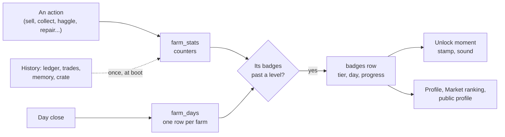

<details>
<summary>All 73 badges</summary>

**Eggs** (8)

| Badge | How | Bronze | Silver | Gold |
|---|---|---|---|---|
| First Egg | Put your first egg in the crate | one level | | |
| Crate Filler | Put n eggs in the crate | 100 | 1,000 | 10,000 |
| Hand Picked | Pick up n eggs by hand | 50 | 500 | 2,500 |
| Golden Egg | Collect a golden egg | one level | | |
| Golden Hoard | Collect n golden eggs | 10 | 50 | 250 |
| Laying Day | Your hens lay n eggs in one day | 25 | 60 | 150 |
| Packed Crate | Hold n eggs in the crate at once | 50 | 150 | 400 |
| Safe Landing | The conveyor saves n eggs from cracking | 10 | 100 | 500 |

**Market** (11)

| Badge | How | Bronze | Silver | Gold |
|---|---|---|---|---|
| First Sale | Sell your first egg | one level | | |
| Market Stall | Sell n eggs | 100 | 1,000 | 5,000 |
| Into the Glut | Sell to the street in a glut, with prices at 80% or less | one level | | |
| Top of the Market | Sell to the street at a peak (prices at 150% or more) n times | 1 | 5 | 20 |
| Order Filler | Fill n buyer orders from the book | 1 | 10 | 50 |
| Big Trade | Make one sale worth 25 coins or more | one level | | |
| Market Mover | Sell n% of all the eggs the street sells in one day | 10 | 25 | 50 |
| Coin Purse | Hold n coins | 200 | 1,000 | 5,000 |
| Nest Egg | Reach a net worth of n coins | 500 | 2,000 | 10,000 |
| Good Day | Make n coins of profit in one day | 25 | 100 | 400 |
| In the Black | Close n days with a profit | 5 | 20 | 60 |

**Haggling** (5)

| Badge | How | Bronze | Silver | Gold |
|---|---|---|---|---|
| First Haggle | Win your first haggle | one level | | |
| Haggler | Win n haggles | 10 | 25 | 50 |
| Worked the Room | Win a haggle against every trader: both suppliers and all three buyers | one level | | |
| No Thanks | Turn down n offers | 10 | 50 | 200 |
| ??? | a secret, below | | | |

**Contracts** (5)

| Badge | How | Bronze | Silver | Gold |
|---|---|---|---|---|
| Signed And Sealed | Take a standing contract | one level | | |
| First Delivery | Deliver a contract day | one level | | |
| On Time | Deliver n contract days in a row without a miss | 5 | 15 | 40 |
| Standing Order | Deliver n contract days | 10 | 50 | 200 |
| Clean Record | Finish n contracts without a miss | 1 | 5 | 15 |

**Flock** (8)

| Badge | How | Bronze | Silver | Gold |
|---|---|---|---|---|
| Full House | Fill your coops | one level | | |
| Big Flock | Keep n hens | 20 | 60 | 150 |
| Seen Them All | Keep hens of every look: each body, eyes, comb and accessory | one level | | |
| Old Bird | Keep a hen n days old | 30 | 60 | 120 |
| Dapper | Keep a hen in a top hat | one level | | |
| Builder | Own n coops | 2 | 3 | 4 |
| Deluxe Living | Own a deluxe coop | one level | | |
| Auction Find | Buy n hens at auction | 1 | 10 | 30 |

**Machines** (11)

| Badge | How | Bronze | Silver | Gold |
|---|---|---|---|---|
| On the Belt | Buy the conveyor | one level | | |
| Graded | Buy the egg grader | one level | | |
| On the Road | Buy the delivery cart | one level | | |
| Hopper Happy | Buy the feed hopper | one level | | |
| Front Desk | Hire the sales clerk | one level | | |
| Fully Automated | Own all five machines | one level | | |
| Handy | Pay for n repairs | 1 | 10 | 30 |
| Stitch in Time | Repair n machines in a row before any breaks down | 3 | 10 | 25 |
| Smooth Running | Run your machines for n days without a breakdown | 10 | 30 | 90 |
| Hard at Work | Your machines carry, grade, deliver and pour n times | 100 | 1,000 | 5,000 |
| ??? | a secret, below | | | |

**Rivals** (5)

| Badge | How | Bronze | Silver | Gold |
|---|---|---|---|---|
| Last One Standing | Outlast n rival farms that go bust | 1 | 3 | 6 |
| Podium | Close n days in the street's top 3 | 1 | 7 | 30 |
| Number One | Close n days as the richest farm on the street | 1 | 7 | 30 |
| Top Half | Close n days in the top half of the street | 1 | 10 | 50 |
| Climber | Climb n places in one day | 2 | 5 | 10 |

**Feathers** (8)

| Badge | How | Bronze | Silver | Gold |
|---|---|---|---|---|
| Ticket Holder | Win a feather ticket | one level | | |
| Lucky | Win n feather tickets | 2 | 4 | 7 |
| Fluff | Mint a fluff feather | one level | | |
| Plume | Mint a plume feather | one level | | |
| Quill | Mint a quill feather | one level | | |
| Golden Quill | Mint a golden quill feather | one level | | |
| Full Plumage | Mint a feather of every grade | one level | | |
| Milestone Hunter | Reach n milestones | 2 | 4 | 7 |

**Days** (5)

| Badge | How | Bronze | Silver | Gold |
|---|---|---|---|---|
| Opening Day | See your farm through its first day close | one level | | |
| Good Standing | Stay in good standing for n days | 7 | 30 | 100 |
| Old Hand | Keep your farm on the street for n days | 7 | 30 | 100 |
| Well Fed | Feed your hens on n days | 7 | 30 | 100 |
| Premium Diet | Feed your hens premium feed on n days | 3 | 10 | 30 |

**Fun** (7)

| Badge | How | Bronze | Silver | Gold |
|---|---|---|---|---|
| Night Owl | Do business after dark, while the hens sleep | one level | | |
| Rooster Crew | Be on your farm when the rooster crows (at dawn) n days in a row | 3 | 7 | 14 |
| ??? | a secret, below | | | |
| ??? | a secret, below | | | |
| ??? | a secret, below | | | |
| ??? | a secret, below | | | |
| ??? | a secret, below | | | |

<details>
<summary>The 7 secret badges (spoilers)</summary>

| Badge | How |
|---|---|
| Thick Skin | Have 10 traders walk away from your asking price |
| Spare Parts | Have a machine break down |
| Omelette | Crack 100 eggs |
| Shoestring | Close a day with less than 1 coin and keep farming |
| Clear the Crate | Sell 200 eggs to the street in one go |
| Gold Rush | Sell a golden egg at a peak |
| New Sign | Rename your farm in settings |

</details>

</details>

**Mint reserve from measured costs.** The thresholds were guesses; they now come from what the live contract cost
(play.coys-game.testnet, 13 November 2026): a Feather mint stores 1,913 to 2,075 bytes (0.0191 to 0.0208 NEAR) and
burns 0.0004 to 0.0005 NEAR of gas, so 0.0213 at most; a day close burns 0.00081 to 0.00087 NEAR of gas, 480 a real day,
about 0.40 NEAR. A mint goes out while

$$
\text{free balance} \ \ge\ \underbrace{1.25 \times 0.0213}_{\text{per mint, }0.027} \ +\ \underbrace{120 \times 0.00084}_{\text{margin, }0.1}
$$

that is, six real hours of day closes stay covered after it. (Measured before batching: since ten closed days settle in
one call of about 0.002 NEAR, the same 0.1 margin covers about 50 calls, 500 day closes, about 25 real hours.)

| Setting | Old | New | Why |
|---|---|---|---|
| `CHAIN_MINT_NEAR` (kept free per mint) | 0.035 | 0.027 | measured 0.0213, plus 25% |
| `CHAIN_MIN_BALANCE_NEAR` (margin) | 0.5 | 0.1 | 120 day closes of settlement gas |
| `AGENT_ACCOUNT_FUNDING_NEAR` (new agent wallet) | 0.05 | 0.01 | the account itself stores 0.0018 |
| A mint waits until free balance is | 0.535 | 0.127 | |
| A new agent wallet waits until | 0.55 | 0.11 | |

With 0.4537 NEAR free when measured, 13 mints fit where none did before.

**New art from Spawn.** Three new assets, made in the Spawn world `@25th/game-11` by the Spawn agent account `@gama`
(Spawn commit `7ec6c4c`), each derived from existing game art in the pico #6 style (PICO-8 palette, 32 px grid) and
pulled byte-exact into [iam25th1/coys-assets](https://github.com/iam25th1/coys-assets) (PR #6): **badge frames**
(`x-badge-frames`: a medal per tier, bronze, silver, gold, plain and locked, each with a glint), **badge icons**
(`x-badge-icons`: 40 icons composed from the game's own sprites: eggs, coins, hens, machines, feathers, the rooster)
and the **hatching egg** (`x-hatch-egg`: rows land, wobble, crack, burst, shell bits). No existing Spawn asset was
changed, and nothing is drawn in code.

**Screenshots** (the browser checks' test server, made-up farm names; every tab of both pages is checked at 1920x1080,
390x844, 1280x720 and 360x640 with nothing scrolled or cut off):

| Market, PRICES, 1920x1080 | Market, PRICES, 390x844 |
|---|---|
| 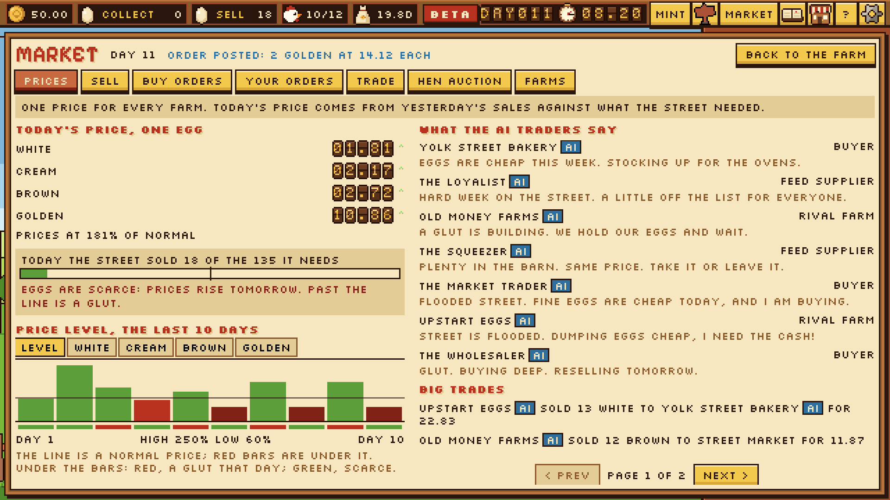 | 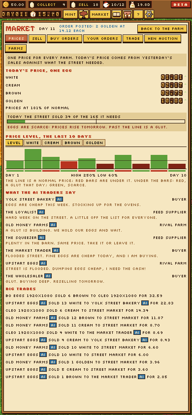 |
| **Market, FARMS** | **Market, SELL (phone)** |
| 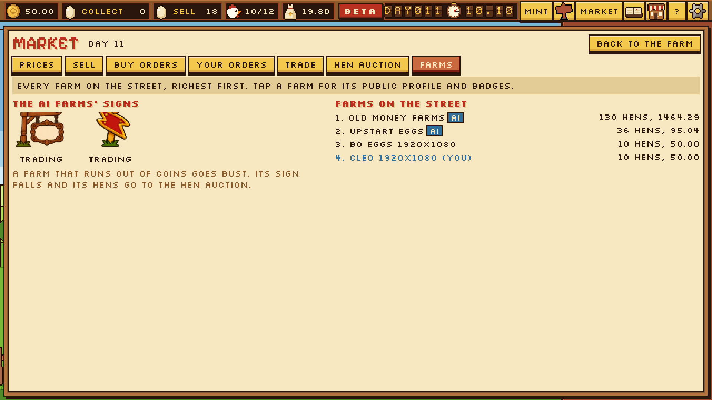 | 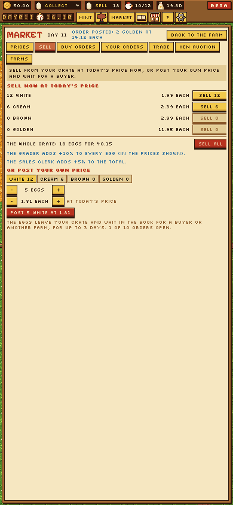 |
| **Profile, OVERVIEW** | **Profile, OVERVIEW (phone)** |
| 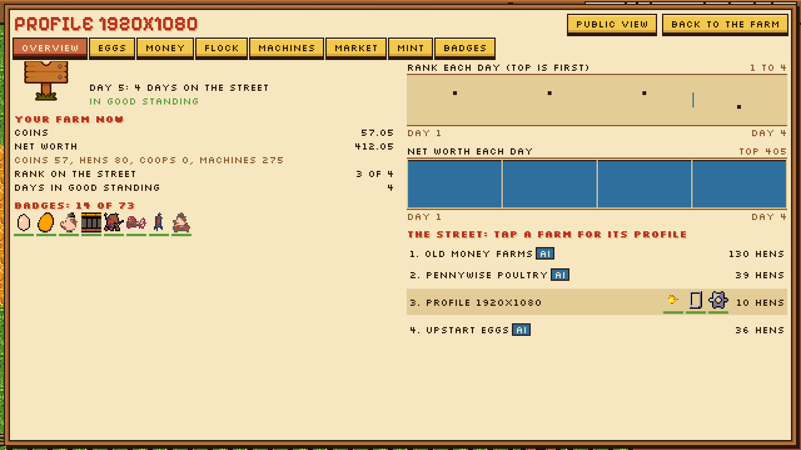 | 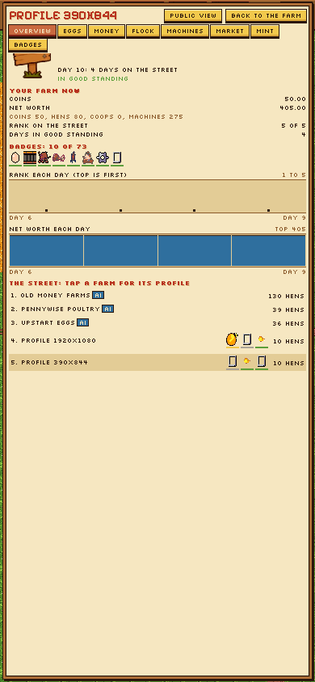 |
| **Profile, BADGES** | **Profile, MONEY** |
| 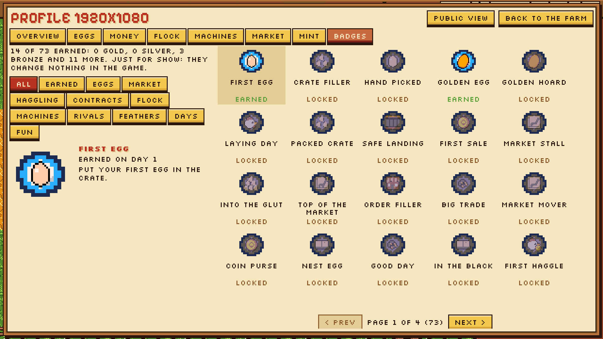 | 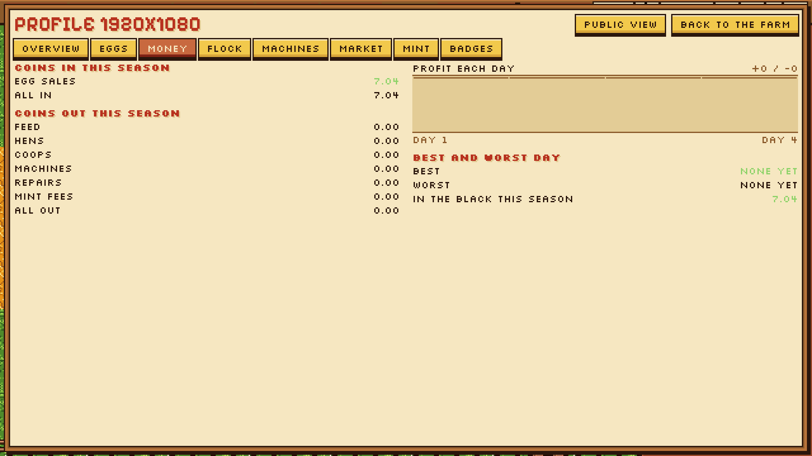 |
| **A badge unlocks** | **A public profile (phone)** |
| 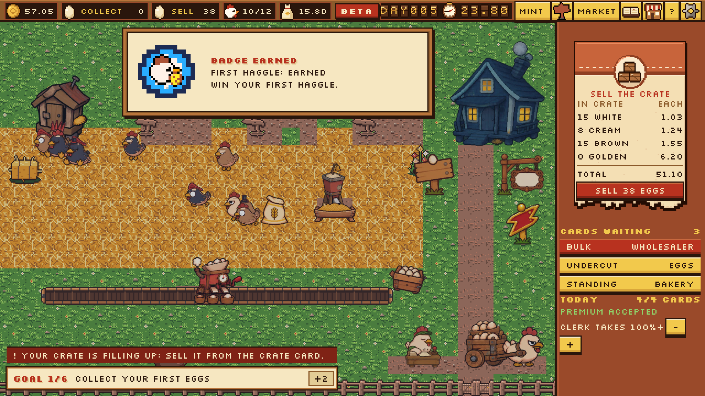 | 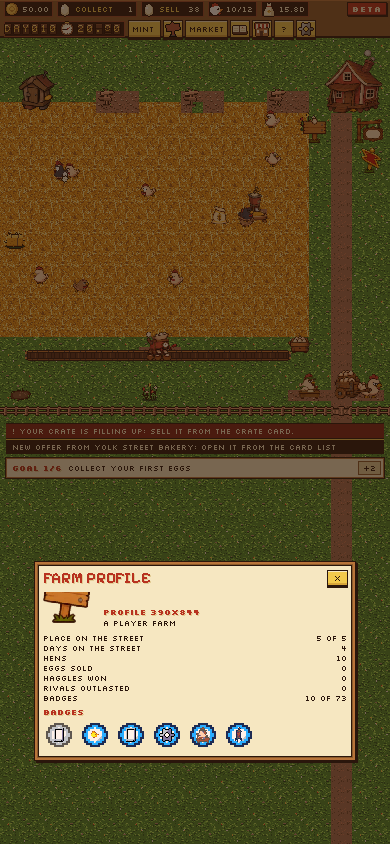 |

Five hens hatching, left to right and top to bottom, about a third of a second apart (the coops filled up too, so FULL
HOUSE unlocked at the same time):

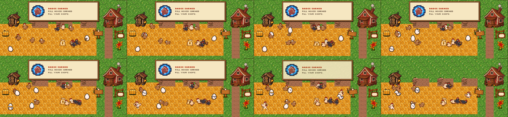

**A clean history.** On 13 November 2026 the repository moved to a fresh public history: three screenshot files from
11 and 12 November that showed farm names made from players' emails were removed from every commit (the later, clean
versions of those screenshots are kept). Every commit message, author and date is unchanged; the old history is
archived privately.

</details>

<details>
<summary><b>Agents that reflect, and AI farms that enter (13 November 2026)</b></summary>

## Agents that reflect, and AI farms that enter (13 November 2026)

**The agent loop.** Each agent decides once per in-game day from a compact observation (its cash and stock, the last
three days' supply against demand, the multiplier's slope, recent busts, how many AI and player farms are open, its own
farm, its memory of the most relevant farms, its last reflection and reasons). Routine days run on its rule-based
strategy. On the days that matter (its first look, its weekly strategy, and at most once in three in-game days a hard
day or a 15% price move) a persona prompt and one strict action schema go down the provider chain: NEAR AI Cloud, then
SERV Reasoning, then the rules. Every answer, model or rules, passes `validateDecision` on the server; anything
unusable, or anything past the shared or per-agent caps, falls back to the upgraded rules. Each decision carries a
public reason under 80 characters, shown on the Market page; every seven days each agent writes a reflection under 400
characters that it reads back next time. The game's own words follow whichever of them is deciding: see
[Honest AI](#honest-ai-a-provider-chain-under-one-spend-cap-13-november-2026).

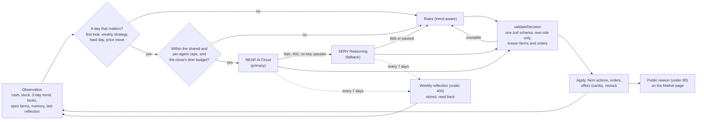

**AI farms that enter.** Beyond the two base rivals, new AI farms (Early Bird Eggs, the Cluck Collective, Gilded Roost
Estates, Pennywise Poultry: a registry in [`agents/entrants.ts`](apps/server/src/agents/entrants.ts), with their own
personas, the Upstart's or Old Money's looks, smaller starts) enter on their own. At each day close, after three days
of supply under demand or a rival's bust in the last five days, one enters with chance 25%; with fewer than two AI farms
open, one enters at once; never more than

$$
\text{cap} = \max\left(4,\ \lfloor 1.5 \times \text{active player farms} \rfloor\right).
$$

Every AI farm and agent wears an **AI** tag on the Market page and the ticker. Agent wallets are now a reusable pool:
a wallet whose agents are all bust (any kind) goes to the next new agent, and no wallet is funded while one is free;
each wallet created and its funding is recorded, and the server logs the pool's size and the NEAR spent.

**Thirty days, five seeds, with entrants** (`apps/server/test/sim.test.ts`): the median day stays in 0.8 to 1.3x, every
seed has gluts, rivals go bust on their own, and the AI farm count stays between 2 and its cap every day.

| Seed | Median | Lowest | Glut days | Rival busts | Entrants |
|---|---|---|---|---|---|
| 1 | 1.16x | 0.48x | 8 | 1 | 2 |
| 2 | 1.11x | 0.46x | 8 | 2 | 2 |
| 3 | 1.16x | 0.49x | 10 | 1 | 1 |
| 4 | 1.10x | 0.46x | 7 | 1 | 2 |
| 5 | 0.97x | 0.40x | 7 | 1 | 2 |

**Model against rules.** The comparison runs a recorded stand-in model, so every run repeats exactly
(replies authored in character and replayed by situation, with some unusable ones) against the rules, 30 days over the
same five seeds. It is a stand-in, not a measurement of a real model. What a real model would cost at the live pace is
in [Honest AI](#honest-ai-a-provider-chain-under-one-spend-cap-13-november-2026) below. The full write-up, the per-day
entrant counts and the cost table: [docs/agents.md](docs/agents.md).

</details>

<details>
<summary><b>Honest AI: a provider chain under one spend cap (13 November 2026)</b></summary>

## Honest AI: a provider chain under one spend cap (13 November 2026)

**What decides.** Agent decisions run on a provider chain: NEAR AI Cloud is the primary model, SERV Reasoning is the fallback, and rule-based strategies are the last resort, all under a hard daily spend cap. Every agent has its own wallet, memory and
personality. The chain is NEAR AI Cloud first, then SERV Reasoning (OpenServ's OpenAI-compatible API), then the rules.
To see which one is deciding right now, hover the AI tag on any AI farm in the game (its tooltip names the live mode), or read the server's startup log. Each provider has a
breaker: a refusal (401, 402, 403) skips it for 30 minutes, a 429 backs off from 30 seconds to 10 minutes, a 5xx or a
timeout skips it for 2 minutes; the change is logged once, not every call. The server reports the mode (`nearai`,
`serv` or `rules`: the provider that answered within the last seven in-game days) in the market state and for each
agent, and the game's words follow it: the AI tag's tooltip, the How to play guide and an AI farm's profile name the
provider that is deciding, or say "rule-based strategy" while none is.

**What it costs.** A model is asked only when it matters: an agent's first look, its weekly strategy (the reflection),
and at most once in three in-game days a hard day (a crash, a glut, cash under the struggle line) or a price move of 15%
since its last model decision. Routine days make no call. The observation lists the six most relevant farms with
rounded numbers, replies are capped (400 tokens a decision, 200 a reflection), and the same prompt to the same model
within a UTC day is answered from a cache. One shared cap covers every provider:

$$
\text{spend}_{\text{today}} + \text{reserve}_{\text{call}} \le \texttt{LLM\_DAILY\_CAP\_USD} = 1.50,
\qquad
\text{reserve} = 1.5 \times \frac{\text{chars}}{4} + \text{overhead} \ \text{in},\ \ \text{max tokens out}
$$

so no call is made once the day's cap is reached, until 00:00 UTC. Each agent also has its own caps (240 calls, failed
ones included, and a quarter of the shared cap), and all calls of one day close share 60 seconds. Every call is logged
(provider, model, tokens, estimated USD, outcome) and recorded per provider; a spend line is logged once a real hour,
and `/healthz` has an `ai` object (mode, each provider's state, today's USD, the cap, calls), never a key.

| At the live pace (480 in-game days a real day) | Calls a real day | NEAR AI Cloud (assumed prices) | SERV Reasoning (published prices) |
|---|---|---|---|
| Days that matter (default) | about 1,460 | 0.61 USD a day, 4.24 a week | 1.03 USD a day, 7.24 a week |
| A model on every agent day | about 3,930 | 1.95 USD a day (held at 1.50) | 2.38 USD a day (held at 1.50) |

One live SERV decision on `gpt-6-luna` (a real observation from a memory game) took 2,381 tokens in and 258 out, about
0.0005 USD, and passed the server's validation. Details: [docs/agents.md](docs/agents.md#provider-chain-and-cost-control).

</details>

<details>
<summary><b>The Feather Mint: random numbers, instant mints and the press (13 November 2026)</b></summary>

## The Feather Mint: random numbers, instant mints and the press (13 November 2026)

**Its own page.** The Feather Mint lives at [`/mint`](https://yolkstreet.25th.dev/mint) and opens without entering the
farm; signing in is needed only to mint. It opens from the title (**MINT**), the top bar (**MINT**) and the market
board. In order: the hero line ("Earn tickets on your farm. Mint a Feather. Each Feather is planned to hatch into one
of 777 Founding Hens at mainnet launch."), your tickets and grade with **MINT A FEATHER**, the Feathers left of 777 and
by grade, each grade's odds of a hen at the reveal (estimates that lock at the reveal), the recent mints with their
farms and grades, all 777 in pages that fit the window (filters: grade, minted, not minted, mine), and the provenance
hash and the contract at the foot. Like every screen, it fits the window at every size without a scrollbar.

| 1920x1080 | 390x844 |
|---|---|
| 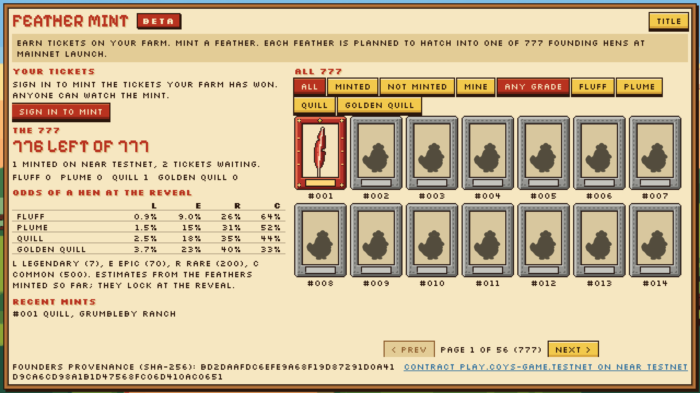 | 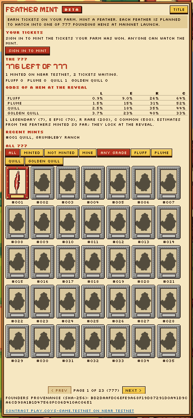 |

**Random numbers.** A Feather used to take the next number in mint order. Now the server draws a random free number from
001 to 777 when the ticket is redeemed, from a seed anyone can check: the SHA-256 of the season, the ticket and the
season's latest settlement transaction on NEAR (fixed before the redemption, and not the server's to choose):

$$
\text{seed} = \mathrm{SHA256}(\texttt{coys-mint|season|ticket|anchor}), \qquad n_i = 1 + \big(\mathrm{SHA256}(\text{seed}\,|\,i)_{0..3} \bmod 777\big)
$$

and the number is the first $n_i$ ($i = 0, 1, 2, \dots$) not taken yet. The seed, the anchor and the number are logged
and kept with the ticket, so a draw can be replayed. Feather #001 (the Quill minted on day 577) keeps its number.

**Instant mints.** Redeeming a ticket now mints its Feather at once, paid by the game, through the contract's new
`mint_feather` (version 6, below): one mint at a time, every RPC call paced and retried with backoff (1.5, 3, 6 and 12
seconds) when NEAR refuses it. A mint that cannot go out yet (no wallet linked, the game account under its margin)
waits and goes again when the wallet is linked or at the next day close. A mint refused after its retries holds the
ticket again and refunds its 25 coins; minting it again draws the same number. A number the contract already holds is
replaced by the next one in the same stream. The settlement is otherwise unchanged (it has since moved to one call per ten days); it no longer carries Feathers.

```mermaid
sequenceDiagram
  participant P as Player
  participant S as Game server
  participant C as Contract (NEAR testnet)
  P->>S: MINT (redeem a held ticket)
  S->>S: fee, grade from the score, number drawn (seed logged)
  S-->>P: ticketRedeemed, mintSent
  S->>C: mint_feather (paced; backoff on 429)
  alt confirmed
    C-->>S: token id, transaction
    S-->>P: featherMinted (CONFIRMED, receipt)
  else refused after retries
    S->>S: ticket held again, fee refunded
    S-->>P: mintFailed (RETRY)
  end
```

**The minting moment.** MINT plays the press: the ticket drops into the hopper, the press squashes down with a thump
(a hitstop, a shake, the stamp and crate sounds) and stamps the card out face down; then **SENT TO NEAR** and
**CONFIRMED** light with the receipt, the card flips to the Feather and a stamp lands (confetti, a sparkle and a harder
shake for a Quill or a Golden Quill). If the mint fails, it says the ticket and the coins are back, with **RETRY**. The
press is a new sheet made from the game's own art (the grader standing in the egg crate, the Fluff feather, the
unminted card frame, the particle sheet), uploaded to `@25th/game-11` by the Spawn agent account `gama` (Spawn commit
`1e5785c`) and backed up in coys-assets (PR #5, `x-mint-press`).

| | 1920x1080 | 390x844 |
|---|---|---|
| Confirmed | 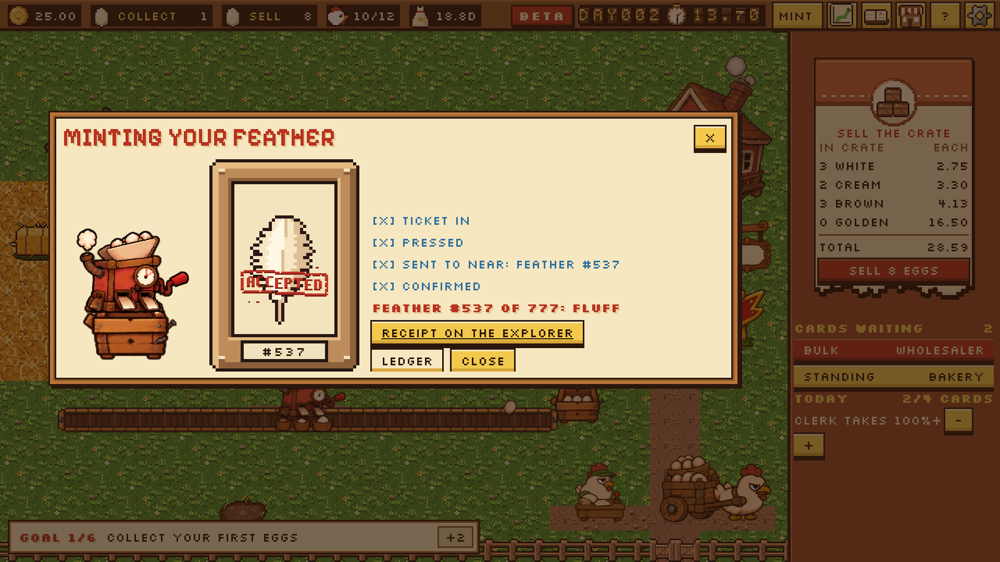 | 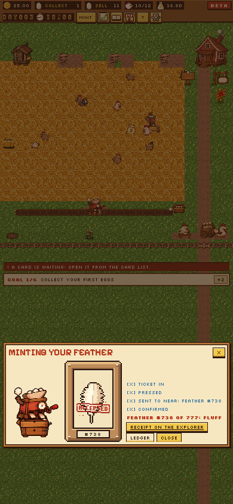 |
| Refused | 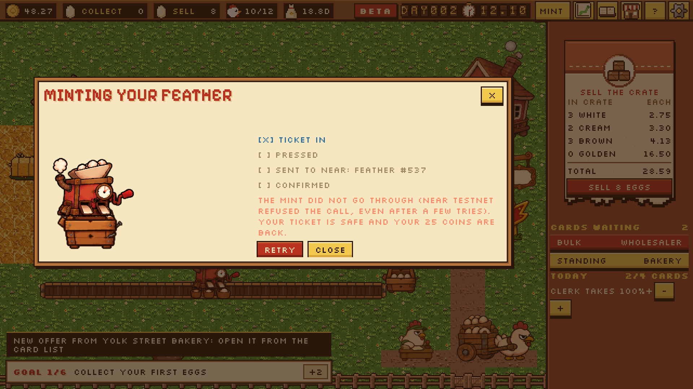 | 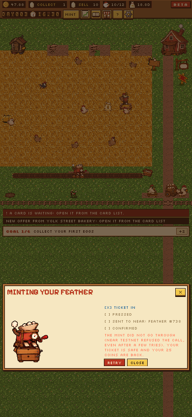 |

**Contract version 6.** `mint_feather` mints one Feather now, owner only, with the number the server drew. The live
season's Feathers are the 777 (token ids `001` to `777`, the cap checked first); any other season's go into its own
test collection (`test-<season>-NNN`) that never counts toward the 777, so a test season can mint for real without
touching the real supply. Built in CI (run 43360778799, sha256 `d6c85dd9...`, 389,151 bytes, sandbox tests including the
upgrade from version 5) and deployed and migrated on `play.coys-game.testnet` in one transaction
([`8aADyAiD...`](https://testnet.nearblocks.io/txns/8aADyAiDPopPb67ZnY9WATvLM6jz7XjyWAgocF9o174r)): 1 of 777 minted,
live season `s1`.

**Checked live on testnet.** A test farm in the test season `verify-mint-1`, its wallet the game account:

- a mint whose RPC calls were all refused (the writer pointed at an unresolvable testnet host): retried at 1.5, 3, 6 and
  12 seconds, reported failed, the ticket held again with its 25 coins back and its seed kept;
- the same ticket minted for real: the same number, `test-verify-mint-1-737`
  ([`J8D9sqrt...`](https://testnet.nearblocks.io/txns/J8D9sqrtx6Pbin58k48hDJLtpEagJj5VSryPzZ6t7pMA)), and a second
  ticket `test-verify-mint-1-091`
  ([`85tSsXN1...`](https://testnet.nearblocks.io/txns/85tSsXN1rJKF735xc2827LNCJ3meCxzb9oK8RY8AWLBn)); afterwards the
  contract still reads 1 of 777 minted.

</details>

<details>
<summary><b>Farm zones and machine wear (13 November 2026)</b></summary>

## Farm zones and machine wear (13 November 2026)

**Zones with real room.** The grader, the clerk's desk and the delivery cart used to stand crammed together at the
belt's end, touching, under labels stacked on top of each other (the layout tests checked only that footprints did not
overlap and that connections met). The layout spec ([pixi/farm/layout.ts](apps/client/src/pixi/farm/layout.ts)) now
lays the farm out in zones: the coops and the straw yard; the **feed corner** at the yard's far end (the trough, the
hopper behind it with its spout over the feed, the sack a hen's width away); the farmhouse; the **production line**
(the belt runs from the field, through the grader partway along it, and ends at the crate, which stands clear); the
**market stall**, the clerk's desk by the path facing it (by the gate on a tall farm, at the line's end on a short one);
and the **cart bay** on the path by the gate, from where the cart drives out. Labels show on hover, for a moment after a
tap, and once when a machine arrives, one at a time, where they cover nothing else.

Every two things standing on the ground keep at least a hen's width between their footprints, except the pairs built to
touch (belt and grader, belt and crate, hopper and trough), which meet only at their connection points; zones keep at
least 8 world pixels apart; and each machine's label has a place that covers nothing else. `test/spacing.test.ts`
checks all of it at 41 window sizes and ratios, and the hen tests still check every walk.

| | 1280x720 | 1920x1080 | 390x844 |
|---|---|---|---|
| Before | 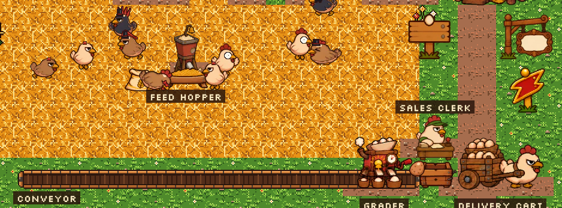 | 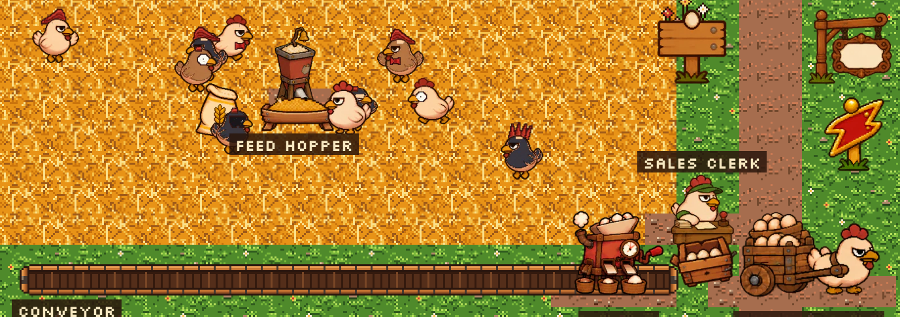 | 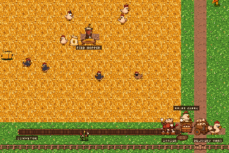 |
| After | 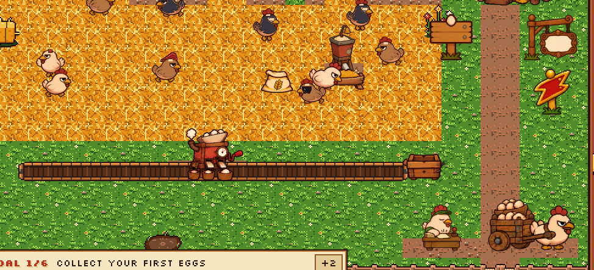 | 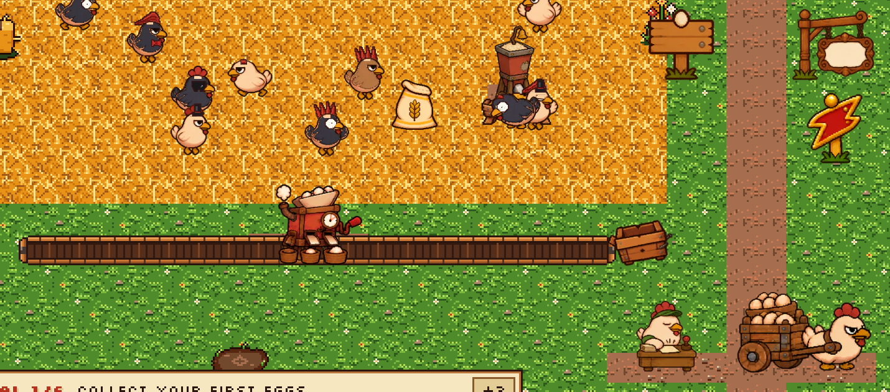 | 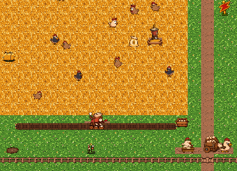 |

**Machine wear.** A machine used to work forever once bought. Now each has a condition from 100% to 0%, falling each
in-game day it works (conveyor 1%, grader 1.5%, hopper 1%, clerk 1%) and 1% per delivery for the cart. Its effect is
full at 50% and over and falls in line below; under 20% each day close may break it (15%), and a broken machine stops
(the belt carries nothing, the grader and clerk add nothing, the cart delivers nothing, the hopper pours nothing) until
it is repaired from its card. For a machine $m$ at condition $c$:

$$
\text{effect}(c) = \min\left(1, \frac{c}{0.5}\right)\ (0 \text{ when broken}), \qquad \text{repair}(c) = 0.4 \times \text{price}_m \times (1 - c)
$$

The card shows the condition, the effect now and **REPAIR FOR** its price; hints come under 30% and on a breakdown. A
worn machine (under 50%) shows its worn look and wobbles as it works; a broken one stands still, greyed, with smoke
rising, and its sound stops. The breakdown is a last sputter, a clunk, dust and steam; the repair is hammer taps, a
sparkle and the start-up sound. The worn and broken looks are new sheets made from the machines' own art (rust and dents
in their own pixels, the particle sheet's steam), uploaded to `@25th/game-11` by the Spawn agent account `gama` (Spawn
commit `cd7282d`) and backed up in coys-assets (PR #4, `18c` to `22c`). How to play and the tour explain wear.

**Payback.** Measured on a reference farm (20 hens, standard feed, a 1.00x market, one bakery contract of 6 eggs a day
that a player without the cart misses 3 days in 10; `machinePayback` in `packages/shared`). "Earned before repair"
counts the days from 100% to the breakdown zone, those under 50% at their share. At the old prices the cart (231 days to
pay back), the hopper (104) and the clerk (170) did not earn their price before their first repair; the config now has
cart 35 (was 120), hopper 60 (was 100) and clerk 60 (was 160). Nothing else changed.

| Machine | Price | Wear | Coins a day | Days to pay back | Repair due (day) | Earned before repair | Net over 150 days, repaired | Never repaired |
|---|---|---|---|---|---|---|---|---|
| Conveyor | 40 | 1.0% a day | 0.60 | 67 | 80 | 42 | 22 | 4 |
| Grader | 80 | 1.5% a day | 1.88 | 42 | 53 | 89 | 120 | 14 |
| Delivery cart | 35 | 1.0% a delivery | 0.52 | 68 | 80 | 37 | 19 | 3 |
| Feed hopper | 60 | 1.0% a day | 0.96 | 63 | 80 | 68 | 43 | 10 |
| Sales clerk | 60 | 1.0% a day | 0.94 | 64 | 80 | 67 | 41 | 9 |

Owning all five without ever repairing earns 40 over 150 days against 245 when they are kept repaired (expected values;
a test holds every machine to paying back before its repair and never-repairing to under half). The five-seed market
simulation still meets its targets.

</details>

<details>
<summary><b>Farm names, privacy and the new tour (13 November 2026)</b></summary>

## Farm names, privacy and the new tour (13 November 2026)

**Farm names.** A farm used to be named after its player at sign-in, and an email sign-in with no name typed sent the
email's local part, so farms on the public board, in trades and on cards carried names made from email addresses. Now:

- the game never receives an email: the client sends only the SHA-256 of the email name's letters and digits and their
  count (the server keeps that hash to refuse farm names that contain it), and the server ignores any name an email
  sign-in sends;
- a new farm gets a goofy generated name ("Cluckingham Acres", "Yolkshire Roost") from farm word lists (no real people
  or brands), and the first visit opens **NAME YOUR FARM**: the farm's sign shows the name as it is typed, **SHUFFLE**
  draws another, **CONFIRM** keeps yours, closing keeps the generated one;
- names are 3 to 24 characters of letters, numbers, spaces and simple punctuation, unique in the season (case aside),
  pass a basic rude-word filter (with disguises undone, and farm words such as cockerel allowed), and never contain the
  player's email name; **SETTINGS** renames the farm once an in-game week;
- farms named before this (the three player farms of `s1`) get a generated name at boot, their old names leave the
  player rows and recorded trades, and their owners are asked to choose a name on their next visit;
- server logs replace anything shaped like an email address.

A test signs in two email players the way the client does (an older client even sending the email name), lets them
trade with each other and the street, closes a day, and checks every WebSocket message, the public market and mint page,
and the player rows: no email and no four-letter piece of either email name anywhere. Three committed screenshots showed
a player's email-derived farm name; they are replaced with the same screens from the test server
([board](docs/screenshots/live-board.png), [tour over the board](docs/screenshots/live-tour-glut.png),
[board at 2560x1440](docs/screenshots/founders-board-founding.png)). History was not rewritten at first; later
that day it was (brief 10), so no commit in this repository holds those files now.

**The tour.** Its box used to sit in the bottom-left corner with only BACK and SKIP (which ended it). Now the box sits
beside what it highlights, with a pointer, never over it; inside the farm's area and clear of the top bar, the side
panel, the goal tracker and the toasts; centred when a step has no target ([ui/tourPlace.ts](apps/client/src/ui/tourPlace.ts)
tries each side and four widths, so it fits a phone's farm band too). It is larger, says **STEP 3 OF 11** (13 steps since) with dots, says
what to do on a highlighted line, and drops in with anime.js over a dimmed window with a spotlight. Every step has
**BACK**, **SKIP STEP** and **END TOUR** (which asks once more; **REPLAY THE TOUR** in Settings brings it back), and
**NEXT** appears after five seconds so nobody is stuck on a step that waits for an action. A new player sees it on first
entry, after naming the farm, with no click. `e2e/tour.test.ts` checks at 1280x720, 1920x1080, 390x844 and 360x640 that
on every step the box stays on screen, off its target and clear of the UI zones, and that every control works.

**CI.** The browser checks (`e2e/`) run in their own workflow, `layout`, on pull requests only, and not for changes to
docs alone.

**Checked live** (yolkstreet.25th.dev, 13 November, two temporary players signed in the way an email sign-in does, with
made-up emails whose name guards alone reached the server; both removed afterwards): one shuffled, chose a name, then
renamed it in Settings (the next rename waits a week); the other kept the generated name. Every WebSocket message they
received and the public market and mint payloads held no email-like text, no five-letter piece of either made-up email,
and no run of letters matching any stored name guard (the three renamed farms' old names included, checked by hash).
The same hash check over every tracked text file and every commit message in the repository finds none. On a phone
whose farm is too short for the tour box beside its target, the box now sits below the farm, pointing up.

| | Step 1 | Step 4 | Step 10 |
|---|---|---|---|
| 1920x1080 | 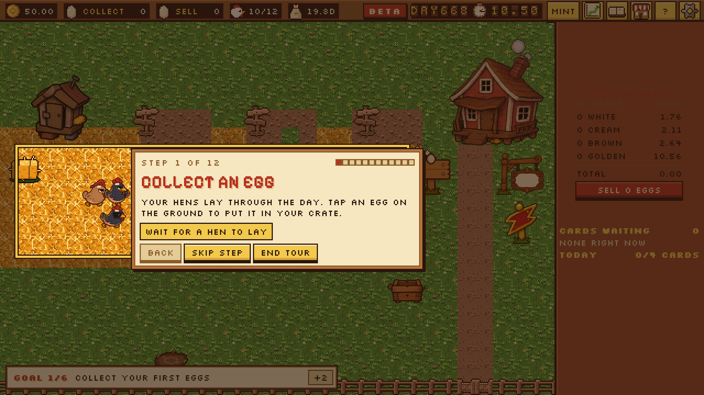 | 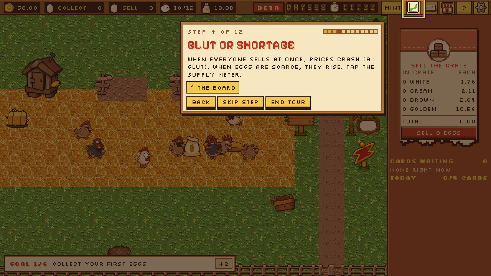 | 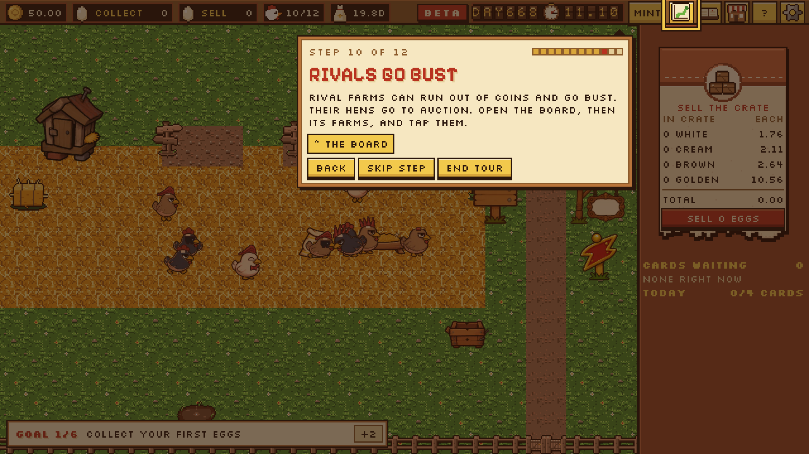 |
| 390x844 | 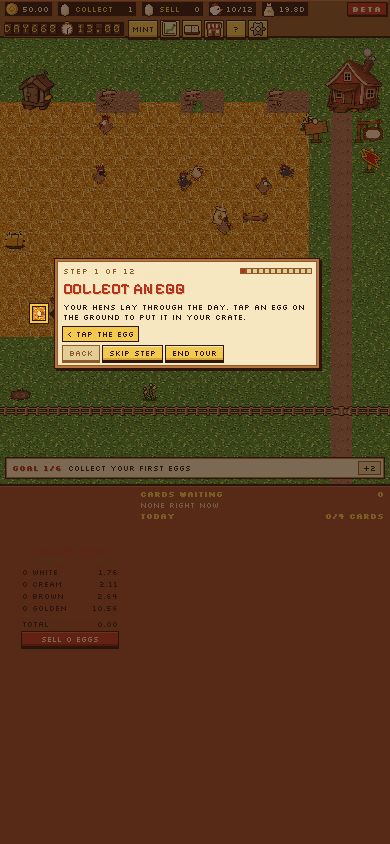 | 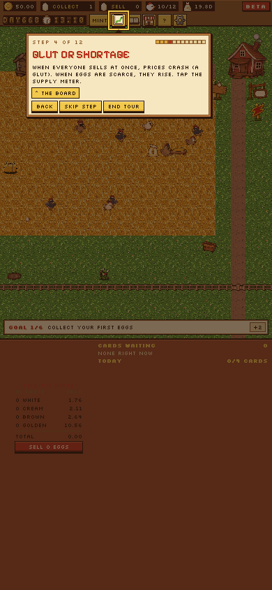 | 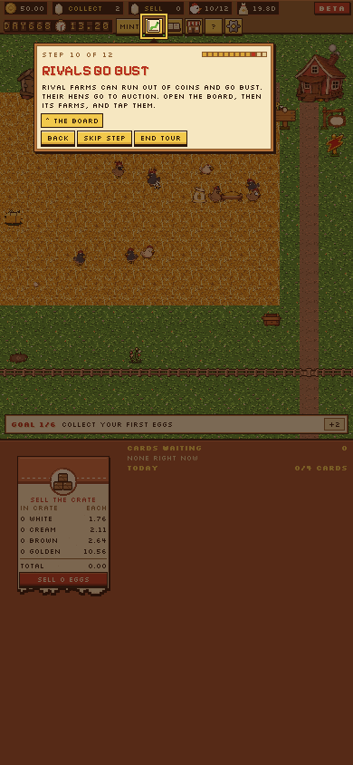 |

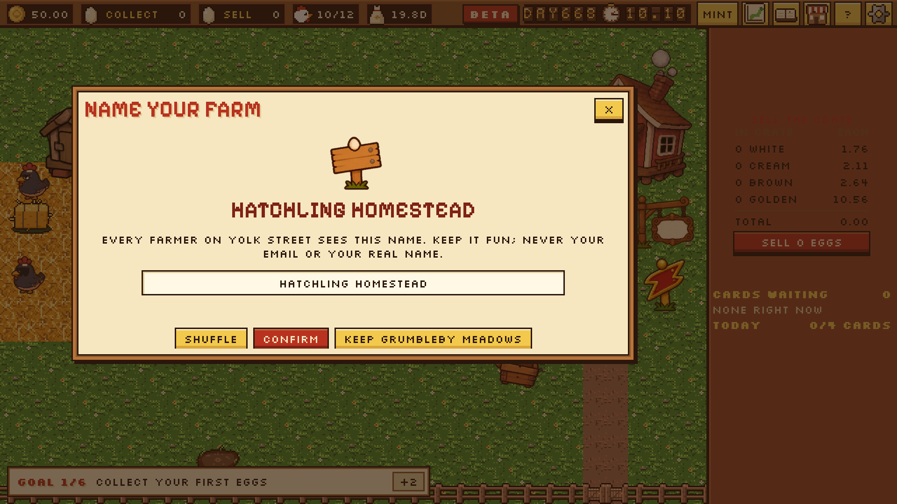

</details>

<details>
<summary><b>Scaling, no scrollbars, a clean conveyor and the 777 restored (12 November 2026)</b></summary>

## Scaling, no scrollbars, a clean conveyor and the 777 restored (12 November 2026)

**One scale for every sprite.** Hens came out at different sizes after a resize, and walked out of their areas and over
standing objects. The size bug had one cause: the sprite store cached each animation's frames under a key that changed
only when an atlas page finished downloading, while each sprite's on-screen size was computed from the density in use
now. After a window change that moved the world to another painted density (say 3 to 4 texels per world pixel), a hen
built from the cached frames of the old density came out at 4/3 of her size, or 3/4. The cache key now carries the
density each sprite group is drawn at, so a frame and its scale always agree; a test resizes through the densities
2, 3, 4, 6 and 8 and back and checks that a hen keeps her size (26.1 world pixels tall, the size table's value).

$$
\text{on-screen size} = \frac{\text{frame texels}}{\text{texels per world pixel}} \times k \quad\text{with both read at the same density}
$$

**Hens keep to their areas.** Where hens may walk now comes from the layout spec
([`pixi/farm/movement.ts`](apps/client/src/pixi/farm/movement.ts)): the straw yard, and the path from the porch that new
hens arrive by, turning into the yard in the gap below the farm sign (they used to cross the belt row). Every standing
object (trough, sacks, hopper, props, signs, machines, coops) is a keep-out box from its lower art down to its footprint,
a hen's half width wider; a hen's feet never stand in one, and every walk goes round them by a box corner. Unbuilt coops
and machines not bought leave their ground free. On a resize every hen (and every egg on the ground) is carried to the
same place relative to the yard in the new layout, then to the nearest free spot, instead of keeping a stale world
position. Positions are world units throughout. Tests sweep 41 window sizes and ratios (3440x1000 to 600x1900), with and
without machines: arrival, entry, trough places, 40 random spots and 40 routed walks a layout, every one walkable and off
every footprint, and a resize sequence (wide, narrow, phone, tall, wide) that carries 31 hens and checks each.

**No scrollbars anywhere.** Nothing scrolls: content that cannot fit becomes pages or tabs, measured as drawn
([`ui/Paged.tsx`](apps/client/src/ui/Paged.tsx)). Each panel says how tall it may grow; each list is packed into pages
that fit what is left, with PREV and NEXT and the page number, and splits differently at every window size. Scrollbars
are hidden only as the last safeguard, after the content fits.

| Screen | Before | Now |
|---|---|---|
| How to play | 13 sections in a list; the glossary and milestones scrolled | one section at a time with PREV and NEXT (a long one in pages); the list of sections stays beside it when the window is wide |
| Ledger | days in a 120-pixel scroll box, then contracts, Feathers and milestones below | tabs DAYS, CONTRACTS, FEATHERS, MILESTONES; days paged |
| Market board | prices and the farm ranking side by side (names cut off on phones) | tabs BOARD, FARMS, ORDERS, TRADES; ranking, order book and trades paged; names wrap |
| Shop | the hen tiles scrolled | hen tiles in a grid paged to fit; coops and machines paged |
| Mint page | one long page (up to 821 pixels past the window) | tabs YOUR TICKETS, ALL 777, ODDS, ABOUT; the 777 slots in a grid paged to fit |
| Settings | 8 to 10 pixels too wide on every window; a scroll box on the title | sliders take the width left; sound rows paged |
| Side panel | 2 pixels too narrow for the sell card; the desk scrolled | the card fits exactly; the desk is paged |
| Toasts | long messages cut with an ellipsis | messages wrap; only the newest that fit are shown |

`e2e/no-scroll.test.ts` opens the built game in a fresh headless browser at 12 window sizes (1280x720, 1440x900, 1920x1080, 2560x1440, 390x844 and 360x640, and in between 1024x640, 1180x820 on a 2x screen, 1680x1050, 768x1024, 1024x768 and 412x915) and, at each, checks the title and
its settings, all 11 tour steps (13 now), the farm, every modal, tab and page (shop, market, ledger, settings, guide, mint page),
every card the farm's things open and an offer: no element scrolls or clips its content, and the page never scrolls. It
runs in CI (job `layout`, on the runner's own Chrome). Screenshots of every screen: [docs/screenshots/](docs/screenshots).

<details>
<summary><b>Every screen, tab and tour step</b> at 1280x720 and on a phone (390x844), from the browser check</summary>

<br>

| | |
|---|---|
| 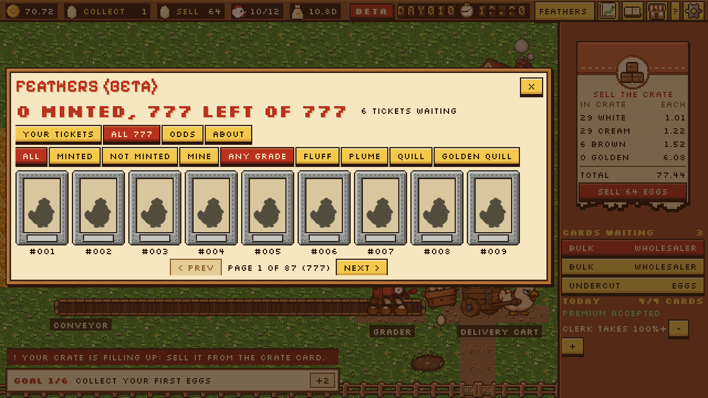 | 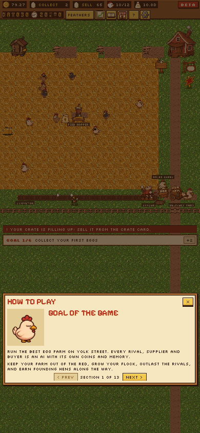 |

| Screen | 1280x720 | 390x844 (phone) |
|---|---|---|
| Title | [title-1280x720.png](docs/screenshots/title-1280x720.png) | [title-390x844.png](docs/screenshots/title-390x844.png) |
| Title settings | [title-settings-1280x720.png](docs/screenshots/title-settings-1280x720.png) | [title-settings-390x844.png](docs/screenshots/title-settings-390x844.png) |
| Farm | [farm-1280x720.png](docs/screenshots/farm-1280x720.png) | [farm-390x844.png](docs/screenshots/farm-390x844.png) |
| Tour step 1 | [tour-step-1-1280x720.png](docs/screenshots/tour-step-1-1280x720.png) | [tour-step-1-390x844.png](docs/screenshots/tour-step-1-390x844.png) |
| Tour step 10 (Feathers) | [tour-step-10-1280x720.png](docs/screenshots/tour-step-10-1280x720.png) | [tour-step-10-390x844.png](docs/screenshots/tour-step-10-390x844.png) |
| Shop: hens | [shop-shop-hens-1280x720.png](docs/screenshots/shop-shop-hens-1280x720.png) | [shop-shop-hens-390x844.png](docs/screenshots/shop-shop-hens-390x844.png) |
| Shop: feed | [shop-shop-feed-1280x720.png](docs/screenshots/shop-shop-feed-1280x720.png) | [shop-shop-feed-390x844.png](docs/screenshots/shop-shop-feed-390x844.png) |
| Shop: coops | [shop-shop-coops-1280x720.png](docs/screenshots/shop-shop-coops-1280x720.png) | [shop-shop-coops-390x844.png](docs/screenshots/shop-shop-coops-390x844.png) |
| Shop: machines | [shop-shop-machines-1280x720.png](docs/screenshots/shop-shop-machines-1280x720.png) | [shop-shop-machines-390x844.png](docs/screenshots/shop-shop-machines-390x844.png) |
| Board | [market-market-board-1280x720.png](docs/screenshots/market-market-board-1280x720.png) | [market-market-board-390x844.png](docs/screenshots/market-market-board-390x844.png) |
| Board: farms | [market-market-farms-1280x720.png](docs/screenshots/market-market-farms-1280x720.png) | [market-market-farms-390x844.png](docs/screenshots/market-market-farms-390x844.png) |
| Board: orders | [market-market-orders-1280x720.png](docs/screenshots/market-market-orders-1280x720.png) | [market-market-orders-390x844.png](docs/screenshots/market-market-orders-390x844.png) |
| Board: trades | [market-market-trades-1280x720.png](docs/screenshots/market-market-trades-1280x720.png) | [market-market-trades-390x844.png](docs/screenshots/market-market-trades-390x844.png) |
| Ledger: days | [ledger-ledger-days-1280x720.png](docs/screenshots/ledger-ledger-days-1280x720.png) | [ledger-ledger-days-390x844.png](docs/screenshots/ledger-ledger-days-390x844.png) |
| Ledger: contracts | [ledger-ledger-contracts-1280x720.png](docs/screenshots/ledger-ledger-contracts-1280x720.png) | [ledger-ledger-contracts-390x844.png](docs/screenshots/ledger-ledger-contracts-390x844.png) |
| Ledger: Feathers | [ledger-ledger-feathers-1280x720.png](docs/screenshots/ledger-ledger-feathers-1280x720.png) | [ledger-ledger-feathers-390x844.png](docs/screenshots/ledger-ledger-feathers-390x844.png) |
| Ledger: milestones | [ledger-ledger-milestones-1280x720.png](docs/screenshots/ledger-ledger-milestones-1280x720.png) | [ledger-ledger-milestones-390x844.png](docs/screenshots/ledger-ledger-milestones-390x844.png) |
| Settings | [settings-1280x720.png](docs/screenshots/settings-1280x720.png) | [settings-390x844.png](docs/screenshots/settings-390x844.png) |
| How to play | [guide-1280x720.png](docs/screenshots/guide-1280x720.png) | [guide-390x844.png](docs/screenshots/guide-390x844.png) |
| Mint page: tickets | [mint-page-your-tickets-1280x720.png](docs/screenshots/mint-page-your-tickets-1280x720.png) | [mint-page-your-tickets-390x844.png](docs/screenshots/mint-page-your-tickets-390x844.png) |
| Mint page: all 777 | [mint-page-all-777-1280x720.png](docs/screenshots/mint-page-all-777-1280x720.png) | [mint-page-all-777-390x844.png](docs/screenshots/mint-page-all-777-390x844.png) |
| Mint page: odds | [mint-page-odds-1280x720.png](docs/screenshots/mint-page-odds-1280x720.png) | [mint-page-odds-390x844.png](docs/screenshots/mint-page-odds-390x844.png) |
| Mint page: about | [mint-page-about-1280x720.png](docs/screenshots/mint-page-about-1280x720.png) | [mint-page-about-390x844.png](docs/screenshots/mint-page-about-390x844.png) |
| A hen | [card-hen-1280x720.png](docs/screenshots/card-hen-1280x720.png) | [card-hen-390x844.png](docs/screenshots/card-hen-390x844.png) |
| A machine | [card-machine-1280x720.png](docs/screenshots/card-machine-1280x720.png) | [card-machine-390x844.png](docs/screenshots/card-machine-390x844.png) |
| The crate | [card-crate-1280x720.png](docs/screenshots/card-crate-1280x720.png) | [card-crate-390x844.png](docs/screenshots/card-crate-390x844.png) |
| Feed | [card-feed-1280x720.png](docs/screenshots/card-feed-1280x720.png) | [card-feed-390x844.png](docs/screenshots/card-feed-390x844.png) |
| A coop | [card-coop-1280x720.png](docs/screenshots/card-coop-1280x720.png) | [card-coop-390x844.png](docs/screenshots/card-coop-390x844.png) |
| The farmhouse | [card-farmhouse-1280x720.png](docs/screenshots/card-farmhouse-1280x720.png) | [card-farmhouse-390x844.png](docs/screenshots/card-farmhouse-390x844.png) |
| An offer | [offer-card-1280x720.png](docs/screenshots/offer-card-1280x720.png) | [offer-card-390x844.png](docs/screenshots/offer-card-390x844.png) |

Tour steps 2 to 9 and 11 are beside them (`tour-step-N-1280x720.png`, `tour-step-N-390x844.png`).

</details>

**A clean conveyor.** The belt's art had eggs painted on it, so eggs that were not there rode the belt. A new sheet,
`conveyor-clean`, was created in 25TH's Spawn world `@25th/game-11` (Spawn commit `9ee1f6c`, a new upload and its
record; the old belt and every other asset untouched): the same 512x640 sheet, 16x16 frames at 8x, five rows of four
frames at 100 ms, the same outline and palette, with each egg pixel given the belt surface of its own frame (432 of 5120
art pixels). It was pulled back byte for byte (`6180dedd...dcde6`), backed up in coys-assets as `18b-conveyor-clean`
(PR #3, hashes verified) and replaces the old belt on the farm and in the shop. A test checks every frame of the
belt at every level, and the packed sheet, for the two egg colours: none.

**The 777 restored.** The three test Feathers (#001 to #003, minted on 12 November in the test season
`verify-feathers-1`) counted against the cap, so the board read 774 of 777. Contract version 5 burns Feathers of a
season that is not the live one and returns their numbers to the supply (the next mints reuse them, smallest first);
it was sandbox-tested against the exact version 4 code, then deployed in place. From now on only the contract's live
season mints Feathers, and a Feather belongs to the season that mints it: a test season cannot mint against the real
777, enforced by the contract (version 5) and by the server (it sends no mints for a season that is not the live one),
with tests for both.

| Step | Transaction |
|---|---|
| Upgrade to version 5 with `migrate` (wasm `7fa2c060...abbfa2d`, CI build) | [4h7ZEQkP...](https://testnet.nearblocks.io/txns/4h7ZEQkPG66zVmNrNvLr8W3b9dyBYmQoFibEBFCWuN92) |
| `set_live_season("s1")` | [6WTTxYay...](https://testnet.nearblocks.io/txns/6WTTxYaySdGt8DggxzAgGCzYJb5AUg1VxUV1QS3SVGxF) |
| `burn_test_feathers(["001", "002", "003"])`: 0 minted, 777 remaining | [2uVuUnQ5...](https://testnet.nearblocks.io/txns/2uVuUnQ52oEQGrgfozpL83PhKw3duat69eB1HZzkdzVo) |

**Days 509 and 510 settled.** Their day closes failed on 12 November when the public RPC refused a burst of reads (429);
day 511 had already caught every egg balance up. Version 5 records a missed day late, by the SHA-256 of its full
settlement, once the season has moved past it: each day's settlement was rebuilt from the database (supply,
multiplier, every farm's net from the ledger; no egg moves) and both went in one call. The contract folds them into a
late record per season:

$$
h_0 = 0^{64},\qquad h_i = \mathrm{SHA256}\big(h_{i-1}\,|\,\text{season}\,|\,\text{day}_i\,|\,\text{digest}_i\big)
$$

| Day | Supply | Multiplier | Farms with a net | Digest |
|---|---|---|---|---|
| 509 | 55 | 1.594 | 1 | `d2eebe0e48f264177a9d04976ab8e21acbfd60401cd18332992034dd628286b7` |
| 510 | 101 | 1.867 | 2 | `ccbf1bb8c1e8873c40cbbb59874d35e4735b5ee639d694988988c22c0dd8e821` |

Transaction [ANKGbgth...](https://testnet.nearblocks.io/txns/ANKGbgthoMpqTw6M6CmZQRz87NKWYqBhyjebMdYjaM8g); the
contract's `late_days("s1")` reads days `[509, 510]` with hash `5f5dbd6d...4f96c`, which anyone can recompute from the two
digests above. No closed day of `s1` is unsettled. From now on, each day close that settles also records any earlier
missed day of the season the same way (one paced call, up to ten days), unless the contract's count of settled days
disagrees with the database, when a day marked failed may have landed after all and a person should look.
`npm run settle-late-days -- --season s1 --dry-run` lists missed days and their digests.

</details>

<details>
<summary><b>The Feathers beta, compact settlement and the layout spec (12 November 2026)</b></summary>

## The Feathers beta, compact settlement and the layout spec (12 November 2026)

**Feathers.** Hens are never minted. The beta mints **Feathers** only: NEAR testnet NFTs that are claim tickets for the
**777 Founding Hens**, planned to be revealed and minted as hens at the mainnet launch. Only 777 Feathers will ever exist,
a cap the contract enforces. Everything about them, including how to audit a roll and the reveal, is in
[docs/founding-hens.md](docs/founding-hens.md); the mainnet path is a plan, [docs/mainnet-plan.md](docs/mainnet-plan.md),
and a checklist, [docs/mainnet-checklist.md](docs/mainnet-checklist.md), with no mainnet action taken.

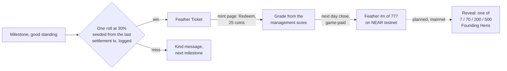

A farm in good standing (never bust this season, no credit past due, no delivery missed in the last 3 in-game days) gets
one roll at each of seven milestones, once. A win is a **Feather Ticket**. On the **mint page** (FEATHERS in the top bar,
or the market board) the player redeems a ticket for 25 coins: its grade comes from the farm's management score at that
moment, and the next day close mints the Feather to the player's wallet, numbered 001 to 777 in mint order, the game
paying the testnet gas and storage.

$$
s = 0.30\,\min\!\Big(1, \tfrac{\text{good days}}{30}\Big) + 0.25\,\text{delivery record} + 0.20\,\min\!\Big(1, \tfrac{\text{haggles won}}{20}\Big) + 0.25\,\min\!\Big(1, \tfrac{\text{profit}}{1000}\Big)
$$

| Grade | Score from | Card frame (from Spawn) | Weight toward Legendary, Epic, Rare, Common |
|---|---|---|---|
| Fluff | 0 | common | 1, 1, 1, 1 |
| Plume | 0.35 | rare | 2, 2, 1.5, 1 |
| Quill | 0.60 | epic | 4, 3, 2, 1 |
| Golden Quill | 0.85 | legendary | 8, 5, 3, 1 |

The grade sets the odds of a high-rarity hen, not the hen. The **777 Founding Hens** are already fixed: seeded
`founders.json` (server side only) with an original name, a rarity (exactly 7 Legendary, 70 Epic, 200 Rare, 500 Common),
traits and a palette for each, made by recolouring the existing hen layers in code, no look repeated; Legendary and Epic
palettes are theirs alone and every Legendary sparkles. Its SHA-256 `bd2daafd...` was committed on chain before the first
Feather. The planned reveal draws without replacement from a seed taken from a future public event, so it always yields
exactly 7/70/200/500 and anyone can reproduce it (Rust and TypeScript, one pinned vector; sandbox-tested only).

The **reveal moment**: the unminted card flips to the Feather card in its grade's frame, the feather shines, a stamp
lands, and "Planned to hatch into a Founding Hen at mainnet launch." shows with the receipt; Quill and Golden Quill add
confetti, a sparkle and a harder shake. The mint page shows minted and left of 777, by grade, the provenance hash and
the contract, the player's tickets with Redeem, each grade's estimated chance of each rarity from the Feathers minted so
far (labelled as an estimate that locks at the reveal), recent mints, and all 777 slots: minted ones as Feather cards,
the rest as the unminted frame with a dark hen silhouette and the number, with filters and pages.

**Compact settlement.** Contract version 4 (upgraded in place on `play.coys-game.testnet`) settles a day by storing only
a fixed-size head per season: the last day, the SHA-256 of that day's full settlement and a running hash chain. The full
settlement (every farm's net, every egg move, every Feather with its image hash) is kept as exact text in the game's
database (`market_days.settlement_json`), so any day can be checked against the chain. The call carries only the egg
moves, the net totals of the farms whose eggs move, and the day's Feathers.

| Per settled day (3-minute days, 480 a real day) | Before (version 2) | After (version 4) |
|---|---|---|
| Storage written | 179 bytes | 0 bytes (sandbox: 30 days with egg moves, 355,102 to 355,102 bytes) |
| Storage per real day | 85,920 bytes, about 0.86 NEAR locked | 0 |
| Gas | about 0.0004 NEAR | about 0.0004 NEAR (3 Tgas in the sandbox) |
| **Projected NEAR a real day** | **about 1.06** | **about 0.19** |

$$
\text{NEAR a real day} = 480 \times \Big(\text{bytes per day} \times 10^{-5} + \text{gas per day}\Big)
$$

Version 2's day records can be released: `prune_days` removes them in order and folds each into the season's archive
hash, after `scripts/release-chain-days.ts` has copied every record exactly as the chain returned it into the database
(`chain_archive`), so the history stays verifiable from the database plus hashes.

**The layout spec** (`apps/client/src/pixi/farm/layout.ts`, `spec.ts`) places every world object in world pixels with
its anchor, art bounds, footprint and connection points, measured on the art. Sizes come from one table relative to the
hen; painted art is cut at exactly those sizes when the atlases are built (no scaling at run time):

| Thing | Size vs the hen | Brief | Note |
|---|---|---|---|
| Hen (with her comb) | 1.0 (27.1 world px) | 1.0 | |
| Egg | 0.35 | 0.35 | the golden and jumbo brown eggs share the white egg's scale |
| Crate | 0.9 | 0.9 | |
| Trough (wide) | 1.4 | 1.4 | |
| Feed sack | 1.0 | 1.0 | |
| Coop: starter, red, deluxe | 2.2, 2.6, 3.2 | 2.2, 2.6, 3.2 | |
| Farmhouse | 3.6 | 3.6 | |
| Conveyor belt height | **0.59** | 0.4 | exact pixel art on the 16 px tile grid; 0.4 would need new art |
| Grader | 1.6 | 1.6 | |
| Delivery cart with hen | 1.6 | 1.6 | |
| Feed hopper | 2.0 | 2.0 | |
| Sales clerk at desk | 1.4 | 1.4 | |
| Signs | 1.4 | 1.4 | |
| Hay bale | **0.96** | 0.8 | exact pixel art; shrinking it would break its pixels |

The belt runs whole tiles from the field, in under the grader and out into the crate's side; the hopper's spout hangs over
the trough; the clerk's desk stands beside the crate facing the path; the cart is parked on the path against the crate;
the path runs from the porch steps through a gate in a fence that spans the width. Tests check every connection within
one world pixel, every size within 3.5%, and that no two footprints overlap, at the five screens and across a sweep of
farm sizes. `?debug=layout` draws anchors, bounds, footprints and connections (green when they line up).

**Assets from Spawn.** The four feathers (`feather-fluff`, `feather-plume`, `feather-quill`, `feather-golden-quill`) and
five card frames (`frame-common`, `-rare`, `-epic`, `-legendary`, `-unminted`) were pulled byte for byte from 25TH's Spawn
workspace `@25th/game-11` (each SHA-256 equals its content-addressed CDN name) and backed up in coys-assets (PR #2). No
new art was needed: the belt's start and end pieces, the pads, the fence and the gate already exist, and the silhouettes
and Founding Hen palettes are recolours of existing layers.

**Checked live** on 12 November 2026 (commit `4471029`, healthz OK), with one temporary check farm made through the
game's own `ensurePlayer` and removed afterwards (`scripts/remove-player.ts`, service stopped; no trades, no tickets).

| On chain (`play.coys-game.testnet`) | Transaction |
|---|---|
| Version 4 deployed with `migrate`, 20:30 UTC | [9jsFd4EA...](https://testnet.nearblocks.io/txns/9jsFd4EAZc3nkE4v11x4poVTMhLyYzPpuZKrsCud9J4s) |
| founders.json provenance `bd2daafd...` committed | [JBoKNVa6...](https://testnet.nearblocks.io/txns/JBoKNVa6Pi5jAb2BA4chAh8K43GGpWgw8AtHJy26b5AB) |
| Version 2 records of `s1` days 1 to 200 released | [F6VE65CK...](https://testnet.nearblocks.io/txns/F6VE65CKSg3bGsau1P9u9MZGyEjxWPu8XXG2SH4yohxq) |
| Days 201 to 400 released | [7RHumWmX...](https://testnet.nearblocks.io/txns/7RHumWmXks3QS9YmfnqLCewaqKGcQVzdoDTb1aPoZxtf) |
| Days 401 to 489 released; archive `cfe525e7...` | [3Wva5eNt...](https://testnet.nearblocks.io/txns/3Wva5eNte8hmPsb6CEh7Unk1nr1WVmET36px94ysjZuC) |
| Test season `verify-feathers-1`, a test farm: Feathers #001 Fluff, #002 Quill, #003 Golden Quill minted to its wallet (the game account) | [BFBD96ii...](https://testnet.nearblocks.io/txns/BFBD96iiCiatw79xgcpzysjf3rb6osjM2Z1Qk1QLJQ7g) |
| First compact `s1` day after the release, a settled day storing nothing | [31a2B6RG...](https://testnet.nearblocks.io/txns/31a2B6RG1SdWN2aoTSX5W3K3CwjFLoPHyjU5G4aiAxGK) |

- **Settlement cost, measured live.** Before: 179 bytes a day (478 records held 85.6 KB). After: `s1` days 511 to 517
  added 333 bytes in all, three first egg balances for agent wallets linked that day, and nothing per day; each
  settlement burnt 0.00025 to 0.00041 NEAR of gas (0.12 to 0.20 NEAR a real day). The release returned about 87,600 bytes
  (489 records of 179 bytes; 0.876 NEAR): storage went from 443,112 to 355,706 bytes and the free balance from 0.35 to
  1.20 NEAR. A fold over the 489 rows of `chain_archive` in the live database gives the on-chain archive hash `cfe525e7...`.
- **Feathers.** The Founding Hen won on day 409 is a held Feather Ticket on the real player's farm; the board and the mint
  page show **774 of 777 left** (the three test-season Feathers) and **1 ticket waiting**; minting is live. Three
  redemptions at three management scores (0.169, 0.683, 0.875) graded Fluff, Quill and Golden Quill, and one day close
  minted all three (`nft_token("003")`: "Feather #003 of 777: Golden Quill", its card image and the provenance in `extra`).
- **Agent wallets.** With the account above its margin, the six open agents were linked to their wallets (`bakery1`,
  `loyalist1`, `oldmoney1`, `squeezer1`, `trader1`, `wholesaler1`), and the current rival got `upstart33` (0.05 NEAR). That
  showed a cost the old margin had hidden: rivals go bust about 30 times a real day on `s1`, and a fresh wallet for each
  successor would cost about 1.7 NEAR a real day. A successor now takes over its predecessor's wallet.
- **Layout, live, at 1280x720, 1920x1080, 2560x1440, 390x844 and 360x640:** the top bar, side panel, tracker and toasts
  never overlapped; all five machines were on screen and clear of the UI; no page errors. The debug overlay shows every
  connection green.

| 1280x720 | 1920x1080 |
|---|---|
|  | 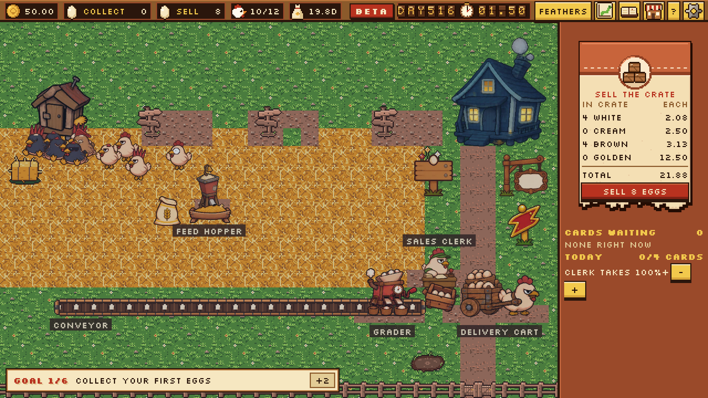 |
| **2560x1440** | **390x844 and 360x640** |
| 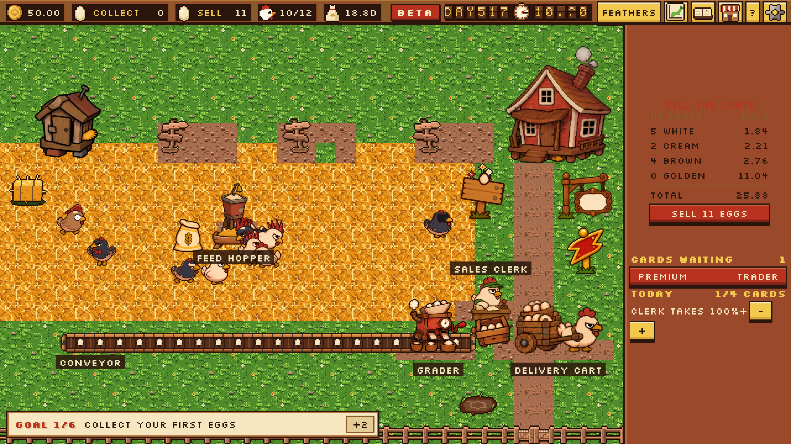 | 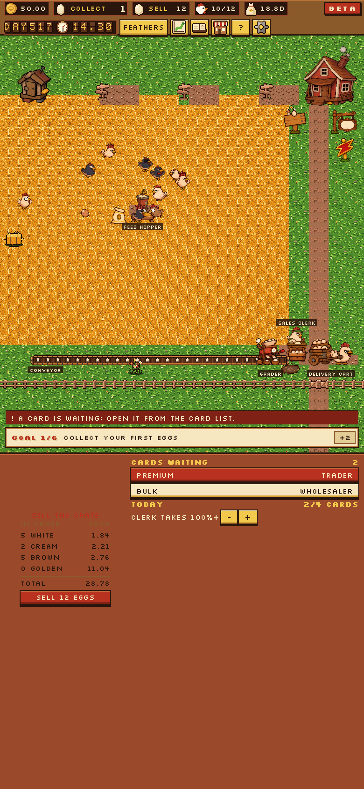 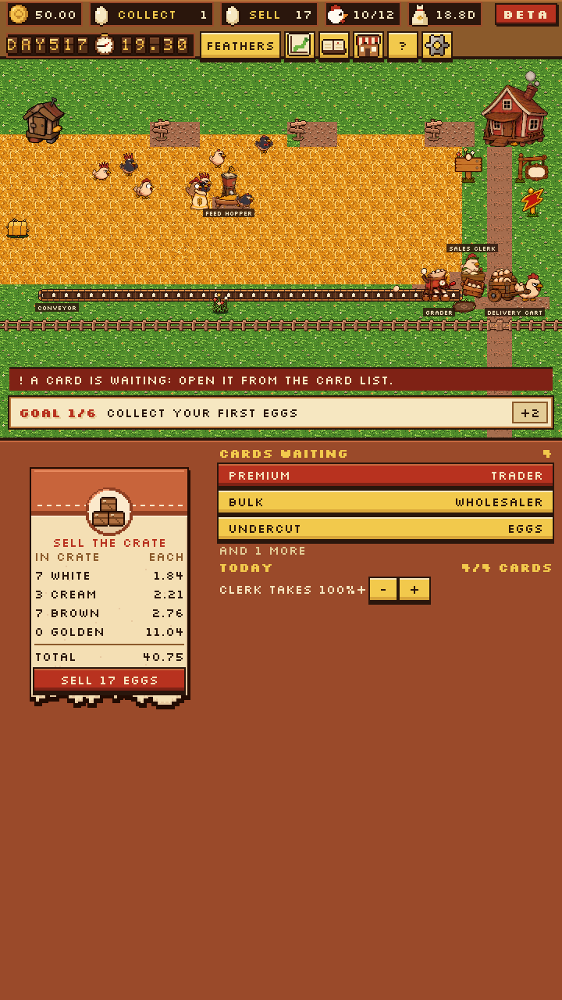 |

<details>
<summary><b>The layout debug overlay</b> (<code>?debug=layout</code>) at the five sizes</summary>

Pink: each object's art bounds and its footprint (filled); white crosses: anchors; cyan: connection points; green lines and
circles: connections within one world pixel (red would mean one is off: none is).

| 1280x720 | 1920x1080 |
|---|---|
| 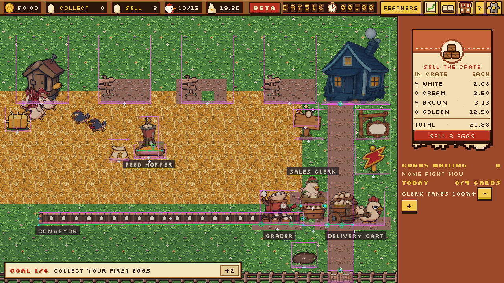 | 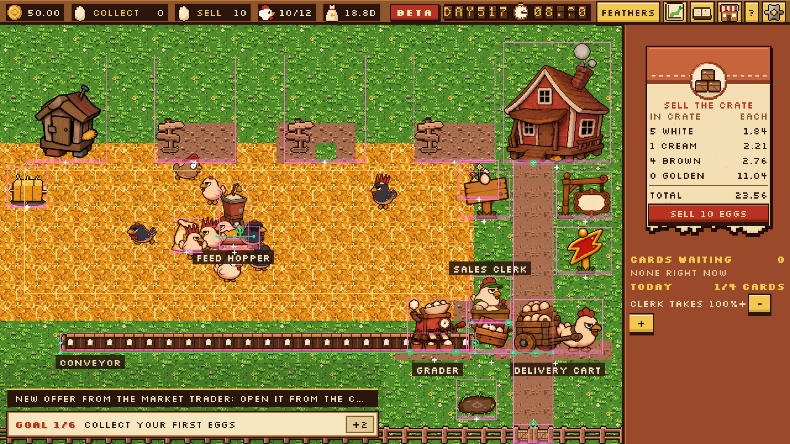 |
| **2560x1440** | **390x844 and 360x640** |
| 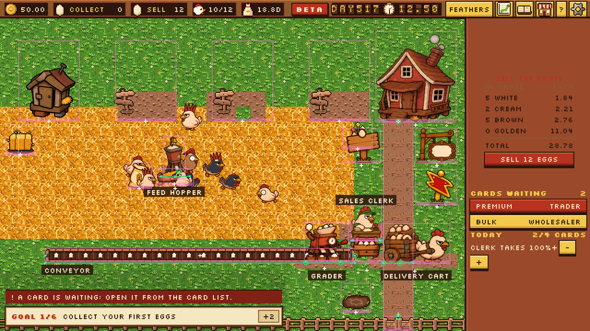 | 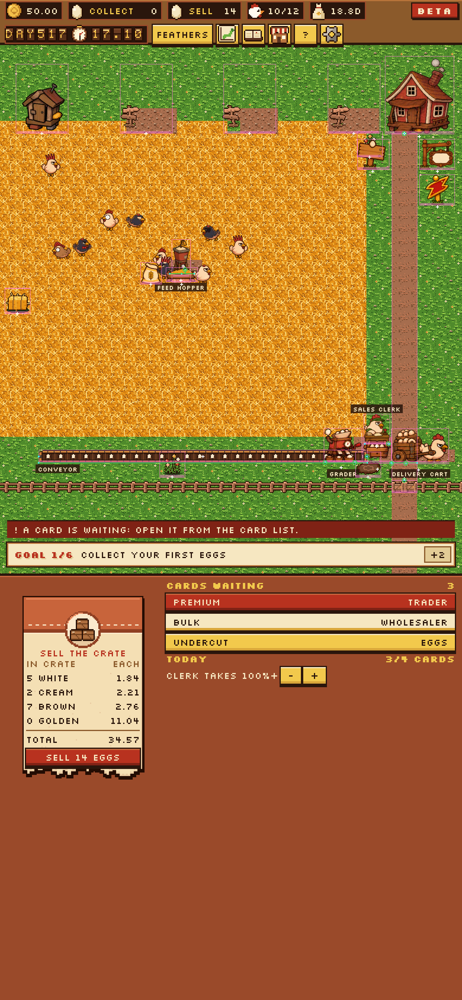 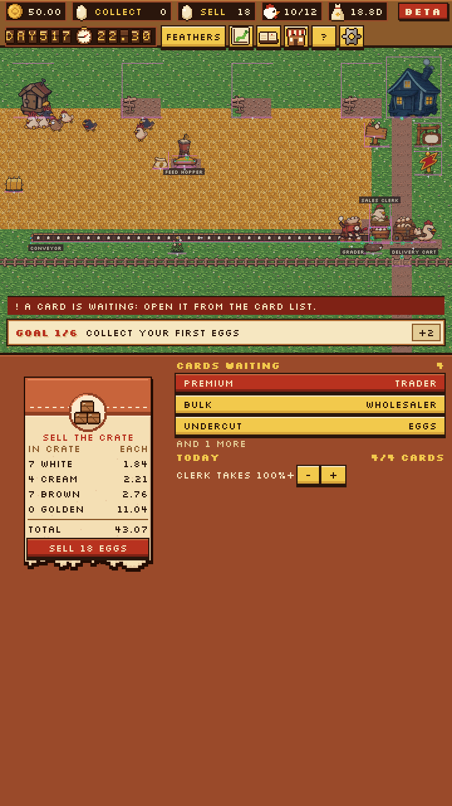 |

</details>

| Mint page (live) | Its estimates (live) |
|---|---|
| 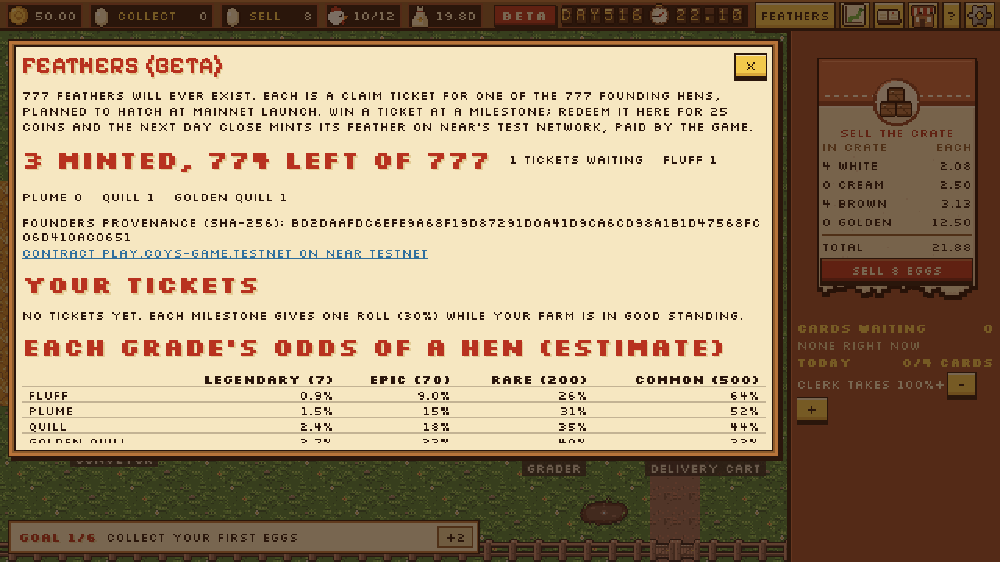 | 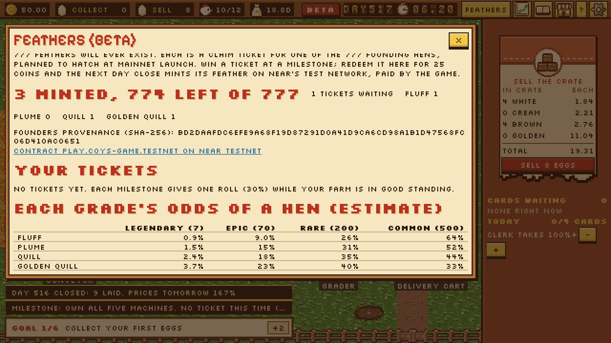 |
| **Unminted slots (live)** | **The minted filter (live)** |
| 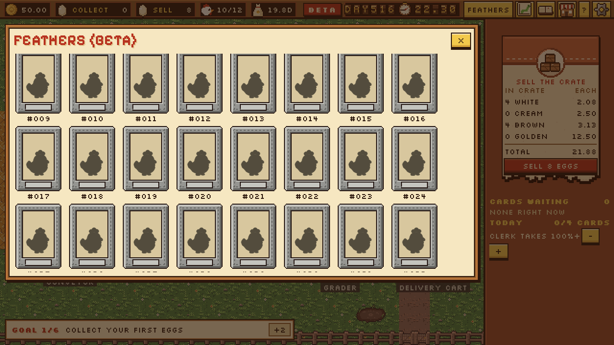 |  |

The reveal moment, from the local check harness (the real server code on a memory database with a stand-in chain, 20-second
days), since a live reveal would mint one of the 777 in `s1`:

| Before the flip | After: a Quill | On a phone |
|---|---|---|
|  |  |  |

</details>

<details>
<summary><b>Founding Hens, machines at work, sound and a guide (12 November 2026)</b></summary>

## Founding Hens, machines at work, sound and a guide (12 November 2026)

*Superseded the same day by [the Feathers beta](#the-feathers-beta-compact-settlement-and-the-layout-spec-12-november-2026): hens are never minted now, and the Founding Hen won live below became a Feather Ticket.*

**Founding Hens.** Regular hens are no longer minted. Only **777 Founding Hens** will ever exist, a cap the contract
itself enforces. A farm in good standing gets one roll at each of seven milestones, once; a win puts a Founding Hen on
the farm and the next day close mints her on NEAR with her portrait, traits, milestone, season, day and her number of 777.
Everything about it, including how to audit a roll, is in [docs/founding-hens.md](docs/founding-hens.md); the mainnet
path is a written checklist, [docs/mainnet-checklist.md](docs/mainnet-checklist.md), with no mainnet action taken.

| Milestone | Reached when |
|---|---|
| First full coop | the coops are full for the first time |
| A good week | 7 day closes in a row in good standing |
| 500 eggs sold | street, orders, cards and contracts all count |
| 10 haggles won | countered by hand and won |
| All five machines | conveyor, grader, cart, hopper and clerk |
| Outlast a rival | a rival farm goes bust after yours opened |
| Top three | a day ends with the farm in the board's top 3 |

Good standing: never bust this season, no feed credit unpaid past its due day lately, no contract delivery missed in the
last 3 days. Each roll is made on the server from a seed fixed by a public record written before it:

$$
\text{roll} = \frac{\big\lfloor \mathrm{SHA256}(\texttt{coys-founding}\,|\,\text{season}\,|\,\text{day}\,|\,\text{farm}\,|\,\text{milestone}\,|\,\text{previous settlement tx}) \,/\, 2^{204} \big\rfloor}{2^{52}}, \qquad \text{won} \iff \text{roll} < 0.3
$$

Every roll is stored with its inputs and logged, at most one hen per milestone, and rolls stop at 777 (minted plus
waiting). A missed roll gets a kind message naming the next milestone. The market board shows how many of the 777 are
left; the ledger lists certificates, milestones and good standing.

**Contract version 3** (`contracts/coys-game`): `settle_day` takes `founding_mints` and refuses ordinary `hen_mints`;
`FOUNDING_MAX = 777` is a `require!` on chain; `founding_supply()` (version 3; `feather_supply()` since version 4) reports minted, max and remaining; `migrate()`
upgrades version 2 in place. 11 unit tests and 6 sandbox tests on the CI-built wasm, among them **mint 777 then refuse
the 778th**, and an upgrade of the exact code running on `play.coys-game.testnet` (read with `view_code`). The testnet
upgrade waits for funds: see the Build log, brief 6.

**The farm.** Coop doors stay shut at rest, swing once when a hen goes in or out, and creak now and then. The world draws
in a fixed layer order (ground, animated ground, floor, things sorted by their feet, labels, effects), which ended the
straw tile that cut the belt and the doors that flapped with the idle loop. The farm fills the whole free window: the
yard takes at least half its width, hens spread out, one unbroken conveyor runs along the bottom into the crate, and one
fence runs the full width with a gate where the path leaves.

| Machine | Size (world px) | Spot | What it does now, every day |
|---|---|---|---|
| Conveyor | 16 px belt tiles, one continuous run | along the bottom of the yard into the crate | carries each egg to the crate 5 s after it is laid; 2% breakage instead of 5%; counts the eggs it saved |
| Egg grader | 48x48 | beside the crate, at the belt's end | flashes as it sorts; +10% on every egg, shown in the sell panel |
| Delivery cart | 48x48 | parked by the crate on the path | drives down the path through the gate and back when it delivers a contract |
| Feed hopper | 48x72 | beside the trough | refills the trough at day close below 1.5 days of feed, up to a price cap you set; 10% cheaper, in the ledger |
| Sales clerk | 48x48 | at a desk on the strip right of the path | stamps the offers it takes on its own; +5% on sales |

Each machine has a name plate and a pad, rises in with a ring when bought, and its card says what it did today. The rival
signs are back on the board and at the farm's edge: they sway, and tip over when a rival busts. The tour's hen talks
again in the hen step.

**Sound settings.** Twelve sliders, each with a mute: master, music, ambience, hens, eggs and money, cards and stamps,
haggling, machines, market and rivals, agent voices, buttons, and new day and stings. Every one of the game's 59 sounds
belongs to exactly one (a test checks it). Changes apply at once, a sample plays on release, settings persist per
browser, and a reset button restores the defaults.

**How to play.** A guide in eleven sections, each with a picture from the game's own art: the goal, your day, eggs and the
crate, the shared market, feed and laying, offers and haggling and contracts, machines, rivals and busts, Founding Hens,
milestones, and a glossary. It opens from Settings and from the **?** in the top bar.

**Beta.** A BETA tag on the title logo, in the top bar and in the page title. The first-run tour now starts for every new
player on their first farm entry with no click, and never again unless replayed: the server remembers it per player
(`tourDone`), and the browser remembers it too.

**Checked live** on 12 November 2026 (commit `c48d2f2`), from fresh headless browsers through the tunnel, with five
temporary check farms made through the game's own `ensurePlayer` and removed afterwards (`scripts/remove-player.ts`,
service stopped; no trades with anyone). One check farm owned all five machines.

| 1280x720 | 1920x1080 |
|---|---|
|  |  |
| **2560x1440** | **390x844 (phone)** |
|  |  |

| First-run tour, no click, 1280x720 | First-run tour, 390x844 | Title with BETA |
|---|---|---|
|  |  |  |

| How to play | Sound settings | Market board |
|---|---|---|
|  |  |  |
| **Ledger** | **An ordinary hen** | **A machine's card** |
|  |  |  |

- **First-run tour:** for a brand-new player at 1280x720, 1920x1080 and 390x844 the first step was up 16 to 208 ms after
  the farm appeared, with no click on the farm; after Skip it did not come back on a reload, nor in a second fresh
  browser for the same player.
- **Layout:** at 1280x720, 1920x1080, 2560x1440 and 390x844 the top bar, side panel, tracker and toasts never
  overlapped; all five machines were on screen with their plates, none under a UI zone; one belt; no page errors.
- **30-second capture** ([founders-live-30s.mp4](docs/screenshots/founders-live-30s.mp4), the equipped check farm at
  1280x720): an egg is laid in the yard, rides the belt and drops into the grader and crate. The coop door is shut in
  31 of the 32 one-second frames; it swung once, with no hen near it: the rare idle creak (every 25 to 75 s).

  

- **Milestones, live:** the first day closes on this build rolled every milestone the farms had reached, each logged
  with its anchor and seed. The real player's farm missed three (top three by 0.0027) and then **won a Founding Hen**
  at a good week (roll 0.003145, day 409). She waits on the farm until the contract is upgraded; the board says 776 of
  777 left, 1 waiting. The check farms' wins went with them.
- **Found and fixed while checking:** the phone left half its screen empty under the side panel (the farm now takes the
  height it can, PR #13); phones whose world zoom is 1 (360x640, 375x667 at 2x) threw `sprite 16-farmhouse not loaded`
  (they now load the smallest painted level, PR #13); the guide's list ran over its text (short names, PR #14).

</details>

<details>
<summary><b>Visual quality and the tour (12 November 2026)</b></summary>

## Visual quality and the tour (12 November 2026)

A recording of the live game at 2560x1284 on a 2x Mac showed assets that looked like 240p, soft top bar and card text,
jagged text on tilted cards, panels piling onto the farm and each other, and a tour that taught only collecting. Causes
and fixes:

| What was seen | Cause | Fix |
|---|---|---|
| Mushy portraits, card art, hens | the previous pass cut every painted sheet down to the grid measured from its outlines (8 source pixels for a hen), throwing away the painting inside: 20% to 67% of visible pixels changed (round trip at that grid, [asset report](docs/asset-report.md)) | each sheet keeps the largest factor whose nearest round trip is near pixel-identical; painted sheets pass at no factor, so they keep their full resolution, cut per screen density |
| Soft top bar, cards and shop | the UI was laid out at 640x360 and scaled by a fraction (1.78 on that screen) | the UI is drawn at a whole number of device pixels per UI pixel through CSS zoom, pixel fonts at whole multiples |
| Jagged "96.00 / BAG" | the card came to rest tilted 2 degrees, stamps at 8 | nothing that carries text rotates; motion is translate and scale in whole-pixel steps |
| Uneven pixels in the world | the world zoom was window height / 360 (3.57 device pixels a world pixel) | the world is drawn at a whole number of device pixels per world pixel, placed on whole device pixels |
| Panels, card art and hints over the farm and each other | free-floating panels with no backdrop; the card was three loose pieces | fixed zones that never overlap; one modal at a time over a dimmed backdrop; a card is one composed panel |
| A tour that taught one thing | four corner messages ended by events, nothing pointed at | ten spotlight steps that move on only when the player does the thing |

**Art at its own detail.** `npm run derive-assets` tries factors 2, 3, 4, 6, 8, 12 and 16 and keeps the largest whose
nearest round trip changes at most 0.5% of visible pixels by more than 24 of 255. The 25 exact sheets pass at their
grid with 0.00% error and ship whole as lossless PNG. Every painted sheet fails even at 2 (6.5% to 31.7%), so it keeps
its original resolution. The hen and its trait layers are judged together and share that factor, so they still stack
pixel for pixel. Painted art ships as WebP pages (alpha lossless) cut by exact area coverage at 2, 3, 4, 6 and 8 texels
per design pixel, on a grid that starts at each sprite's pivot. A screen loads the density that divides its zoom, so a
texel is one device pixel (or a whole square of them). [docs/asset-report.md](docs/asset-report.md) lists every sheet:
factors tried, the factor chosen and its round-trip error, and the previous grid's error.

**Whole pixels everywhere.** With a window of $W \times H$ device pixels, the UI zoom and the farm's zoom are

$$
p = \max\{\, s \in \{2,3,4,6,8\} : W/s \ge 560,\ H/s \ge 330 \,\}, \qquad k = \max\{\, s : 502\,s \le W_{\text{world}},\ 312\,s \le H_{\text{world}} \,\}
$$

where $W_{\text{world}} \times H_{\text{world}}$ is the free area left by the top bar and the side panel, with room for the
guide under the farm's ground line. 1280x720 gets $p = k = 2$, 1920x1080 and a 2x 1280x642 window $3$, 2560x1440 $4$,
a 2x 2560x1440 screen $8$.

**Zones.** Top bar; right side panel (the crate's sell card, waiting cards with a count, contracts and debts); a
bottom-left goal tracker; one toast area stacked above it for hints and news; the world. Only ground lies under the
tracker and toasts. Modals (shop, ledger, market board, a card, a hen, a machine, the crate, a certificate, settings) open
one at a time in the world zone over a backdrop that dims the whole window; Escape and the close button dismiss them.

**The tour**, each step done by doing it, with Back, Skip and progress dots, replayable from Settings:

1. Collect an egg: the spotlight follows an egg on the ground.
2. Sell from the crate at today's price.
3. Open the market board: one market shared by every farm and trader.
4. Tap the supply meter: everyone selling at once crashes prices (a glut), scarcity lifts them.
5. Buy a bag of feed at the trough (on the Loyalist's credit when coins are short); the tiers show how they change laying.
6. Answer an offer and counter it: a practice offer from a buyer, whose first counter always gets a counter back.
7. Buy a hen: she is one of a kind, and her card opens. The sentence about NEAR is honest about whether recording is live.
8. See what the conveyor saves.
9. Tap the farms on the board: rivals go bust, their hens go to auction.
10. Open the ledger: each day closes with a receipt.

The goal tracker continues from there.

**Hen certificates** (gone since version 4: hens are never minted now). When a day close mints a player's hen, the server stores the settlement transaction and day on her
and tells her owner (`henMinted`). The game then shows a certificate: her portrait and traits, a stamp, and one line, "SHE
IS NOW PERMANENTLY YOURS ON NEAR", with the receipt in the ledger. Her card shows her token and receipt link. While
`play.coys-game.testnet` is below its 2.05 NEAR threshold (1.301 available, 0.749 short), mints wait and the game says
"certificate pending: recording on NEAR is paused for now".

**Measured live** on 12 November 2026, from fresh headless browsers through the tunnel. Cold load with an empty cache,
median of three runs (range in brackets), to a playable farm (top bar up and farm objects on the canvas):

| Window | Before (brief 4) | After | On the wire by then (the sharp art keeps arriving) |
|---|---|---|---|
| 1280x720 | 7.4 s, 5.4 MB | **5.1 s** (5.0 to 6.0) | 1.6 MB |
| 1920x1080 | | **8.2 s** (4.8 to 11.9); 6.0 to 6.9 s on three further runs | 2.4 to 5.4 MB |
| 2560x1440 | | **5.6 s** (4.5 to 7.9) | 1.6 to 4.4 MB |
| 2560x1440 at 2x | | **8.7 s** (7.2 to 8.8) | 1.6 to 9.5 MB |
| 390x844 | | **8.6 s** (6.5 to 10.9) | 1.6 to 4.4 MB |

The farm comes up with the smallest painted density that divides the screen's zoom (about 1 MB, drawn several device
pixels a texel), then the sharp one; sounds wait until the sharp farm is in. The loading screen is on screen in 0.6 s.

- **Tour, live, by doing:** an automated browser completed all ten steps at 1280x720, 1440x900, 1920x1080, 2560x1440 and
  390x844, on a fresh check farm each, clicking only what the spotlight showed, in 38 to 61 seconds.
- **No overlap:** at each of those sizes, the boxes of the top bar, side panel, tracker, toasts, tour box and modal never
  overlapped at any tour step or with each modal open (shop hens, feed and machines, ledger, board and orders, crate,
  conveyor, settings, a hen, a certificate). Nothing on the farm sat under a UI zone, and no page logged an error.
  `apps/client/test/viewport.test.ts` asserts the same layout rules for eight window sizes.
- **Whole pixels:** in device-pixel crops at 2x 2560x1440, the share of aligned blocks whose pixels are all one colour
  (a fractionally scaled image scores about 73%):

| Crop | Block | Uniform |
|---|---|---|
| top bar (icons, labels, counters) | 8x8 | 100% |
| card art with its terms (a card modal) | 8x8 | 100% |
| the crate's sell card in the side panel | 8x8 | 99.4% (its centred title sits half a UI pixel over: 4 whole device pixels) |
| a hen's portrait (painted, full detail at 2x) | 2x2 | 100% |
| an agent's portrait (painted, full detail at 2x) | 2x2 | 100% |

<details>
<summary><b>The crops</b> (device pixels, 2x 2560x1440)</summary>

<br>

| Top bar | Card art | Hen | Agent |
|---|---|---|---|
|  |  |  |  |

</details>

The Verify Bot farm from the rescue's checks is gone from season `s1` entirely (`scripts/remove-player.ts`: its hens,
coop, machine, cards and ledger, out of the market, the rankings, demand and the ticker), and so are the five check farms
this pass used.

</details>

<details>
<summary><b>Playability rescue (12 November 2026)</b></summary>

## Playability rescue (12 November 2026)

A screen recording of the first live build showed a small letterboxed game with blurry pixels, hens
that blinked out, a trough that flickered between full and empty, nothing on the farm that answered
a click, egg counts that disagreed, codes like `WHT X0`, and more than two minutes of loading. Each
had one cause, now fixed:

| What was seen | Cause | Fix |
|---|---|---|
| Over 2 minutes to load (52.8 MB before the farm; now 7.4 s, see below) | 1024 to 4096 px painted sheets, 49 MB of them, decoded and resampled in the browser; 2.7 MB of title music decoded before the title | [`scripts/derive-assets.ts`](scripts/derive-assets.ts) builds true-pixel atlases (1.8 MB in all), loaded by screen; music streams after the first tap; hashed files are cached for a year and sent brotli compressed |
| Hens vanishing between frames | the load-time row masking gave whole hens to the row below: idle frame 4, waddle frames 1 and 4, lay frame 4 and eat frame 3 were blank | frames are cut offline by body ownership at full resolution; a test checks every frame of every animation |
| The trough flickering | every server update forced full or empty from yesterday's feeding, fighting the spill animation | sprites keep a resting row from game state that a play-once animation returns to |
| Nothing clickable | a nested full-size layer took every pointer event over the canvas | layers are click-through; every world object has a hover highlight and a card |
| Eggs on the ground, crate at 0 | only collected eggs counted, and nobody could click to collect | the top bar shows eggs to collect and eggs to sell |
| A small blurry box | a 640x360 stage at the largest whole-number scale that fit | the world is 360 pixels tall and as wide as the window, at device resolution, nearest-neighbour |

**Measured live**, cold, in a fresh headless browser through the tunnel, on the Pier Mac:

| | Before (11 November) | After (12 November) |
|---|---|---|
| Loading screen on screen | after the bundle and WebGL | **0.98 s** (inlined in the page) |
| Title screen | 8.3 s, 3.7 MB, 48 requests | **3.3 s**, 1.3 MB, 34 requests (the farm's art already downloading) |
| Farm playable | about 66 s and 52.8 MB of network alone, then decode | **7.4 s**, 5.4 MB, 143 requests (sounds still arriving in the background) |

A 20-second capture of the live farm checked every hen on every animation frame (1201 frames): 10
hens on every frame, no frame where a hen's drawing shrank to nothing. An automated browser on the
live site clicked every kind of world object (hen, crate, trough, coop, farmhouse, sign, machine),
saw its card open each time, and collected a ground egg: **COLLECT** went down by one and **SELL**
up by one. Before the fix the farm canvas took no clicks at all.

<details>
<summary><b>True sprite sizes</b> of that pass (superseded the same day: painted art now keeps its full detail, see the asset report)</summary>

<br>

Painted sheets have no exact grid, so each one's true grid was measured from outline thickness (a
pixel-art outline is one art pixel wide) and every block takes its majority colour.

| Sheet | Grid (source px per art px) | True cell | World scale |
|---|---|---|---|
| hen and its trait layers | 8 | 32x32 | 1 |
| eggs | 12 | 21x21 | 1 |
| crate, sacks, trough, farm sign | 8 | 32x32, 32x48, 48x32, 48x32 | 1 |
| coops | 8 | 48x48 | 2 (drawn coarser than the farm needs) |
| farmhouse | 4 | 96x96 | 1 |
| machines (grader, sorter, cart, hopper, clerk) | 4 | 64x64 (hopper 64x96) | 0.5 (drawn finer than the hen's grid) |
| character portraits | 4 | 64x64 | 1 |
| tiles, props, UI, icons, particles, stamps | 8 (exact) | 16, 32 | 1 |
| plates, cards, logo, loading and title animation | 2 or 4 (exact) | 640x360 plates | 1 |

</details>

</details>

## Build log

The dated build history (briefs 1 to 10, 11 to 13 November 2026) is in [docs/build-log.md](docs/build-log.md).
