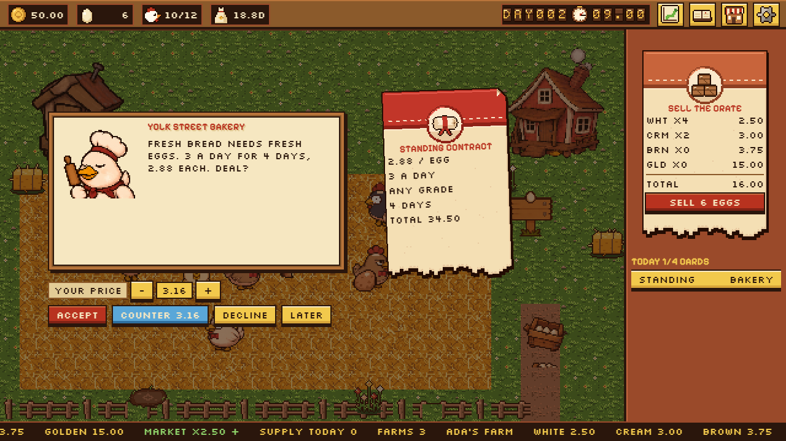
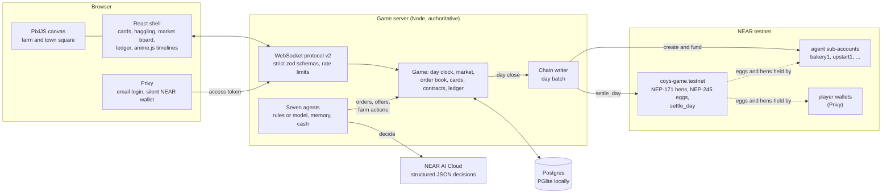

<p align="center"></p>

# Chickens of Yolk Street

Run an egg farm in **one shared live market** where every rival, supplier and buyer is an AI agent with its own cash, memory and wallet. Egg prices, gluts and bankruptcies come only from what everyone trades, never from a script. NEAR hackathon entry (tracks: games, agents, NFTs), built 1 to 14 November 2026.

| | |
|---|---|
| **Play loop** | Hens lay on a schedule; you collect, sell, buy hens, feed, coops and machines. One in-game day is 3 real minutes, and each day brings 2 to 4 decision cards from the agents. |
| **Market** | One price multiplier for everyone, set by the whole market's daily supply. Instant street sales, a real order book with limit orders, and player-to-player trades. |
| **Agents** | Seven: two rival farms, two feed suppliers, three egg buyers. Each decides once a day on NEAR AI Cloud (structured JSON output) or its rule policy, pays for its thinking, remembers every deal, haggles in character, and can go bust. |
| **Chain** | Hens are NEP-171 NFTs, eggs are NEP-245 tokens, and each day settles in one call on NEAR testnet. Agents hold sub-account wallets. Players sign in with email; their wallet is made silently. No crypto words in the game: one "on-chain receipt" link in the ledger. |
| **Feel** | Squash and stretch, hitstop, screen shake, particles and layered sound on every action, portraits that talk with voice babble, and a reduce-motion switch. |

## The problem

Farm games fake their economies: prices follow a curve someone wrote, rivals are scripts, and nothing a player does moves the market. On-chain games often go the other way and lead with wallets and tokens, so the game is buried under the plumbing.

Chickens of Yolk Street puts a **real, shared economy** in a toy you can play with one hand. Every egg anyone sells (players and AI agents alike) is supply in the same market. Sell too many and everyone's price falls. NPCs are businesses with wallets: the Squeezer prices your hunger into your feed, the Bakery holds you to your contract, and a rival that overbuilds goes bust and its hens go to auction. The economy evolves without a dev patch, and the chain keeps an honest record of each day while staying out of sight.

## How NEAR fits in

| NEAR piece | What it does here | Status in this build |
|---|---|---|
| **Game contract on testnet** (`near-sdk` 5.30.1) | One contract on the game account: hen NFTs (NEP-171, `near-contract-standards` 5.30.1), egg tokens (NEP-245, `near-sdk-contract-tools` 4.0.0 from the near org), and `settle_day`, owner only, once per in-game day. | **Deployed** to `coys-game.testnet` (tx [`Bzhs5zTq...`](https://testnet.nearblocks.io/txns/Bzhs5zTqUJFNE83HzjZsCUonxhwkcHTXuV868nbMdGoc)). Wasm built in CI with `cargo near`, sha256 `df6fe36d...`. |
| **Agent wallets** (near-api-js 7.5.3) | Each agent gets a testnet sub-account of the game account (`bakery1.coys-game.testnet` and so on), funded from it; its eggs and hens settle to it. | Created on the first day close with credentials. |
| **Privy social login** (docs.near.org social login) | Email sign-in; a NEAR testnet wallet is created silently with Privy's extended-chains API; the server verifies the ES256 access token with `jose`. That wallet holds the player's hens and eggs. | Wired. Needs `PRIVY_APP_ID`; without it the game runs a labelled local dev login. |
| **NEAR AI Cloud** (OpenAI-compatible) | Every agent's daily decision, as structured JSON output (`json_schema`, strict) checked against a zod schema; anything unusable falls back to rules and is logged. Hard daily spend cap. | Wired. Needs `NEARAI_API_KEY`; default model `Qwen/Qwen3.6-35B-A3B-FP8`, cheaper `z-ai/glm-5.3-flash` for struggling agents. |

**Live on NEAR testnet (11 November 2026).** A run of this build against testnet, with one headless player linked to a fresh implicit account:

| What | Where |
|---|---|
| Game contract deployed and initialised on `coys-game.testnet` | [Bzhs5zTq...](https://testnet.nearblocks.io/txns/Bzhs5zTqUJFNE83HzjZsCUonxhwkcHTXuV868nbMdGoc) |
| Seven agent wallets created as sub-accounts: `bakery1`, `loyalist1`, `oldmoney1`, `squeezer1`, `trader1`, `upstart1`, `wholesaler1` (each `.coys-game.testnet`) | on the first day close |
| Day 1 settled: 94 egg tokens minted, 12 hen NFTs minted | [tW6D6wqy...](https://testnet.nearblocks.io/txns/tW6D6wqyd97366MCi59in83ge8N8RfRZwtKHuxEDrLm) |
| Day 2 settled: 54 eggs minted, 4 burned (the player's street sale), 12 more hens | [2b2wWs9X...](https://testnet.nearblocks.io/txns/2b2wWs9XSU8MDcPmpUeyujtbmUXPRZfsbfduF17TS8MS) |

Anyone can check it with view calls on `coys-game.testnet`: `day_record({"day": 2})`, `nft_total_supply`, `mt_batch_balance_of`. In that run NEAR AI Cloud answered 402 (the account had no credits yet), so every agent fell back to its rule policy and each fallback was logged: the path the tests also cover.

## Try it

Node 22.22.2 or newer. Each step says what to do and what you should see.

1. **Install.** Run `npm ci --ignore-scripts`. No package install scripts run (`.npmrc` also sets `ignore-scripts=true`).
2. **Test.** Run `npm test`. You see **66 tests** pass, including the economy sheet (margin **0.46**, payback **17.3** days, multiplier **0.54** at 1300 supply, a 30-hen coop **full on day 16**), a 30-day market simulation, haggling, model fallbacks, the chain batch, and two real WebSocket clients in one market.
3. **Play.** Run `npm run dev` and open http://localhost:5173. An egg fills up over the loading plate, then the title: the logo stamps in and the price ticker scrolls.
4. **Sign in.** Press **PLAY**. With `PRIVY_APP_ID` set you sign in with email; without it a red **LOCAL DEV LOGIN** label asks for a name. You see your farm: 10 hens, a starter coop, **50.00** coins, **DAY001**.
5. **Collect and sell.** Click an egg a hen just laid: it pops into the crate. Press **SELL N EGGS**: a **SOLD** stamp slams, coins arc to the counter.
6. **Meet the agents.** At the start of day 2 the first card slides in: a portrait talks in its own voice while its line types out (the Bakery offering a standing contract, the Squeezer a feed deal, the Wholesaler a bulk order). Press **ACCEPT** and the right stamp slams.
7. **Counter the Squeezer.** When the Squeezer offers feed, lower **YOUR PRICE** a few steps and press **COUNTER**. It answers with a counter of its own, stingier than the Loyalist would; three rounds at most. Ask too little and it walks away (fail sound). Land inside its walk-away price and the card flips to gold with confetti and the haggle win chime.
8. **Sell into a glut and watch the price fall.** Open the **market board** (top bar). Sell a big crate (or post a sell order). Today's supply on the ticker board rises; at the day close the next multiplier falls, all prices drop, and the ticker turns red if it crashes (multiplier 0.80 or lower) while the tension music takes over.
9. **Watch a rival bust.** Rivals pay 0.50 coins per decision; one that over-expands into a glut runs out of cash. Its sign tips over, a price wave crosses the ticker, feathers fall, and its hens appear in the shop as **AUCTION** hens at half price. A new rival opens three days later. (The test `a rival can go bust in a glut` drives this in seconds.)
10. **Deliver a contract.** Accept the Bakery's contract, then press **DELIVER** on the desk each day (or buy the delivery cart and it delivers at dusk). Miss one and you pay a penalty and the Bakery remembers.
11. **Read the ledger.** Open the **ledger** (top bar): day-by-day income, costs and net, contracts and debts, and an **ON-CHAIN RECEIPT** link for each settled day.
12. **Comfort.** **SETTINGS**, **REDUCE MOTION**: stamps still slam and chime, but nothing shakes or freezes.

Production build: `npm run build` then `npm start` serves the game and API on http://localhost:8787.

## Screenshots and video

| Card overlay | Market board |
|---|---|
|  |  |
| **Shop: hens with visible traits** | **Farm** |
|  |  |

Screenshots are from a headless browser run of this build at 1280x720, with no credentials set.

**Video:** _slot for a direct upload (drag the gameplay video into this section on GitHub)._

## Architecture



The client never sends a balance or an outcome. It asks for actions; the only prices it sends are proposals (a haggle ask, a limit order) that the server bounds and that an agent or counterparty must accept. The server applies every action in a database transaction and answers with state and events that drive the juice.

## The economy

Every number lives in one object, `ECONOMY` in [`packages/shared/src/economy.ts`](packages/shared/src/economy.ts), including every agent's costs, markups, penalties and thresholds.

**Market price.** One multiplier for every grade's base price (white 1.00, cream 1.20, brown 1.50, golden 6.00), set by the total eggs sold that day by all players and agents (street sales, order fills, card deals, contract deliveries and the wholesaler's resales):

$$
m_{d+1} = \operatorname{clamp}\left(\left(\frac{600}{S_d}\right)^{0.8},\ 0.40,\ 2.50\right)
$$

At $S = 1300$, $m = 0.54$. The market has crashed when $m \le 0.80$.

**Hen payback.** With base laying $0.80$, feed laying multiplier $f$, breakage $b$, the tier's expected egg price $\bar p$ at multiplier $m$, and feed at $0.12$ kg a day from a 25 kg bag of price $P$:

$$
\text{margin} = 0.80\, f\,(1-b)\,\bar p\, m - \frac{P}{25}\cdot 0.12
\qquad
\text{payback} = \frac{8}{\text{margin}}
$$

On standard feed at $m = 1$: margin $= 0.4624$, payback $= 17.3$ days.

**Feed from the Squeezer.** Its bag price rises with how desperate a farm looks, $\delta \in [0, 1]$ (feed days left weigh most, low cash adds): $P_{sq} = P \cdot (1.05 + 0.5\,\delta)$. The Loyalist takes 2% off per past deal, up to 15%, and offers credit due in 5 days at 8%.

## The agent cast

| Agent | Role | Character (rule policy and haggling) |
|---|---|---|
| **Upstart Eggs** | rival farm | Over-expands on good weeks (fills coops to 140% when the market is hot), cheap feed, dumps every egg: crashes hardest in a glut. Undercuts players to the trader. Haggles loosely. |
| **Old Money Farms** | rival farm | Never panics: holds eggs in a slump, keeps cash, premium feed, buys bust farms' hens at auction. Makes buyout offers to struggling players. Proud: walks away from insulting asks. |
| **The Squeezer** | feed supplier | Reads desperation (low feed, low cash) and prices it in. Barely bends in a haggle. |
| **The Loyalist** | feed supplier | Rewards repeat buyers with discounts and offers credit terms; never extends credit after a default. Bends the most. |
| **Yolk Street Bakery** | egg buyer | Wants steady volume: offers standing contracts and posts daily buy orders. A missed delivery costs a penalty; two cancel the contract and start a sulk. |
| **The Market Trader** | egg buyer | Pays a premium for brown and golden, up to what it resells for in town; walks away from farms whose quality slips; warns of gluts. |
| **The Wholesaler** | egg buyer | Buys anything in bulk at a low price, resells it into the street the next day (adding to supply and pushing prices down). |

Each agent has its own cash, stock and **memory of every farm** (deals, value, refusals, haggles won and lost, missed deliveries, sulks) in Postgres. It decides once per in-game day and pays 0.50 coins per decision from its own cash. Below 40 coins it thinks only every other day, on the cheaper model, so a struggling business visibly gets worse. Below zero it closes: its orders and contracts end, a rival's hens go to auction at half price, and a new agent of the same role opens three days later under a fresh name.

## Systems

<details>
<summary><b>Agent decisions</b>: one shape for rules and the model, always validated</summary>

- Each agent sees a context: its cash and stock, the live market and recent history, auction hens, its own farm (rivals), and a brief of every farm with its memory of it (`apps/server/src/agents/decision.ts`).
- The model gets a role and personality prompt and must answer with the decision JSON schema (`response_format: json_schema, strict`). The reply is parsed and validated with zod; anything else falls back to the rule policy and the fallback is logged and counted.
- The game bounds every number: prices are shares of the live price within bands, quantities are capped by stock and cash, offers only reach real player farms, and every farm action goes through the same validated actions players use.
- Spend cap: `NEARAI_DAILY_SPEND_CAP_USD` per UTC day, tracked from token usage and the model's per-token price (from `/v1/models`). Each call reserves its estimated cost first, so the cap is never crossed; past it, agents use rules until the next day.
- Decisions apply in two phases: farm actions and restock before the market closes (their sales count today), then orders, fills and offers once tomorrow's price is set.

</details>

<details>
<summary><b>Cards and haggling</b>: 2 to 4 a day, never scripted</summary>

- Agents' offers become cards (bulk order, premium order, standing contract, feed deal, credit terms, undercut, buyout offer, glut warning), plus player trade cards from other players' sell orders. At most one per agent and four per player per day, arriving at 12%, 30%, 48% and 64% of the day.
- Choices: accept, decline, counter, and the card's own options (switch supplier, match price, sell now or hold, sell hens).
- A counter is a proposal. The agent accepts any ask inside its hidden walk-away price; otherwise it concedes part of the gap (its personality's concession), and walks away after three rounds, or at once from an insulting ask if it is proud. The walk-away price comes from personality and memory: regulars get more room, farms that won haggles get less, missed deliveries cost room.
- The sales clerk auto-accepts bulk and premium orders at or above the player's floor; the delivery cart delivers standing contracts at dusk.

</details>

<details>
<summary><b>Order book</b></summary>

- Buyer agents post buy orders each day; farms post limit sells (the eggs leave the crate into the order and come back if it expires after 3 days). Orders cross at the resting price, best price first.
- Players sell into buy orders, buy each other's eggs (also offered as player trade cards), and cancel their own orders. Every fill is a trade on the market board and counts as supply.

</details>

<details>
<summary><b>Chain</b>: one contract, one call a day</summary>

- `contracts/coys-game` (Rust, `near-sdk` 5.30.1): NEP-171 hens from `near-contract-standards`, NEP-245 eggs from `near-sdk-contract-tools` (`Nep245` derive without per-account storage fees, so holders need no deposit; the contract pays storage), `Owner` access control, and `settle_day`.
- `settle_day(batch)`: owner only, days strictly in order and each once. It mints, transfers and burns egg tokens, mints hens with their metadata, moves hens that changed hands, stores the day's summary and digest, and emits a `day_settled` event.
- The batch (`apps/server/src/chain/batch.ts`): the day's trades between holders become egg transfers; then every account is reconciled to what it really holds (crate plus open sell orders, or a buyer's stock) with mints and burns, starting from the balances last confirmed on chain. A failed day is caught up by the next, and no burn exceeds a balance. Every farm's net result travels in the call with a SHA-256 digest.
- **Hen images**: the stacked trait layers are rendered once at mint into a 32x32 PNG (about 1 KB) and stored in the token metadata as a data URI with its `media_hash`. Why: it is the simplest correct storage. The token is self-contained and verifiable from the chain alone, with no image host, pinning service or URL to keep alive, and a 1 KB portrait costs about 0.01 NEAR of storage. Mints are capped per day (`CHAIN_HEN_MINTS_PER_DAY`, default 12) and wait when the game account runs low.
- **Agent wallets**: sub-accounts of the game account, funded from it (`AGENT_ACCOUNT_FUNDING_NEAR`, default 0.05), with keys derived from the game key by HMAC so no extra secret is stored.
- **Players**: the Privy wallet holds their hens and eggs. Minting and transfers happen only in the day batch, never per click.
- Testnet only, enforced in code before any key is used: accounts must be `.testnet` (or implicit), RPC hosts must be testnet, and the RPC's `chain_id` must say `testnet` before anything is signed. Without credentials, every day's batch is built the same way and logged as a NO-OP.
- Tests: contract unit tests and **sandbox tests** (`contracts/sandbox-tests`, near-workspaces 0.24) for a full day settlement, holder transfers, and that no other account can settle or mint. They run in CI (Linux); the wasm CI builds is what gets deployed (`npm run deploy-contract -w @coys/server` checks its sha256).

</details>

<details>
<summary><b>Server</b>: authoritative, transactional, reconnect safe</summary>

- `apps/server`: Node, `ws`, `pg` and PGlite behind one `Db` interface. `DATABASE_URL=postgres://...` uses Postgres; `pglite://<dir>` (default `.data/coys`) or `memory://` uses embedded PGlite.
- Migrations: v1 (clock, market days, players, farms, coops, hens, unlocks, lay events, orders, ledger) and v2 (agents, memory, cards, contracts, debts, order book fields, trades, inference usage, confirmed chain balances).
- Every farm cash change writes the balance and a ledger row in the same transaction; tests check the ledger total equals cash, for players and rival farms, across a 30-day simulation.
- Mutations run one at a time; messages go out only after commit. Strict zod schemas reject any extra field. Per-player rate limits, reconnect-safe request ids.

</details>

<details>
<summary><b>Client</b>: screens, juice and sound</summary>

- 640x360, scaled by a whole number, nearest-neighbour everywhere. PixiJS draws the farm and the town square; anime.js drives every UI motion.
- **Card overlay**: slides in with an overshoot and a paper swoosh; the portrait talks with its voice babble while the line types out; outcomes play the agent's expression and slam a stamp; a haggle win flips the card to gold with a hitstop, shake, confetti and the win chime; a fail sends the agent walking with the fail sound.
- **Market board**: town square plate with animated bunting and a milling crowd (market murmur loop), split-flap ticker board by grade, farms ranked with their signs, the cast, big trades, the order book.
- **Ledger**: day-by-day profit, contracts, debts, and the on-chain receipt link per day.
- **Shop**: listed hens drawn from their trait layers with laying trait and price (auction hens marked), feed with supplier switching, coops, machines.
- **Rival bust**: the sign tips over, a price wave crosses the ticker, medium shake, falling feathers, the collapse crash and the bust sting. **Glut**: the ticker drops red and the market tension music plays until prices recover.
- Everything from brief 1 stays: lays, hand collect, big haul, deal stamp, coop builds, unlocks, crash, new day.

</details>

<details>
<summary><b>Simulation</b>: 30 in-game days, seven agents and two headless players</summary>

`apps/server/test/sim.test.ts` runs the whole market for 30 days with a stub model that answers valid JSON on most calls and garbage on every fourth, under a 0.25 USD cap. One run:

- **Prices** follow supply: big supply days (271, 302, 418 eggs) drop the next day's multiplier to 1.89, 1.73 and 1.34; otherwise roughly 190 eggs a day keeps it near the 2.50 cap (the reference supply is 600, sized for a full market of players).
- **Contracts**: 8 signed, 31 deliveries, 6 missed.
- **Inference**: 203 decisions, 68 model calls, 152 rule fallbacks (cap reached, or a bad reply), 7 days skipped by struggling agents; spend 0.2432 USD against the 0.25 cap.
- **Busts**: none in this 30-day run. The companion test forces a glut on Upstart Eggs (no cash, empty trough, crashed market): it goes bust on day 2, its hens go to auction, and Hatch and Dash opens as the new rival on day 5.

</details>

<details>
<summary><b>Asset pipeline</b>: verified, byte for byte</summary>

- `npm run pack-assets` checks all 375 manifest files of `iam25th1/coys-assets` against their SHA-256 and packs 67 sprite sheets (PixiJS JSON with rows, per-frame durations and anchors) and 59 sounds (124 MP3 takes, 12 gapless loop OGGs). PNG, MP3 and OGG files are copied byte for byte.
- Hen trait layers match `01-hen-anims` frame for frame; brown and black bodies are palette swaps in code. The server renders hen NFT portraits with the same passes.

</details>

<details>
<summary><b>Security</b></summary>

- No secrets in the repo or the client bundle: `.env` is ignored; `.env.example` names and describes every variable with no values; the client reads only the public Privy app id from `/api/config`; the built bundle is grepped for key-like strings.
- The model key, the testnet key and agent keys live only on the server. Testnet only, enforced in code.
- Every dependency pinned exactly; installed with `npm ci --ignore-scripts` locally and in CI; Rust crates pinned with `Cargo.lock` and built `--locked`; cargo-near checksum-verified in CI.

</details>

## Environment variables

All optional. Copy `.env.example` to `.env` at the repo root.

| Variable | Used by | Without it |
|---|---|---|
| `PORT`, `DATABASE_URL`, `SESSION_SECRET` | server | 8787; PGlite at `.data/coys`; a random secret per boot |
| `ALLOW_DEV_LOGIN` | server | dev login only when Privy is not set up |
| `PRIVY_APP_ID`, `PRIVY_VERIFICATION_KEY` | server, client (via `/api/config`) | labelled local dev login |
| `NEAR_TESTNET_ACCOUNT_ID`, `NEAR_TESTNET_PRIVATE_KEY` | server, deploy script | daily settlement is a recorded NO-OP |
| `NEAR_TESTNET_RPC_URL`, `NEAR_GAME_CONTRACT_ID` | server | `https://test.rpc.fastnear.com`; the signing account |
| `CHAIN_HEN_MINTS_PER_DAY`, `CHAIN_MIN_BALANCE_NEAR`, `AGENT_ACCOUNT_FUNDING_NEAR` | server | 12; 2; 0.05 |
| `NEARAI_API_KEY`, `NEARAI_BASE_URL`, `NEARAI_MODEL`, `NEARAI_CHEAP_MODEL` | server | agents use their rule policies |
| `NEARAI_DAILY_SPEND_CAP_USD` | server | 1.00 |
| `ASSETS_DIR` | `npm run pack-assets` | required to re-pack |

## Commands

| Command | Does |
|---|---|
| `npm ci --ignore-scripts` | install from the lockfile, no install scripts |
| `npm run dev` | server (port 8787) and client (Vite, port 5173) |
| `npm test` | Vitest: economy, agents, haggling, market, chain batch, simulation, WebSocket, packer, pixel passes |
| `npm run typecheck` / `npm run lint` | strict TypeScript; ESLint plus a check that no file holds an em dash |
| `npm run build` / `npm start` | bundle the server and client; serve both on one port |
| `npm run deploy-contract -w @coys/server` | deploy the CI-built contract to the game's testnet account (sha256 checked) |
| `cd contracts/coys-game && cargo test` | contract unit tests (CI also runs `cargo near build` and the sandbox tests) |

## Repository layout

```
apps/client          Vite + React shell + PixiJS world + anime.js motion + Web Audio
apps/server          game server: HTTP, WebSocket, game, agents, cards, market, chain, db
packages/shared      economy config and formulas, agent pricing, protocol, pixel passes
contracts/coys-game  the game contract (Rust); res/ holds the CI-built wasm and its sha256
contracts/sandbox-tests  near-workspaces sandbox tests for the contract
scripts              asset packer, dev runner, text check
docs/screenshots     headless captures of this build
```

## What is stubbed, and why

- **Contract builds run in CI, not on this Windows machine**: Windows Application Control blocks the unsigned build scripts cargo compiles, so the contract is built and sandbox-tested on Linux in CI, and the deployed wasm is the CI artifact (its sha256 is committed and checked by the deploy script).
- **Privy end to end** needs a real browser and inbox; the server and client sides are wired and tested headlessly up to the token check.
- **Credit default** is remembered and blocks further credit, but there is no collection beyond the day's cash.
- **Hen NFT mints are capped per day** to keep gas and the game account's storage in check; older hens catch up on later days.

## Verification

On a fresh clone: `npm ci --ignore-scripts`, then typecheck, lint, test and build all pass; CI is green (TypeScript job and contracts job). The economy sheet tests hit their values exactly; a malformed model answer falls back to rules; the contract's sandbox tests pass and non-game accounts cannot mint or settle; two real WebSocket clients see the same prices and each other's trades; no secrets in the repo or bundle; no file has an em dash.

**Not verifiable headlessly:** how haggling and cards feel, whether portraits and voices read right, Privy login end to end, and how the market evolves over weeks of real play.

## Build log

### Brief 2: agents, cards and chain (11 November 2026)

- Seven agents with personalities, memory, cash and wallets; decisions on NEAR AI Cloud as structured JSON with rule fallbacks, a hard daily spend cap, struggling agents on a cheaper model every other day, busts and replacements.
- Decision cards with three-round haggling, standing contracts and deliveries, feed credit, the sales clerk, a real order book and player-to-player trades.
- Screens: card overlay with talking portraits and voices, market board over the town square, ledger with on-chain receipts, a shop of hens with visible traits.
- Juice: card arrivals, haggle win and fail, rival bust (sign, price wave, feathers), glut music.
- Chain: one game contract on NEAR testnet (NEP-171 hens, NEP-245 eggs, daily `settle_day`), sandbox-tested in CI and deployed; agent sub-account wallets; hen portraits rendered at mint.
- A 30-day simulation and a rival-bust scenario in the test suite.

### Brief 1: foundation and farm loop (11 November 2026)

- Merged the asset backup (coys-assets PR #1) and packed 67 sheets and 59 sounds from it, byte for byte.
- Monorepo: client, server and shared packages; strict TypeScript, ESLint, Vitest; pinned dependencies; CI on `npm ci --ignore-scripts`.
- Economy in one config object, tested against the sheet (0.46 margin, 17.3-day payback, 0.54 multiplier at 1300, day 16 coop fill).
- Authoritative server on Postgres or PGlite: day clock, shared market, order book, ledger, strict protocol, rate limits, reconnect-safe request ids.
- Privy email login with a silent NEAR testnet wallet, and a labelled dev login fallback.
- Designed screens with real art: loading, title, login, farm, settings; the full farm loop with juice and sound on every action.
