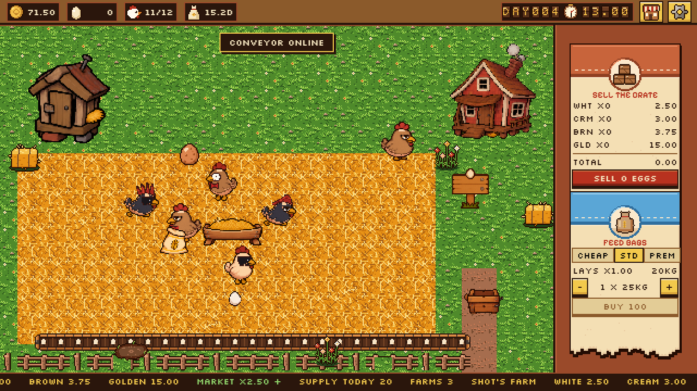
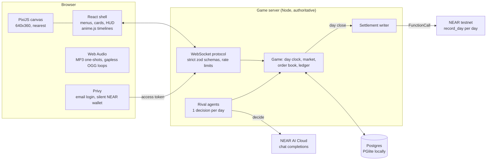

<p align="center"></p>

# Chickens of Yolk Street

Run an egg farm in **one shared live market** where every rival, supplier and buyer is an AI agent. Egg prices, gluts and bankruptcies come only from what everyone sells, never from a script. NEAR hackathon entry (tracks: games, agents, NFTs), built 1 to 14 November 2026.

| | |
|---|---|
| **Play loop** | Hens lay on a schedule, you collect, sell into the live market, buy hens, feed, coops and machines. One in-game day is 3 real minutes. |
| **Market** | One price multiplier for everyone, set by the whole market's daily supply. |
| **Rivals** | Agent-run farms in the same market, deciding once a day on NEAR AI Cloud (or a built-in heuristic). |
| **Chain** | Email login, a NEAR testnet wallet made silently, each day's net trade results written to NEAR testnet in one call. No crypto words in the game. |
| **Feel** | Squash and stretch, hitstop, screen shake, particles and layered sound on every action, with a reduce-motion switch. |

## The problem

Farm games fake their economies: prices follow a curve someone wrote, rivals are scripts, and nothing a player does moves the market. On-chain games often go the other way and lead with wallets, seed phrases and tokens, so the game is buried under the plumbing.

Chickens of Yolk Street puts a **real, shared economy** in a toy you can play with one hand. Every egg anyone sells (players and AI rivals alike) is supply in the same market. Sell too many and everyone's price falls. Rivals who overbuild go bust, and their hens go to auction. The chain keeps an honest record of each day while staying out of sight.

## How NEAR fits in

| NEAR piece | What it does here | Status in this build |
|---|---|---|
| **Privy social login (per docs.near.org social login)** | Email sign-in; a NEAR testnet wallet is created silently with Privy's extended-chains API (`createWallet({ chainType: 'near' })`). The server verifies Privy's ES256 access token with `jose`. | Wired. Needs `PRIVY_APP_ID`; without it the game runs a clearly labelled local dev login. |
| **near-api-js 7.5.3 (testnet)** | Server-side signer writes the day's settlement batch: one `FunctionCall` to `record_day` carrying every farm's net result and a SHA-256 digest. | Wired. Needs `NEAR_TESTNET_ACCOUNT_ID` and `NEAR_TESTNET_PRIVATE_KEY`; without them each day logs a loud NO-OP and stays recorded in Postgres. |
| **NEAR AI Cloud** (OpenAI-compatible, `cloud-api.near.ai/v1`) | Rival farms make one decision per in-game day, paying 0.50 coins of inference cost per decision. Replies are schema-checked; anything unreadable falls back to the heuristic. | Wired. Needs `NEARAI_API_KEY`; without it rivals use the heuristic brain. |
| **NFTs, egg tokens, agent wallets** | Hens already carry their traits (body, eyes, comb, accessory, laying trait 0.85 to 1.15) and a `token_id` column. | Next brief; interfaces are in place. |

## Try it

Node 22.22.2 or newer. Each step says what to do and what you should see.

1. **Install.** Run `npm ci --ignore-scripts`. You see the lockfile install, and no package install scripts run (`.npmrc` also sets `ignore-scripts=true`).
2. **Test.** Run `npm test`. You see **47 tests pass**, including the economy sheet: margin **0.46**, payback **17.3** days, multiplier **0.54** at 1300 supply, and a 30-hen coop **full on day 16**.
3. **Play.** Run `npm run dev` and open http://localhost:5173. You see an egg fill up over the loading plate, then the title: the logo stamps in and the price ticker scrolls.
4. **Sign in.** Press **PLAY**. With no `PRIVY_APP_ID` you see a red **LOCAL DEV LOGIN** label. Type a name and press **START FARMING**. You see your farm: 10 hens, a starter coop, **50.00** coins, **DAY001** on the split-flap clock.
5. **Collect.** Watch a hen puff up and lay. Click the egg: it pops into the crate with a sparkle and a tiny freeze. The egg counter goes up by one.
6. **Sell.** On the **SELL THE CRATE** card press **SELL N EGGS**. A **SOLD** stamp slams down, the screen shakes in proportion to the deal, coins arc into the cash counter and the hens cheer. Cash rises by the total the card showed.
7. **Grow.** Open the shop (top right), **HENS**, **BUY FOR 8**. A new hen waddles in through the gate and the hen count shows 11/12.
8. **Machines.** Shop, **MACHINES**, **BUY 40**. The conveyor boots along the yard with a puff of steam and a **CONVEYOR ONLINE** toast. Breakage drops from 5% to 2%.
9. **End of day.** Wait for the clock to pass 02.00 (3 minutes per day). Uncollected eggs stream into the crate, a toast reports the day, the rooster crows and **DAY002** flips in.
10. **Shared market.** Run `curl localhost:8787/api/market`. You see the live multiplier, today's supply and `"farms":{"players":1,"agents":2}`: the rival farms trade in the same market as you.
11. **Settlement.** Watch the server log at each day close. Without testnet credentials you see `[settlement] !!! NO-OP for day N ...`. With them you see `written to NEAR testnet: <tx hash>`.
12. **Comfort.** Open **SETTINGS** and turn on **REDUCE MOTION**. Sales and hauls still stamp and chime, but nothing shakes or freezes.

Production build: `npm run build` then `npm start` serves the game and API on http://localhost:8787.

## Screenshots and video

| Title | Farm |
|---|---|
|  |  |
| **Deal stamp** | **Conveyor unlocked** |
|  |  |

Screenshots are from a headless browser run of this build at 2x.

**Video:** _slot for a direct upload (drag the gameplay video into this section on GitHub)._

## Architecture



The client never sends a price, a balance or an outcome. It asks for actions (`sell`, `buyHens`, `collect`, ...); the server prices them from one config object, applies them in a database transaction, and answers with state and events that drive the juice.

## The economy

Every number lives in one object, `ECONOMY` in [`packages/shared/src/economy.ts`](packages/shared/src/economy.ts).

**Market price.** One multiplier for every grade's base price (white 1.00, cream 1.20, brown 1.50, golden 6.00), set by the total eggs sold into the market that day by all players and agents:

$$
m_{d+1} = \operatorname{clamp}\left(\left(\frac{600}{S_d}\right)^{0.8},\ 0.40,\ 2.50\right)
$$

At $S = 1300$, $m = 0.54$. The market has crashed when $m \le 0.80$.

**Hen payback.** With base laying $0.80$, feed laying multiplier $f$, breakage $b$, the tier's expected egg price $\bar p$ at multiplier $m$, and feed at $0.12$ kg a day from a 25 kg bag of price $P$:

$$
\text{margin} = 0.80\, f\,(1-b)\,\bar p\, m - \frac{P}{25}\cdot 0.12
\qquad
\text{payback} = \frac{8}{\text{margin}}
$$

On standard feed at $m = 1$: $\bar p = 1.24$, margin $= 0.80 \cdot 0.95 \cdot 1.24 - 0.48 = 0.4624$, payback $= 17.3$ days.

## Systems

<details>
<summary><b>Economy</b>: one config object, tested against the economy sheet</summary>

- Day: 3 real minutes. Hens lay between 6% and 70% of the day; night from 80%.
- Hens: price 8, base laying 0.80 eggs a day, prime laying life 120 days then laying halves, NFT laying trait 0.85 to 1.15.
- Feed: 25 kg bags, 0.12 kg per hen per day. Cheap 70 / standard 100 / premium 140 per bag; laying 0.80 / 1.00 / 1.10; grade mix (white, cream, brown, golden) 60/30/10/0, 40/35/24/1, 25/35/37/3.
- Breakage 5%. Coops: starter 12 hens (free), red 30 (150), deluxe 60 (450); four plots; crowding costs 15% laying per 10% over capacity, at most 90%.
- Unlocks: conveyor 40 (breakage 2%), grader 80 (+10% egg price), delivery cart 120 (contracts), feed hopper 100 (-10% feed cost), sales clerk 160 (+5% revenue).
- Agents: 0.50 coins per decision, one decision a day, bust below 0 cash, bust hens auction at half the hen price.
- Start: 50 coins, 10 hens, the starter coop, and one 25 kg standard bag (50 coins cannot buy the cheapest 70-coin bag, so day one could not lay without it).
- Lay timing is deterministic per hen: each hen's rate builds up "lay progress" and every whole egg becomes a timed lay event; new hens start with a random head start so a flock lays on day one.

</details>

<details>
<summary><b>Server</b>: authoritative, transactional, reconnect safe</summary>

- `apps/server`: Node, `ws`, `pg` and PGlite behind one `Db` interface. `DATABASE_URL=postgres://...` uses Postgres; `pglite://<dir>` (default `.data/coys`) or `memory://` uses embedded PGlite. No local Postgres needed.
- Migrations in `src/db/migrations.ts`: clock, market days, players, farms, coops, hens with traits, unlocks, lay events, order book, ledger. Checks stop players going below zero.
- Every cash change writes the farm balance and a ledger row in the same transaction; tests check the ledger total equals cash for players and agents.
- Mutations run one at a time. Protocol messages are strict zod schemas: any extra field (a `price`, a `cashMilli`) is rejected. A token bucket rate-limits each player.
- Reconnects: a newer connection replaces the older one; actions carry request ids, and a retried id is answered without being applied twice.
- Day close: auto-collect, rival decisions, market close on total supply, settlement batch, next dawn (feed eaten, lay plan made). After downtime the clock starts a fresh day instead of replaying missed ones.

</details>

<details>
<summary><b>Login</b>: Privy email, silent wallet, labelled dev fallback</summary>

- Client: `@privy-io/react-auth` 3.51.3, lazy-loaded only when `PRIVY_APP_ID` is set. After email sign-in it sends the Privy access token to `/api/login/privy`, then creates the NEAR wallet with `useCreateWallet` from `@privy-io/react-auth/extended-chains` (picking an existing NEAR wallet explicitly if the user has other chains), and links it to the farm.
- Server: verifies the token with `jose` (ES256, issuer `privy.io`, audience = app id) against `PRIVY_VERIFICATION_KEY`, or the app's JWKS when that is unset. No Privy app secret is used.
- Without `PRIVY_APP_ID` the login screen shows a red **LOCAL DEV LOGIN** label and a name field; the farm is tied to a device id kept in the browser.
- The client bundle carries no environment variable; it reads the public app id from `/api/config`.

</details>

<details>
<summary><b>Chain plumbing</b>: one testnet call per day</summary>

- At each day close the server writes `{ day, supply, multiplier, nextMultiplier, farms: [{ farm, owner, account, netMilli }], digest }` as the arguments of one `FunctionCall` to `record_day` on the settlement log contract.
- Why this and not transfers: a NEAR transaction has a single receiver, so paying each farm is one transaction per farm per day, not one batch; a `Transfer` carries no memo; and coins are game money, so moving NEAR equal to coin results would misstate them. A function call's arguments are stored with the transaction, so one signature records the whole day, readable in any explorer.
- The settlement log contract is the smallest possible NEAR contract (an empty `record_day`), hand-assembled WebAssembly in `src/chain/settlement-log-wasm.ts`; a test compiles and runs it. Deploy once with `npm run deploy-settlement-log -w @coys/server`.
- Safety: the signer only exists on the server; it refuses any account not ending in `.testnet` (or implicit), refuses non-testnet RPC hosts, and checks the RPC's `chain_id` is `testnet` before signing. Each day's status and tx hash land in `market_days`.

</details>

<details>
<summary><b>Agents</b>: rivals in the same market</summary>

- Upstart Eggs (cheap feed, grows fast, accepts crowding) and Old Money Farms (premium feed, big start, holds eggs when prices are weak), drawn from the art's two rival signs.
- Each decision sees the same market a player sees and acts only through the validated farm actions. Inference costs 0.50 coins per decision, so a rival that keeps losing goes bust and its hens go to auction, where players buy them at half price.
- `NearAiBrain` asks NEAR AI Cloud (`zai-org/GLM-5.1-FP8` by default) for JSON actions; replies are checked against a strict schema; anything else falls back to the heuristic.

</details>

<details>
<summary><b>Asset pipeline</b>: verified, byte for byte</summary>

- `npm run pack-assets` reads a clone of `iam25th1/coys-assets` at `ASSETS_DIR`, checks all 375 manifest files against their SHA-256, and writes `apps/client/public/assets`: 67 sprite sheets with PixiJS JSON (hash format, animations keyed by row name, per-frame durations and anchors from `anim.json`), 59 sounds (124 MP3 takes, 12 gapless loop OGGs with loop points) and an index.
- PNG, MP3 and OGG files are copied byte for byte: no trimming, no resampling. Tests trace every packed file to the bundled source manifest and check a re-pack reproduces the index.
- Hen trait layers match `01-hen-anims` frame for frame; the stack is body, eyes, comb, accessory. Brown and black bodies are palette swaps of the base body in code, using the ramps in `art/02-traits.json`.
- `19-egg-grader` is the canonical machine; `19b-egg-sorter` is packed but unused.
- The packer measures each sheet's pixel grid: tiles, UI and plates are on an exact 8, 4 or 2 px grid and draw at one art pixel per game pixel; soft sprites have no grid and draw at a whole-number divisor with a hard alpha cut at load.
- Hen frames are cut with 96 px of headroom that holds the bottom of the row above (and 8 px of the row below). At load every blob in the union of the hen layers is given to the row its lowest pixel sits in, so each frame keeps only its own hen.

</details>

<details>
<summary><b>Client</b>: pixel rendering, juice and sound</summary>

- 640x360, scaled by the largest whole number that fits, nearest-neighbour everywhere. The React UI lives in the same 640x360 space, so UI and world pixels line up.
- PixiJS draws the world; anime.js drives every UI motion as timelines (panels, cards, stamp, counters, coin arcs, ticker crash, split-flap flips) and the world's squash and stretch.
- Juice: lay (hen puffs up, egg drops with squash and stretch, feather puff, cluck and plop); hand collect (egg pops to the crate, tiny hitstop, sparkle, egg pop); big haul (crate overflows, counter rolls, hitstop, light shake, coin arc, coin cascade); deal (stamp slam, hitstop, shake sized to the deal, cash burst, stamp and register); coop built (bouncy assembly, hens walk over, landing shake, dust, hammer taps and hen chorus); unlock (machine boots and runs a cycle, steam, machine sound); crash (ticker drops, medium shake, alarm); new day (rooster and sting).
- Music: loading jingle, title theme, farm day; market tension while the market has crashed. Ambience: day and night loops, snoring at night, conveyor and grader hums.
- Every one-shot plays a random press with pitch and volume variation; the 12 loops use the gapless OGGs and their sample-exact loop points.
- Fonts: Pixelify Sans (display) and Silkscreen (numbers and body), bundled with their OFL licences in `apps/client/public/fonts`.

</details>

<details>
<summary><b>Security</b></summary>

- No secrets in the repo: `.env`, `.env.*` and `*.key` were ignored before the first commit; `.env.example` names and describes every variable with no values.
- Testnet only, enforced in code before any key is loaded.
- The client bundle has no environment variables; the build was grepped for key-like strings.
- Every dependency is pinned to an exact version and installed with `npm ci --ignore-scripts` (CI too).

</details>

## Environment variables

All optional. Copy `.env.example` to `.env` at the repo root.

| Variable | Used by | Without it |
|---|---|---|
| `PORT` | server | 8787 |
| `DATABASE_URL` | server | PGlite at `.data/coys` |
| `SESSION_SECRET` | server | random per boot; sessions end on restart |
| `ALLOW_DEV_LOGIN` | server | dev login only when Privy is not set up |
| `PRIVY_APP_ID` | server, client (via `/api/config`) | labelled local dev login |
| `PRIVY_VERIFICATION_KEY` | server | Privy JWKS is fetched instead |
| `NEAR_TESTNET_ACCOUNT_ID`, `NEAR_TESTNET_PRIVATE_KEY` | server | settlement is a recorded NO-OP |
| `NEAR_TESTNET_RPC_URL` | server | `https://test.rpc.fastnear.com` |
| `NEAR_SETTLEMENT_CONTRACT_ID` | server | the signing account |
| `NEARAI_API_KEY`, `NEARAI_BASE_URL`, `NEARAI_MODEL` | server | heuristic rival brains |
| `ASSETS_DIR` | `npm run pack-assets` | required to re-pack |

## Commands

| Command | Does |
|---|---|
| `npm ci --ignore-scripts` | install from the lockfile, no install scripts |
| `npm run dev` | server (tsx watch, port 8787) and client (Vite, port 5173) |
| `npm test` | Vitest: economy, server, protocol, settlement, packer, pixel passes |
| `npm run typecheck` | strict TypeScript for every workspace and the scripts |
| `npm run lint` | ESLint, plus a house-rule check that no file holds an em dash |
| `npm run build` | bundle the server (esbuild) and the client (Vite) |
| `npm start` | serve the built game and API on one port |
| `npm run pack-assets` | re-pack from `ASSETS_DIR` |

## Repository layout

```
apps/client      Vite + React shell + PixiJS world + anime.js motion + Web Audio
apps/server      Node game server: HTTP, WebSocket, game, agents, settlement, db
packages/shared  economy config and formulas, protocol schemas and types
scripts          asset packer, dev runner, text check
docs/screenshots headless captures of this build
```

## What is stubbed, and why

- **Privy login, testnet settlement, NEAR AI brains** run only with their credentials (none were present while building). Each falls back loudly: the dev login is labelled, settlement logs NO-OP, rivals use the heuristic.
- **Delivery cart** can be bought, but contracts come from buyer agents in a later brief, so it has nothing to deliver yet (the shop says so).
- **Order book** fills market sells at once; limit orders and buy orders arrive with buyer agents.
- **NFTs, egg tokens and agent wallets** are a later brief; hens already carry traits and a `token_id` column.

## Verification

On a fresh clone: `npm ci --ignore-scripts`, then typecheck, lint, test and build all pass. The economy tests hit the sheet values exactly; every packed file traces to a manifest hash; trait layers align frame for frame; the server rejects forged prices and balances; the built bundle holds no key-like strings; licences are present for both fonts; no file has an em dash.

**Not verifiable headlessly:** how the juice feels, whether every animation reads right at speed, whether loops sound seamless, Privy login end to end in a real browser, and whether a testnet batch lands (no credentials were present).

## Build log

### Brief 1: foundation and farm loop (11 November 2026)

- Merged the asset backup (coys-assets PR #1) and packed 67 sheets and 59 sounds from it, byte for byte.
- Monorepo: client, server and shared packages; strict TypeScript, ESLint, Vitest; pinned dependencies; CI on `npm ci --ignore-scripts`.
- Economy in one config object, tested against the sheet (0.46 margin, 17.3-day payback, 0.54 multiplier at 1300, day 16 coop fill).
- Authoritative server on Postgres or PGlite: day clock, shared market, order book, ledger, strict protocol, rate limits, reconnect-safe request ids.
- Rival agents on NEAR AI Cloud or a heuristic; daily settlement to NEAR testnet as one `record_day` call (recorded no-op without keys).
- Privy email login with a silent NEAR testnet wallet, and a labelled dev login fallback.
- Designed screens with real art: loading, title, login, farm, settings; the full farm loop with juice and sound on every action.
