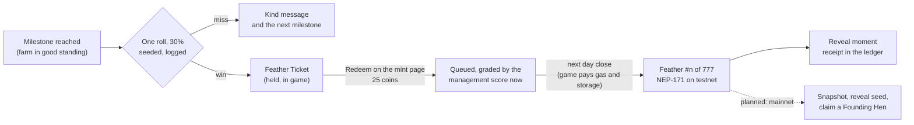

# The Feathers (beta) and the 777 Founding Hens

Hens on a farm are never minted. The beta mints **Feathers** only: NEAR testnet NFTs that are claim tickets for the
**777 Founding Hens**, which are planned to be revealed and minted as hens at the mainnet launch. Only 777 Feathers will
ever exist; the game contract enforces the cap.



## Tickets

A farm in good standing gets one roll at each milestone, once. A win is a **Feather Ticket** for that farm; a miss is
final, with a kind message naming the next milestone. Tickets keep: a player redeems when they choose. Tickets are claims
on the 777, so no roll is made once the Feathers minted plus the tickets out reach 777.

| Milestone | Reached when | Config (`ECONOMY.feathers`) |
|---|---|---|
| `full-coop` | the farm's coops are full for the first time | coop capacity |
| `good-week` | 7 day closes in a row in good standing | `goodDays: 7` |
| `eggs-sold` | 500 eggs sold (street, orders, cards, contracts) | `eggsSold: 500` |
| `haggles-won` | 10 haggles won by hand | `hagglesWon: 10` |
| `all-machines` | all five machines owned | the five unlocks |
| `outlast-rival` | a rival farm went bust after this farm opened | |
| `top-three` | the farm ends a day in the board's top 3 (by coins, farms still trading) | `topRank: 3` |

**Good standing**, checked for every player farm at every day close: never bust this season; no feed credit unpaid past
its due day (an open debt past due, or a default in the last 3 days); no contract delivery missed in the last 3 in-game
days (`missWindowDays: 3`). Out of good standing a farm does not roll, and its good-week count starts again.

## The roll, and how to audit it

Odds are `odds: 0.3` per milestone. The roll is made on the server at the day close from a seed anyone can recompute:

$$
\text{seed} = \mathrm{SHA256}\big(\texttt{coys-feather}\,|\,\text{season}\,|\,\text{day}\,|\,\text{farm}\,|\,\text{milestone}\,|\,\text{anchor}\big)
$$

$$
\text{roll} = \frac{\text{first 52 bits of the seed}}{2^{52}} \in [0, 1), \qquad \text{won} \iff \text{roll} < \text{odds}
$$

The **anchor** is the previous day's settlement transaction on NEAR testnet (`none` before the first), a public record
written before the roll. Every roll is stored in `milestone_rolls` (farm, milestone, season, day, anchor, seed, roll, odds,
won, ticket) and logged:

```text
[feathers] season s1 day 512 farm 1ae7... milestone eggs-sold: anchor 8WeC... seed 3be1... roll 0.214077 odds 0.3 WON ticket 91aa...
```

`rollFor` in `apps/server/src/game/feathers.ts` is exactly that; its tests recompute stored rows. A Founding Hen won
before the Feathers (one, on `s1`, day 409, by the real player's farm) became a Feather Ticket for her farm in migration 9;
she stays on the farm as an ordinary hen.

## Redemption and grades

On the mint page the player redeems a held ticket for **25 coins** (`redeemFee`). Its grade is set then, from the farm's
**management score** (0 to 1):

$$
s = 0.30\,\min\!\Big(1, \frac{g}{30}\Big) + 0.25\,d + 0.20\,\min\!\Big(1, \frac{h}{20}\Big) + 0.25\,\min\!\Big(1, \frac{p}{1000}\Big)
$$

where $g$ is days in good standing, $d$ the delivery record (contract eggs delivered over delivered plus missed; 0.5 with
no contracts yet), $h$ haggles won and $p$ coins of profit over the starting 50. Weights and full marks live in
`ECONOMY.feathers.score`.

| Grade | Score from | Card frame | Weight toward Legendary, Epic, Rare, Common |
|---|---|---|---|
| Fluff | 0 | common | 1, 1, 1, 1 |
| Plume | 0.35 | rare | 2, 2, 1.5, 1 |
| Quill | 0.60 | epic | 4, 3, 2, 1 |
| Golden Quill | 0.85 | legendary | 8, 5, 3, 1 |

The redeemed ticket mints at the next day close, in redemption order, at most 20 a day, to the player's wallet; the game
pays testnet gas and storage, so players never need testnet NEAR. A ticket whose player has no wallet linked waits.

## The Feather token (contract version 4)

`contracts/coys-game`, near-sdk 5.30.1 and near-contract-standards 5.30.1, on `play.coys-game.testnet`:

- `settle_day(batch)`, owner only, carries `feather_mints` and refuses any `hen_mints` ("ordinary hens are never minted").
- **Hard cap on chain:** `FEATHER_MAX = 777`. A batch that would pass it is refused whole ("the Feathers are all minted:
  777 is the limit"). The contract numbers each Feather in mint order: token id `001` to `777`.
- Each token stores its number, grade, milestone, season and day (`extra`), and a still image of its Feather card: the
  grade's Spawn card frame with its feather and the number, a 96x136 PNG as a data URI with its hash (no image host).
  Title `Feather #041 of 777: Quill`.
- `feather_supply()` returns `{ minted, max, remaining, provenance }`; the collection is "Yolk Street Feathers (beta)"
  (`FEATHER`).
- `commit_provenance(sha256)`, once: the SHA-256 of `founders.json`, committed on 12 November 2026
  ([JBoKNVa6...](https://testnet.nearblocks.io/txns/JBoKNVa6Pi5jAb2BA4chAh8K43GGpWgw8AtHJy26b5AB)), and copied into
  every Feather's `extra`.

On testnet, the verification minted three Feathers in the test season `verify-feathers-1` to a test farm's wallet:
#001 Fluff, #002 Quill and #003 Golden Quill, redeemed at management scores 0.169, 0.683 and 0.875
([BFBD96ii...](https://testnet.nearblocks.io/txns/BFBD96iiCiatw79xgcpzysjf3rb6osjM2Z1Qk1QLJQ7g)). They count toward the 777
like any other; the mint page names their season.

Tests: 18 contract unit tests and 8 sandbox tests on the CI-built wasm, among them **mint 777 in 39 batches of 20 then
refuse the 778th** (126 Tgas at most per batch, 3,169 bytes a Feather), and the upgrade of the exact version 2 code
deployed on testnet.

## The 777 Founding Hens

`scripts/generate-founders.ts` (seeded: `coys-founders-2026-11-12`) writes `apps/server/data/founders.json`, which stays
on the server and never enters the client bundle; only its hash is public (`founders.json.sha256`, the contract's
provenance, and the mint page).

- 777 hens, each with a number, an original name (Ivy Muddlebeak, Archduchess Lottie Haystacktuft...), a rarity and
  traits.
- **Exactly 7 Legendary, 70 Epic, 200 Rare and 500 Common**, shuffled so a number says nothing about rarity.
- Looks come from the existing hen layers only (body, eyes, comb, accessory), extended by code recolours:
  `recolourBody` for 16 body palettes and `recolourComb` for 7 comb colours, giving 1,728 possible looks (576 Common, 576 Rare, 288 Epic, 288 Legendary). No
  two hens share a look or a name.
- Legendary and Epic palettes (gold, obsidian, opal; teal, plum, cobalt; golden, pearl, violet and cyan combs) are used
  by no lower rarity, and every Legendary hen has a sparkle.

## The planned reveal (mainnet; sandbox-tested only)

The reveal assigns each Feather number one Founding Hen. It is a pure function of a seed and the snapshot, implemented
twice (Rust in `contracts/founding-hens/src/draw.rs`, TypeScript in `scripts/lib/reveal.ts`) and pinned to the same test
vector:

1. A stream: value $i$ is the first 8 bytes of $\mathrm{SHA256}(\text{seed}\,|\,i)$, big-endian.
2. The 777 numbers are shuffled (Fisher-Yates from the last position).
3. In that order each number draws a rarity $r$ with weight $w_{\text{grade},r} \cdot \text{left}_r$ (the grade weights
   doubled to whole numbers); that rarity's count drops by one. Numbers not minted count as Fluff. Because the counts
   start at 7/70/200/500 and there are 777 numbers, the draw always ends at exactly 7/70/200/500.
4. Within each rarity, founders.json's hens (file order) are shuffled with the same stream and handed out in number order.

The seed comes from a public event chosen and announced before the snapshot (a future NEAR mainnet block). The
prototype contract `contracts/founding-hens` (snapshot, seal, reveal once, claim by the snapshot holder) is built and
sandbox-tested in CI and never deployed: the reveal of 777 took 111 Tgas, gave exactly 7/70/200/500, and a second
deployment drew the same hens from the same seed. See [mainnet-plan.md](mainnet-plan.md).

## Estimates on the mint page

Each grade's chance of each rarity, given the Feathers minted so far (unminted numbers as Fluff):

$$
P(r \mid g) = \frac{w_{g,r}\, x_r}{\sum_{r'} w_{g,r'}\, x_{r'}}, \qquad \text{with } x \text{ such that } \sum_g n_g\, P(r \mid g) = K_r
$$

where $n_g$ counts Feathers per grade and $K = (7, 70, 200, 500)$; $x$ is found by iterating. It is an estimate (the real
draw is without replacement) and is labelled so; it locks at the reveal. With nothing minted every Feather has
$7/777 \approx 0.9\%$ of a Legendary.

## In the game

- **Mint page** (FEATHERS in the top bar, or the board): minted and left of 777, per grade, the provenance hash and the
  contract, the player's tickets with Redeem and the grade a redemption would get now, the estimates, recent mints, and
  all 777 slots (minted as Feather cards, the rest as the unminted frame with a dark hen silhouette and the number), with
  filters (grade, minted, unminted, mine) and pages.
- **Reveal moment**: the unminted card flips to the Feather card, the feather shines, a stamp lands, and "Planned to hatch
  into a Founding Hen at mainnet launch." shows with the receipt; Quill and Golden Quill get confetti, a sparkle and a
  harder shake.
- The **board** shows Feathers left of 777 and tickets waiting; the **ledger** lists tickets and Feathers with receipts,
  every milestone and good standing; the **tour** has a Feathers step; **How to play** has Feathers, grades and odds, the
  mint page and the reveal, and milestones.

## Costs, measured

| | |
|---|---|
| Version 4 wasm | 353,408 bytes (version 2: 341,943) |
| Upgrade in place (sandbox, exact v2 code) | +11,490 bytes, `migrate` 1 Tgas |
| One Feather | 3,169 bytes with its card image, about 0.032 NEAR (`CHAIN_MINT_NEAR`, default 0.035); all 777 about 24.6 NEAR |
| One settled day | 0 bytes (version 2: 179); about 0.0004 NEAR of gas |
| Release of a version 2 day record | 179 bytes back |
