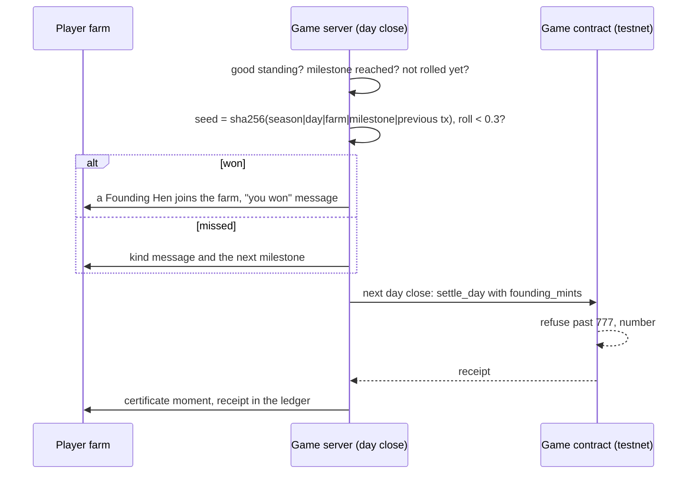

# The Founding Hens

Only **777** Founding Hens will ever exist. They are the only hens recorded on NEAR: each one is a
NEP-171 token that proves she belongs to her farm for good. Ordinary hens (bought in the shop, or
on a farm from the start) live and lay the same, but are not recorded on chain.

A farm wins a Founding Hen at a **milestone**. Each milestone gives a farm in good standing one
roll, once. A win puts the hen on the farm at once; the next day close mints her on NEAR, and her
owner sees the certificate moment: her portrait, her number of 777, her traits, the milestone, a
stamp, "She is now permanently yours on NEAR", and the receipt in the ledger.

## Milestones

In the order a farm usually reaches them. Every threshold lives in `ECONOMY.founding`
(`packages/shared/src/economy.ts`).

| Milestone | Reached when | Config |
|---|---|---|
| `full-coop` | the farm's coops are full for the first time | coop capacity |
| `good-week` | the farm has been in good standing for 7 day closes in a row | `goodDays: 7` |
| `eggs-sold` | the farm has sold 500 eggs (street, orders, cards, contracts) | `eggsSold: 500` |
| `haggles-won` | the player has won 10 haggles by hand | `hagglesWon: 10` |
| `all-machines` | the farm owns all five machines | the five unlocks |
| `outlast-rival` | a rival farm went bust after this farm opened | |
| `top-three` | the farm ends a day in the board's top 3 (by coins, farms still trading) | `topRank: 3` |

## Good standing

Checked for every player farm at every day close. A farm is in good standing when:

- it has **never gone bust** this season;
- it has **no feed credit unpaid past its due day** (an open debt past due, or a default in the last 3 days);
- it has **missed no contract delivery in the last 3 days** (`missWindowDays: 3`).

A farm out of good standing does not roll; its reached milestones wait until it is back in good
standing (if they still hold). Its `good-week` count starts again.

## The roll, and how to audit it

Odds are `odds: 0.3` (30%) per milestone. The roll is made on the server at the day close from a
seed anyone can recompute:

$$
\text{seed} = \mathrm{SHA256}\big(\texttt{coys-founding}\,|\,\text{season}\,|\,\text{day}\,|\,\text{farm}\,|\,\text{milestone}\,|\,\text{anchor}\big)
$$

$$
\text{roll} = \frac{\text{first 52 bits of the seed}}{2^{52}} \in [0, 1), \qquad \text{won} \iff \text{roll} < \text{odds}
$$

The **anchor** is the previous day's settlement transaction hash on NEAR testnet (or `none` before
the first settlement), so the seed is fixed by a public record written before the roll. Every roll
is stored in the `milestone_rolls` table (farm, milestone, season, day, anchor, seed, roll, odds,
won, hen) and logged:

```text
[founding] season s1 day 412 farm 6f0c... milestone eggs-sold: anchor 8WeCaoGp... seed 3be1... roll 0.214077 odds 0.3 WON hen 91aa...
```

To check a roll: hash the six fields joined by `|` with SHA-256, take the first 13 hex digits as
an integer, divide by 2^52, and compare with the odds. `rollFor` in
`apps/server/src/game/founding.ts` is exactly that, and its tests check it against the stored rows.

At most one hen per milestone per farm; rolls stop when 777 Founding Hens are minted or won and
waiting (the server counts the contract's own number plus those waiting).

## The contract (version 3)

`contracts/coys-game` (near-sdk 5.30.1, near-contract-standards 5.30.1):

- `settle_day(batch)`, owner only, now carries `founding_mints` and refuses any ordinary
  `hen_mints` ("ordinary hens are not minted: only Founding Hens").
- **Hard cap on chain:** `FOUNDING_MAX = 777`. A batch that would pass it is refused whole ("the
  Founding Hens are all minted: 777 is the limit"). The contract numbers each hen in order.
- Each token stores: title `Founding Hen #n of 777`, her portrait (a PNG data URI built from her
  stacked trait layers, with its hash), and in `extra` her number, the milestone, season, day and
  traits.
- `founding_supply()` returns `{ minted, max, remaining }`. The collection is named
  "Yolk Street Founding Hens" (`FOUNDING`).
- `migrate()` upgrades the deployed version 2 in place: tokens, egg balances, days and the owner
  stay; the founding count starts at 0. The hens version 2 minted keep their `hen-<id>` tokens,
  outside the 777.

Tests: 11 unit tests (777 then refuse, one batch past the cap, ordinary hens refused, the v2
upgrade) and 6 sandbox tests on the built wasm, among them **mint 777 in 39 batches of 20 then
refuse the 778th**, and **upgrade the exact code deployed on `play.coys-game.testnet`**
(`contracts/sandbox-tests/res/coys_game_v2.wasm`, read from the chain with `view_code`).

## Costs, measured

| | |
|---|---|
| Version 3 wasm | 351,309 bytes (version 2: 341,943) |
| Upgrade in place | +9,384 bytes of state, about 0.094 NEAR; `migrate` 1 Tgas |
| One Founding Hen | 2,647 bytes of state with a full-size portrait and her share of the day's record, about 0.026 NEAR (`CHAIN_MINT_NEAR`, default 0.03); all 777 about 20.6 NEAR |
| Mints per day close | at most 20 (`mintsPerBatch`); 20 mints with full portraits burnt at most 139 Tgas of a 300 Tgas call |
| One settled day (s1, measured on chain) | 179 bytes of state and 0.0004 NEAR of gas |

The server mints only as many hens as the game account's free balance can store above its margin
(`CHAIN_MIN_BALANCE_NEAR`, default 1.25 NEAR: about one real day of settlements at 3-minute days).
Hens that cannot be minted yet wait for a later day close; nothing is lost.

## How it flows



## In the game

- The hen's card says what she is: a Founding Hen (her number, milestone and day, and whether her
  certificate is recorded, waiting, or paused) or an ordinary hen (not recorded on NEAR).
- The market board shows how many of the 777 are left to win.
- The ledger lists the farm's Founding Hen certificates with receipts, every milestone (to do,
  won, tried) and whether the farm is in good standing.
- The How to play guide has a section on Founding Hens and one on milestones.

## Upgrading the testnet contract (owner step)

The game account must hold enough free balance first (see the reserve in the README's Build log).
Then, from the repo root with `.env` signing as `play.coys-game.testnet`:

```powershell
npm run deploy-contract -- --wasm contracts/coys-game/res/coys_game.wasm --account play.coys-game.testnet --migrate
```

The script checks the wasm against its `.sha256`, refuses anything that is not testnet, deploys and
calls `migrate` in one transaction, and prints the transaction. Check with the view call
`founding_supply()` (`{"minted":0,"max":777,"remaining":777}`). The running server notices the
upgrade at its next day close and starts minting waiting Founding Hens. Mainnet is a separate,
later step: see [mainnet-checklist.md](mainnet-checklist.md).
