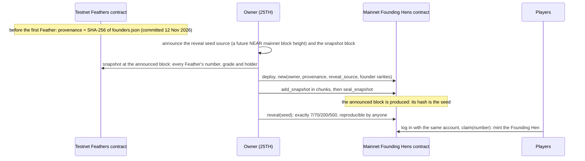

# Mainnet plan: from testnet Feathers to the 777 Founding Hens

A plan, not a deployment. Nothing here has touched mainnet. Every step is the owner's (25TH), and the order matters:
each step fixes something the next one relies on, so nobody (the game included) can steer which hen a Feather becomes.

## 1. Provenance (done on testnet)

`apps/server/data/founders.json` holds the 777 Founding Hens (name, rarity, traits, palette). Its SHA-256,
`bd2daafdc6efe9a68f19d87291d0a41d9ca6cd98a1b1d47568fc06d410ac0651`, was committed once on `play.coys-game.testnet`
(`commit_provenance`, tx [JBoKNVa6...](https://testnet.nearblocks.io/txns/JBoKNVa6Pi5jAb2BA4chAh8K43GGpWgw8AtHJy26b5AB))
before the first Feather was minted, and every Feather carries it in its metadata. At the reveal the file is published;
anyone can hash it and compare. `npm run generate-founders -- --check` regenerates it from its seed byte for byte.

## 2. The holder snapshot

- Announce, in the game and on the project's page, the block height at which the snapshot is taken (a few days ahead).
- At that block, read every Feather from the testnet contract (`nft_tokens`, paged): number (token id), grade (`extra`),
  holder (`owner_id`). Feathers keep moving freely until then; the holder at the snapshot block is the claimant.
- Publish the snapshot file and its SHA-256 before the seed block exists.
- Numbers not minted by the snapshot have no holder. They draw as Fluff in the reveal (so the counts stay exact), and the
  hens they draw stay unclaimed in the contract (the owner decides later: a later claim window, or none).

## 3. Sybil checks (before the snapshot is sealed)

A Feather is earned by play, so the checks look at the farm behind each ticket, from the game database:

- one farm per player and one player per Privy account; Privy accounts are email-verified;
- every ticket's roll is in `milestone_rolls` with its seed and anchor (a ticket without a matching roll is void);
- farms that reached milestones implausibly fast (for example several in one in-game day from a fresh farm), or that only
  traded with each other, are flagged for a person to look at; nothing is removed automatically;
- transfers of Feathers to many fresh accounts just before the snapshot are listed.

Flagged entries are published with the snapshot; the owner decides on them before `seal_snapshot`.

## 4. The reveal seed

- Source: the hash of a NEAR **mainnet** block at a height announced together with the snapshot block, far enough ahead
  that nobody can know it (or produce it alone) when the snapshot is sealed.
- Seed text: `near-mainnet:<height>:<block hash>`, exactly as the sandbox test uses it.
- `reveal(seed)` is owner only and runs once. Anyone can recompute it: the draw is in `contracts/founding-hens/src/draw.rs`
  and step for step in `scripts/lib/reveal.ts`, both pinned to the same test vector, and the sealed snapshot is public.

## 5. The draw (always exactly 7/70/200/500)

1. Stream: value $i$ is the first 8 bytes (big-endian) of $\mathrm{SHA256}(\text{seed}\,|\,i)$.
2. Shuffle the 777 numbers with it (Fisher-Yates from the last position).
3. In that order each number draws a rarity $r$ with weight $w_{\text{grade}, r} \times \text{left}_r$, then
   $\text{left}_r$ drops by one. Grade weights, doubled to whole numbers: Fluff 2, 2, 2, 2; Plume 4, 4, 3, 2; Quill
   8, 6, 4, 2; Golden Quill 16, 10, 6, 2 (Legendary, Epic, Rare, Common).
4. Per rarity, founders.json's hens of that rarity are shuffled with the stream and handed to that rarity's numbers in
   number order.

Since the counts start at 7, 70, 200 and 500 and there are 777 numbers, every draw ends at exactly 7/70/200/500 (tested
for many seeds and grade mixes). Sandbox: 111 Tgas for the whole reveal in one call.

## 6. The mainnet Founding Hens contract

`contracts/founding-hens` (NEP-171 with near-contract-standards 5.30.1), sandbox-tested in CI:

| Method | Who | What |
|---|---|---|
| `new(owner_id, provenance, reveal_source, founder_rarity)` | deployer | checks the 777 rarities are exactly 7/70/200/500 |
| `add_snapshot(entries)`, `seal_snapshot()` | owner | the holder snapshot, in chunks, then closed for good |
| `reveal(seed)` | owner, once, after the seal | runs the draw, stores each number's rarity and hen |
| `claim(number)` | the snapshot holder | mints `hen-NNN` with its rarity, the founder number, the Feather and its grade; the claimant pays the token's storage |
| `reveal_of`, `reveals`, `rarity_counts`, `status`, `nft_*` | anyone | views |

Still to do before mainnet (each the owner's): the hen images and full metadata (from founders.json, published with the
reveal, with a `reference` and `reference_hash` per token), a review by someone other than the author, a reproducible
build, and the deploy itself. See [mainnet-checklist.md](mainnet-checklist.md).

## 7. Claim by logging in with the same account

A player logs in to the game with the same Privy account; the game shows their Feathers at the snapshot and a Claim
button per Feather. The claim is a mainnet transaction from the holder's own wallet (the claimant pays the hen's storage,
a few thousandths of a NEAR; the owner may sponsor it with a relayer). Feathers held by other wallets claim from those
wallets directly (the contract checks the snapshot holder, not the game).

## What stays on testnet

The Feathers remain testnet NFTs. The beta's Feathers contract keeps running for the beta; mainnet adds a new contract
that reads only the published snapshot. No testnet key or account is reused on mainnet.
